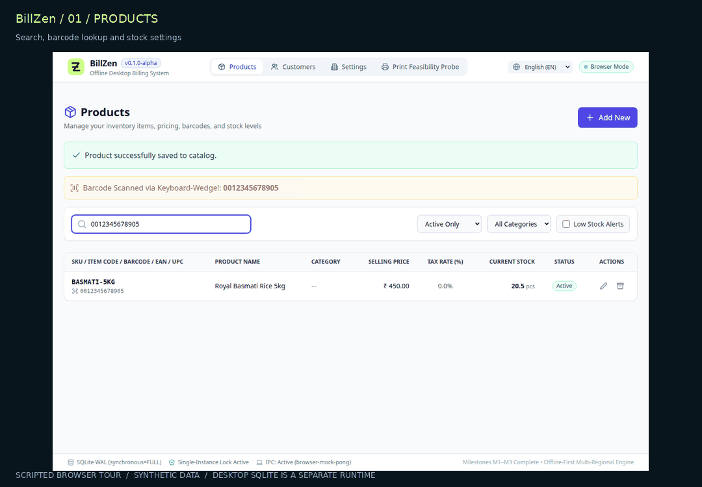
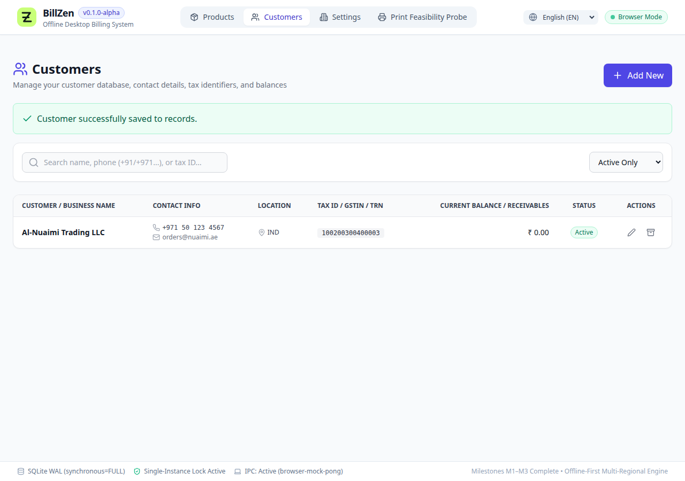
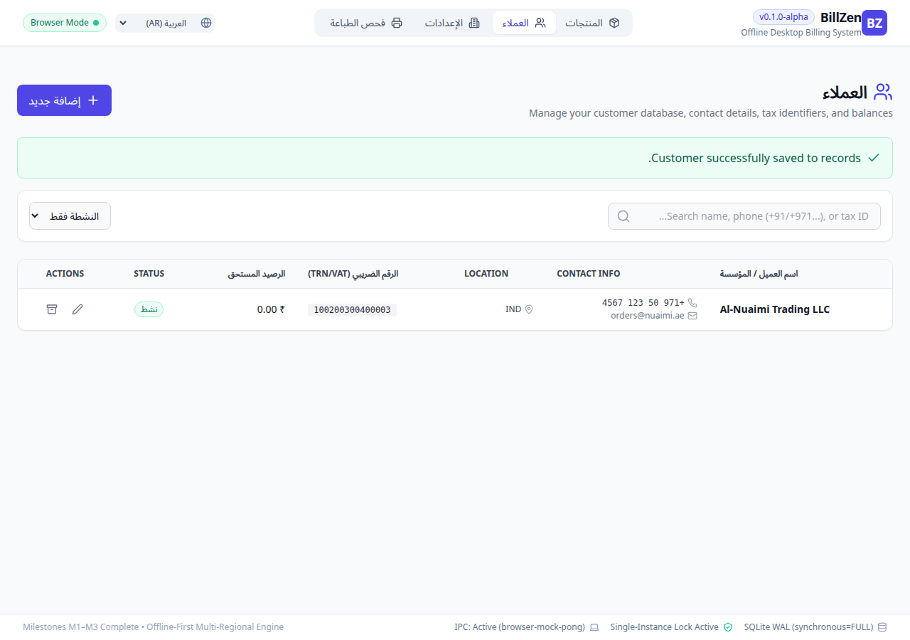
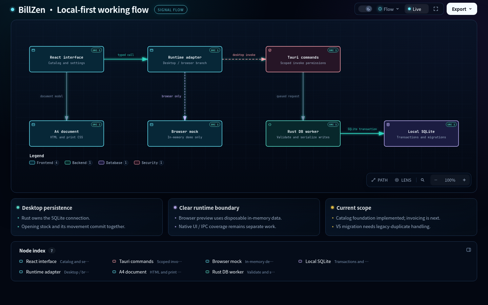

<div align="center">


<br />

**An independent workspace for the business you run.**

Local data. Exact money. An offline-first foundation for India & the GCC.

[](https://github.com/MohammedJabir18/BillZen/actions/workflows/ci.yml) [](LICENSE) [](docs/roadmap.md) [](src-tauri/Cargo.toml)

**[Explore the product](#-see-it-in-motion) · [Start building](#-run-it-locally) · [Read the architecture](#-inside-billzen) · [Meet the maker](#-built-by-mohammed-jabir)**

</div>

---

## ✦ Small business. Full ownership.

The shop counter should keep moving when the internet stops. Your catalog, customers and business records should stay within reach.

**BillZen** is an offline-first desktop application in development for retail shops, freelancers and small businesses. It brings a Rust core, a React interface and a local SQLite database together, with billing, inventory and customer relationships as its product direction.

<table>
<tr>
<td width="33%"><strong>◈ Local at the core</strong><br /><br />Native catalog operations persist in SQLite. No cloud account is needed for the implemented local workflows.</td>
<td width="33%"><strong>⌁ Exact by design</strong><br /><br />Integer minor units, scaled quantities and checked calculations form the financial foundation.</td>
<td width="33%"><strong>↗ Room to grow</strong><br /><br />A shared Rust/React foundation with native SQLite and durable browser IndexedDB workflows.</td>
</tr>
</table>

> [!IMPORTANT]
> **BillZen is a beta.** Company Cashbook, customer-linked history, account transfers, stock adjustments and complete workspace backups are available. Complete invoice finalization, supplier bills and device synchronization remain future work. [Download desktop v0.1.6 / Android v0.1.5 →](https://github.com/MohammedJabir18/BillZen/releases/tag/v0.1.6) · [Verification & limitations →](docs/verification-status.md)

## 🎬 See it in motion



<sub>A looping tour assembled from fresh automated browser screenshots. Synthetic demo records; the browser adapter uses in-memory data. This is not a recording of native SQLite persistence. [Static screenshot →](docs/assets/catalog-products.png)</sub>

<details>
<summary><strong>Open the screenshot gallery</strong></summary>

### Catalog workspace


### Customer workspace



### Arabic interface



</details>

## 🧭 What works today

| Area | Implemented foundation | Still ahead |
| :--- | :--- | :--- |
| **Catalog** | Products, customers, categories, search, archive/restore and barcode lookup | Variants, vendor workflows and large-catalog performance validation |
| **Inventory** | Opening stock, Add/Reduce adjustments, immutable history/corrections and quantity bounds | Automatic sale/purchase-linked inventory and wider reconciliation tooling |
| **Cashbook & transfers** | Receipts/payments, customer-linked cash history, atomic account transfers and paired reversals, period/account reports, CSV and A4 transfer documents | Invoice-linked debt/settlements and supplier bills |
| **Financial core** | Checked Rust/TypeScript arithmetic, currency/exponent validation and document models | Persisted draft/finalize invoice workflow and payment allocation UI |
| **Regional UX** | English, Malayalam and Arabic resources; RTL mode; INR + six GCC currencies | Full translation/input acceptance and jurisdiction-specific tax adapters |
| **Documents** | Reusable A4 component and four automated Chromium/Chrome PDF fixtures | Native export parity, physical printer validation and 80 mm/58 mm layouts |
| **Local platform** | Rust worker, SQLite migrations, startup checks, advisory lock and versioned complete native/supported-browser workspace backup/restore | Encryption, sync and wider OS verification |

Account transfers: [operator guide](docs/account-transfers-guide.md) · [engine/backup contracts](docs/transfer-engine-status.md) · [verification and candidate checksums](docs/verification-status.md). Product stock: [operator guide](docs/product-stock-guide.md). Platform packages and signing/update limitations: [desktop updater guide](docs/desktop-updates.md) · [v0.1.6 delivery evidence](docs/distribution-v0.1.6.md).

**Status is evidence-based.** Schema tables and sample invoice documents do not imply that complete billing workflows have shipped. Currency formatting is not a GST/VAT or statutory e-invoicing certification.

## ⚡ Run it locally

For application-menu installation and the Windows installer workflow, see the [desktop installation guide](docs/desktop-installation.md).

**Requirements:** Node.js 22.12+ within the 22 series, npm, a compatible stable Rust toolchain and the native prerequisites for your host. Lockfiles define resolved dependencies.

```sh
git clone https://github.com/MohammedJabir18/BillZen.git
cd BillZen
npm ci
npm run tauri dev
```

<details>
<summary><strong>Linux native prerequisites · Debian / Ubuntu</strong></summary>

```sh
sudo apt-get update
sudo apt-get install --no-install-recommends \
  libwebkit2gtk-4.1-dev build-essential curl wget file \
  libxdo-dev libssl-dev libayatana-appindicator3-dev librsvg2-dev
```

For browser PDF verification, also install `poppler-utils` and the Playwright browsers described in [testing](docs/testing.md).

</details>

| Command | What it runs |
| --- | --- |
| `npm run tauri dev` | Native desktop application with local SQLite |
| `npm run dev` | Browser demonstration with disposable in-memory data |
| `npm run build` | TypeScript check + Vite production assets |
| `npm run tauri build` | Host-native application and configured installer bundles |
| `npm run test:native-probe` | Isolated worker persistence check across two processes |

**Choose the native command for persistence.** Browser edits can disappear on reload. See [development setup](docs/development.md) for platform requirements and data locations. Native builds are host-specific; no cross-platform package-size or release claim is implied.

## 🏗 Inside BillZen

<picture>
  <source media="(prefers-color-scheme: dark)" srcset="docs/assets/architecture-dark.png" />
  <source media="(prefers-color-scheme: light)" srcset="docs/assets/architecture-light.png" />
  
</picture>

**[Explore the interactive Archify diagrams →](docs/diagrams/README.md)** · [Technical design →](docs/technical-design.md) · [Database model →](docs/data-model.md)

The diagram traces committed source at `a116ac0`. Its downloadable HTML viewer supports theme switching, source links and optional trace motion. GitHub displays the static preview; download the HTML to use the interactive viewer locally.

| Layer | Choice | Responsibility |
| --- | --- | --- |
| Shell | **Tauri 2** | Desktop lifecycle, capabilities and native commands |
| Interface | **React 19 · TypeScript · Vite** | Views, typed adapters and interaction |
| Styling | **Tailwind CSS · Lucide** | Layout, visual language and icons |
| State | **React state · TanStack Query** | Local UI and selected asynchronous views; Zustand is installed but unused |
| Core | **Rust · checked integer arithmetic** | Validation, database requests and financial calculations |
| Storage | **SQLite via bundled rusqlite** | Local records, transactions and versioned migrations |
| Documents | **React + print CSS** | Reusable A4 layout and browser PDF verification |

<details>
<summary><strong>Browse the project structure</strong></summary>

```text
src/                  React views, adapters, domain calculations and i18n
src-tauri/src/
  commands/           Tauri entry points
  domain/             Rust contracts and financial rules
  db/                 Serialized worker + SQL migrations
  bin/                Database, lock and persistence probes
scripts/              Browser/PDF checks and native probe runner
public/fonts/         Bundled fonts for offline rendering
brain/                Persistent architecture and session notes
docs/                 Requirements, design, diagrams and verification
.github/workflows/    Linux CI and generated test artifacts
```

</details>

## 🧪 Evidence before “done”

Fresh local checks on **18 October 2026**:

| Check | Result | Boundary |
| --- | --- | --- |
| Frontend unit suite | **14 passed** | Tested calculations and document models |
| Rust suite | **38 passed** | Tested domain, migration and worker paths |
| Production build | **Passed** | TypeScript + Vite assets |
| Catalog automation | **6 scripted steps passed** | Browser mock interactions |
| A4 PDF matrix | **4 scenarios passed** | 1 / 3 / 1 / 1 pages in Chrome output |
| Native persistence probe | **Passed** | Actual worker + SQLite across separate processes |

A separate source review reproduced a legacy V4→V5 category migration failure despite the green suites. Passing checks cover their tested cases; they do not certify every database upgrade. [Reproduction and next correction →](docs/reviews/2026-10-18-m3-review.md)

```sh
npm test
npm run build
cargo test --manifest-path src-tauri/Cargo.toml
npx playwright install --with-deps chromium chrome
npm run test:catalog
npm run test:matrix
npm run test:native-probe
```

**Remote CI:** the latest inspected run passed its Rust job but failed the long-text PDF string assertion; local matrix success does not establish CI success. [Inspect the failed run](https://github.com/MohammedJabir18/BillZen/actions/runs/39144580607).

Physical printing and Windows/macOS/Android/iOS native behavior remain unverified. [Testing guide →](docs/testing.md) · [CI runs →](https://github.com/MohammedJabir18/BillZen/actions)

## 🗺 The road ahead

| Milestone | Outcome | State |
| --- | --- | --- |
| **M0–M2** | Desktop, SQLite, financial and A4 foundations | Implemented foundation |
| **M3** | Product/customer catalog and integrity rules | Implemented; legacy migration correction required |
| **M3.1 — next** | Data-preserving category upgrade and expanded migration regression coverage | Required before closure |
| **M4A** | Save, reopen and edit a draft invoice offline | Planned after M3.1 |
| **M4B** | Atomic finalization, numbering, snapshots and stock movements | Planned |
| **M5+** | Payments, expenses, analytics, backup/restore and platform expansion | Planned |

**Platform direction:** Linux development now → validated Windows/macOS releases → standalone offline Android/iOS and durable web storage. Optional sync stays separate from local operation. [Detailed roadmap →](docs/roadmap.md)

## 📚 The project library

| Start here | Go deeper |
| --- | --- |
| [Product requirements & acceptance criteria](docs/product-requirements.md) | [Technical design & decision register](docs/technical-design.md) |
| [Architecture & runtime boundaries](docs/architecture.md) | [Database schema & migration policy](docs/data-model.md) |
| [Development setup](docs/development.md) | [Testing & evidence boundaries](docs/testing.md) |
| [Verification status](docs/verification-status.md) | [M3 review & upgrade reproduction](docs/reviews/2026-10-18-m3-review.md) |
| [Roadmap](docs/roadmap.md) | [India/GCC regional scope](docs/regional-scope.md) |
| [Interactive Archify diagrams](docs/diagrams/README.md) | [README design & media sources](docs/readme-design.md) |
| [Contributing](CONTRIBUTING.md) | [Security](SECURITY.md) · [Third-party notices](THIRD_PARTY_NOTICES.md) |

## 🤝 Build with care

Small, reviewable changes make a reliable business tool. Read the [contribution guide](CONTRIBUTING.md), keep customer data out of fixtures, and attach actual verification results to each change.

**Agent delivery rule:** complete one logical section → verify → commit → push → inspect CI. The repository's [agent instructions](AGENTS.md) and [Antigravity handoff](docs/antigravity-next-task.md) define the boundaries. Failed checks must be fixed or reported before declaring that section complete.

Local SQLite files are **unencrypted** today. A safe backup/restore workflow is pending. Never upload real customer databases or treat Git as a business-data backup.

## 👋 Built by Mohammed Jabir

I’m building BillZen for small businesses that need control of their everyday workflow.

**[Website](https://mohammedjabir.me)** · **[GitHub](https://github.com/MohammedJabir18)** · **[LinkedIn](https://www.linkedin.com/in/mohammed--jabir)** · **[Email](mailto:jabirahmedz111@gmail.com)**

[𝕏 / Twitter](https://twitter.com/mohammedjabir__) · [Instagram](https://www.instagram.com/mohammedjabir__/) · [Reddit](https://www.reddit.com/u/Mohammadjabir/s/usrcbZqXzK)

☕ **[Support the work on Buy Me a Coffee](https://buymeacoffee.com/mohammedjabir)**

The website link is the author's personal site; it is not a hosted BillZen application.

---

<div align="center">

**Your business. In your hands.**

MIT licensed · Copyright © 2026 Mohammed Jabir<br />
Third-party dependencies and fonts retain their own licenses. [License](LICENSE) · [Notices](THIRD_PARTY_NOTICES.md)

</div>
