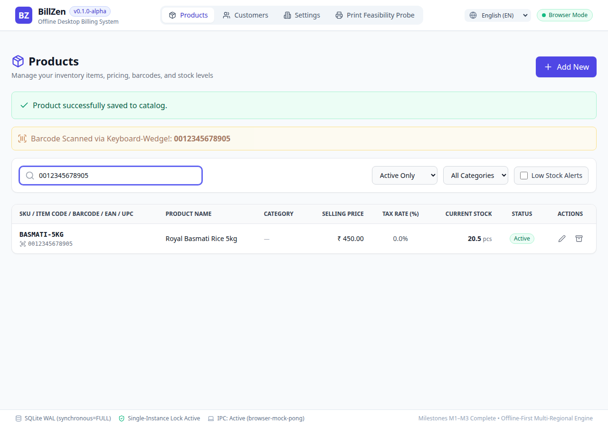
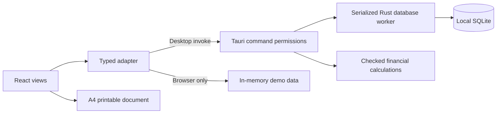

# BillZen

**Offline-first billing, inventory and mini-CRM for small businesses.**

BillZen is being built for retail shops, freelancers and small businesses in India and the GCC. Its desktop foundation combines a React interface, a Rust application core and a local SQLite database. Everyday business operations are intended to work without a cloud account or internet connection.

> **Development preview · v0.1.0.** This repository contains the foundation and catalog milestone, not a finished billing product. Invoice persistence workflows, payments, backups and statutory e-invoicing integrations still require implementation. Use synthetic data during development.



## Current capabilities

| Area | Current state |
| --- | --- |
| Desktop foundation | Tauri application, startup database checks, advisory instance lock and scoped IPC capabilities |
| Local storage | Bundled SQLite, migration checksums, foreign keys, WAL and full synchronous mode |
| Products and customers | Create, edit, archive, restore, search, barcode lookup and categories |
| Inventory foundation | Opening-stock transaction and stock movement schema; reconciliation gaps remain |
| Money | Integer minor units, scaled quantities and checked calculations in TypeScript and Rust |
| Regional foundation | INR, AED, SAR, QAR, KWD, BHD and OMR currency/exponent validation; English, Malayalam and Arabic interface resources |
| Print foundation | Reusable A4 document component and four automated browser PDF scenarios |
| Invoice/payment/expense schema | Present; complete user-facing business workflows are pending |
| Windows, macOS, Android and iOS | Targets in the roadmap; no verified release packages in this repository |
| Web application | Browser demonstration uses in-memory mocks; durable web storage is pending |
| Backup, encryption and cloud sync | Planned; database is currently unencrypted |

**Browser preview is not the desktop database.** `npm run dev` opens a demonstration adapter using process-local JavaScript data. Restarting/reloading it can discard edits. `npm run tauri dev` runs the native SQLite-backed application.

## Technology

- **Application shell:** Tauri 2 with Rust (2021 edition).
- **Interface:** React 19, TypeScript, Vite, Tailwind CSS and Lucide icons.
- **Client state:** React state and TanStack Query; Zustand is installed for future use.
- **Database:** SQLite bundled through `rusqlite`; database access belongs to Rust.
- **Verification:** Vitest, Cargo tests, Playwright and Poppler PDF inspection.
- **Documents:** React/HTML and print CSS; no cloud PDF service.

The checked-in `package-lock.json` and `src-tauri/Cargo.lock` define resolved dependencies. See [development](docs/development.md) before upgrading. The repository does not claim that its selected versions are the newest available releases.

## Getting started

Install Node.js 22.12+ within the 22 series, npm, a compatible stable Rust toolchain and the native dependencies for your operating system. The current automation runs on Ubuntu; other targets need their own validation.

On Debian/Ubuntu, the native development packages used by this project's CI are:

```sh
sudo apt-get update
sudo apt-get install --no-install-recommends libwebkit2gtk-4.1-dev build-essential curl wget file libxdo-dev libssl-dev libayatana-appindicator3-dev librsvg2-dev
```

Clone and install the locked frontend dependencies:

```sh
git clone https://github.com/MohammedJabir18/BillZen.git
cd BillZen
npm ci
```

Run the desktop application:

```sh
npm run tauri dev
```

Run the browser demonstration:

```sh
npm run dev
```

Build frontend assets or a native installer on a configured host:

```sh
npm run build
npm run tauri build
```

Native outputs appear under `src-tauri/target/release/`; installer formats depend on the host and bundling prerequisites. A sub-15 MB package is a goal, not a guarantee across platforms or with system runtimes included.

## Architecture



Business rules and persistence sit behind the native command boundary. The browser mock implements a development substitute, not a production web backend. SQLite schema migrations include invoices, invoice items, customers, products, movements, payments, allocations and expenses; schema existence does not imply a completed workflow.

## Project layout

```text
src/
  adapters/          Native IPC and browser demonstration adapter
  components/        Application views and reusable invoice document
  domain/            Financial calculations, document models and tests
  i18n/              Translation resources and locale handling
  styles/            Application and print CSS
  types/             Shared frontend contracts
src-tauri/
  capabilities/      Window permission policies
  src/commands/      Tauri entry points
  src/domain/        Rust financial and catalog contracts
  src/db/            Worker and versioned SQL migrations
  src/bin/           Database, lock and persistence probes
scripts/             Browser and PDF verification
public/fonts/        Bundled fonts for offline rendering
.github/workflows/   Linux CI verification
brain/               Persistent architectural notes and session history
docs/                Development, architecture, testing and roadmap
```

## Verification

```sh
npm test
npm run build
cargo test --manifest-path src-tauri/Cargo.toml
npx playwright install --with-deps chromium
npm run test:catalog
npm run test:matrix
```

The PDF matrix additionally needs Poppler (`pdfinfo`, `pdftotext`, `pdftoppm`; Ubuntu package `poppler-utils`). The current matrix launches Google Chrome, so install it separately when running that script. The catalog script can fall back to Playwright Chromium. See [testing](docs/testing.md) for probe commands and what each check establishes.

Fresh local verification and known gaps are recorded in [verification status](docs/verification-status.md). Passing a browser PDF check does not establish native WebKit print-dialog behavior, successful hardware printing or tax compliance.

## Platform and regional scope

Linux is the current development host. Windows and macOS require native build, persistence, packaging and printing checks. Android and iOS are intended as standalone offline applications, with their own lifecycle, layout and printing work. A shared Rust/React architecture does not automatically make every desktop API mobile-compatible.

Currency formatting and translated labels do not provide GST, VAT, IRN, QR-signing or ZATCA compliance. Country-specific issuance rules and online obligations must be designed and validated separately. See [regional scope](docs/regional-scope.md).

## Documentation

- [Architecture and storage](docs/architecture.md)
- [Development and platform prerequisites](docs/development.md)
- [Database model and migration policy](docs/data-model.md)
- [Testing and evidence boundaries](docs/testing.md)
- [Verification status and known issues](docs/verification-status.md)
- [Roadmap and next implementation task](docs/roadmap.md)
- [Regional scope and compliance boundaries](docs/regional-scope.md)
- [Contributing](CONTRIBUTING.md) · [Security](SECURITY.md) · [Third-party notices](THIRD_PARTY_NOTICES.md)

The earlier technology, platform and tax matrices remain design notes. Where they describe future adapters or broad verification claims, use the evidence boundaries in the documents above.

## Data safety

Real data lives in the OS data directory resolved by `dirs::data_dir()`, inside `billzen/`. The application opens `billzen.db` and `billzen.lock` there. On Linux this normally means `$XDG_DATA_HOME/billzen` or `~/.local/share/billzen`. This is separate from the Git checkout. Do not copy an open WAL-mode database file alone as a backup; a safe backup/restore workflow is pending.

The repository excludes local databases, secrets, dependencies, build outputs and generated test reports. Do not commit customer data, production invoices or private keys. Source control is not a database backup.

## License

A project license has not yet been selected. This repository does not grant an open-source license to BillZen source code. Dependencies and bundled fonts retain their respective licenses; see [third-party notices](THIRD_PARTY_NOTICES.md).
