<div align="center">

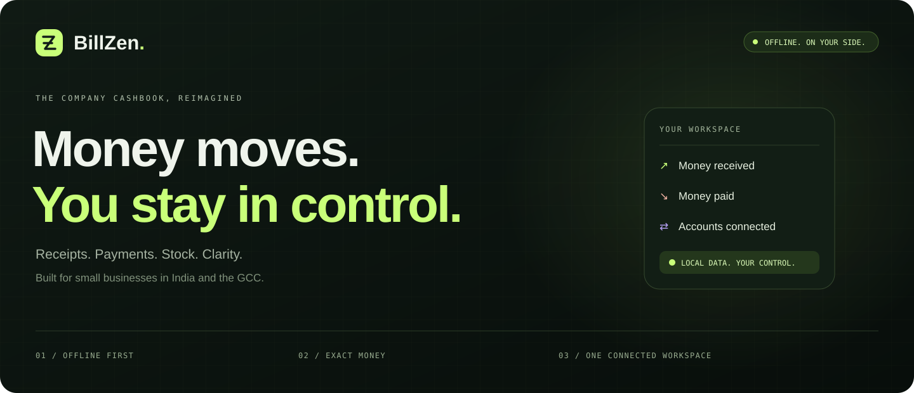

<br />

**The company cashbook that stays on your side—even when the internet doesn't.**

Record money in. Understand money out. Keep customers, stock and reports within reach.

[](https://github.com/MohammedJabir18/BillZen/releases/latest) [](https://github.com/MohammedJabir18/BillZen/actions/workflows/ci.yml) [](LICENSE) [](docs/roadmap.md)

**[📥 Download](#download) · [🎬 Product tour](#product-tour) · [🧭 How it works](#workflow) · [🏗 Architecture](#architecture) · [🛠 Build](#development)**

Windows · Linux · Apple Silicon Mac · Android ARM64 · Browser build<br />
English · മലയാളം · العربية / RTL

</div>

---

## ✦ Your business, with a little more clarity

**BillZen** is a local-first business workspace for shop owners, freelancers and small companies. Its working core is a **company cashbook**: receipts, payments, Cash/Bank balances, customer-linked history, stock adjustments and understandable daily/monthly/yearly reports.

Business records live in **SQLite on installed apps** and **IndexedDB in supported browsers**. No cloud account is required for these local workflows. Each device keeps its own workspace; device synchronization is deferred.

| A little more control | What that means for your day |
| :--- | :--- |
| **🧾 Know what moved** | Numbered receipts/payments, linked parties, immutable history and correction through reversals. |
| **📦 Know what remains** | Products, opening stock, Add/Reduce adjustments, quantity previews and stock history. |
| **🔐 Keep control** | Local records, complete workspace backups, recovery snapshots and signed desktop updates. |

> [!IMPORTANT]
> **A working beta, with clear boundaries.** Cashbook, transfers, customer cash history, inventory adjustments and backup/restore are implemented. Complete commercial invoice finalization, invoice receivables, supplier bills and device sync remain planned. Cash movement is **not** the same as accounting profit.

<a name="product-tour"></a>
## 🎬 Less guesswork. More “got it.”

<picture>
  <source media="(prefers-reduced-motion: reduce)" srcset="docs/assets/current/product-tour-static.png" />
  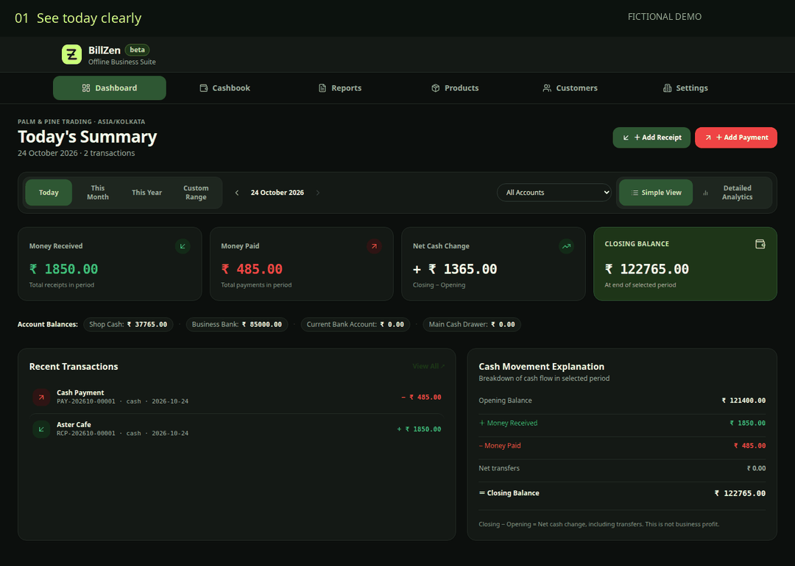
</picture>

<sub>Fresh screen-to-screen tour of the current interface, captured on 24 October 2026. Fictional records in an isolated browser/IndexedDB workspace; this is a slideshow, not a recording of native SQLite persistence. [Static view](docs/assets/current/product-tour-static.png) · [Media provenance](docs/readme-design.md).</sub>

<details>
<summary><strong>🖼 Open the gallery · desktop, mobile, light/dark and Arabic</strong></summary>

### Today, without the noise

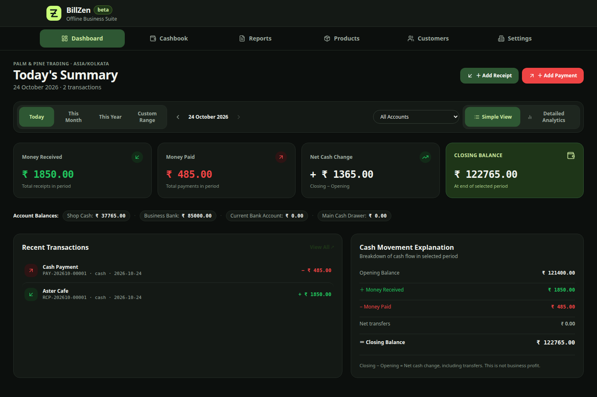

### A month, made understandable

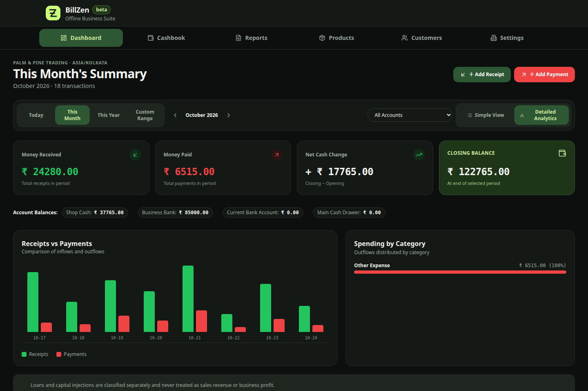

### Reports with room to breathe

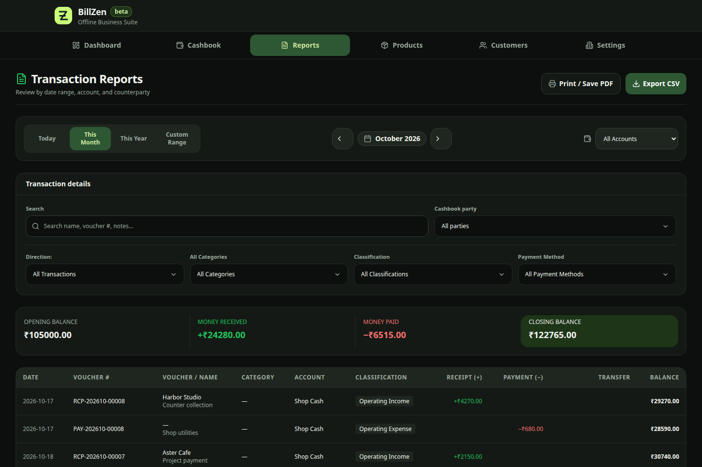

### Stock changes that leave a trail

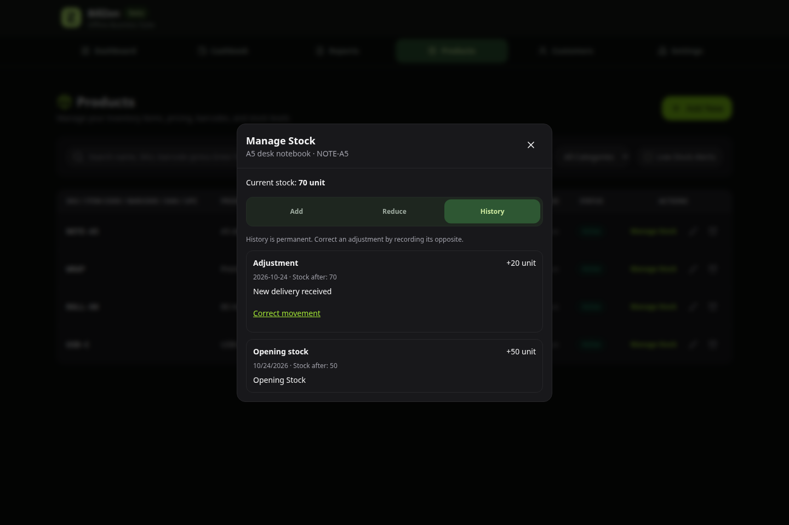

### Light mode and a smaller screen

<p align="center">
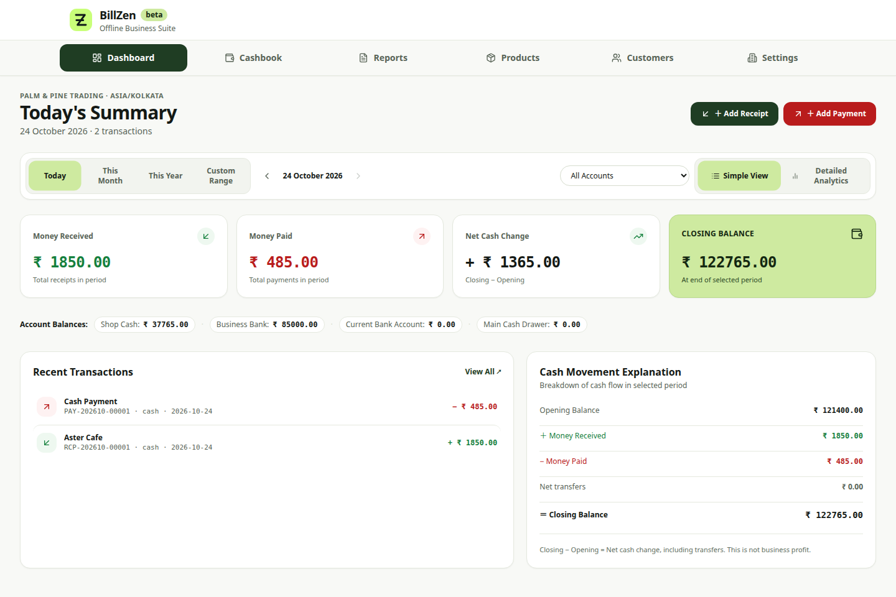
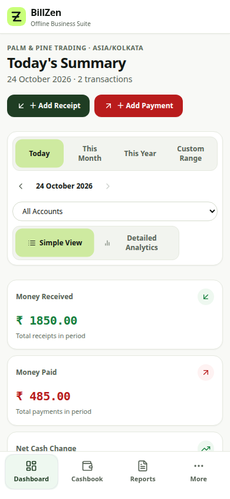
</p>

### العربية · right to left

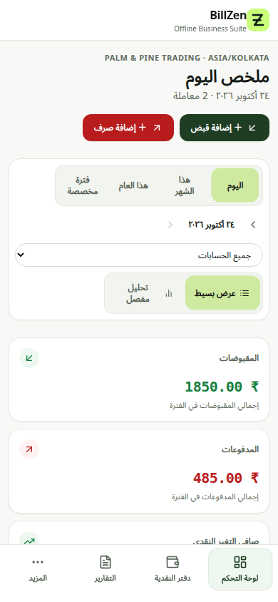

[Cashbook](docs/assets/current/cashbook-dark.png) · [Products](docs/assets/current/products-dark.png) · [Customers](docs/assets/current/customers-dark.png) · [Settings](docs/assets/current/settings-light.png)

</details>

<a name="download"></a>
## 📥 Pick your device. Bring your business.

**Current releases:** desktop **v0.1.6** · Android **v0.1.5 / code 1010**. The desktop update did not introduce a new Android APK.

| Your device | Download | Update path |
| :--- | :--- | :--- |
| 🪟 Windows 64-bit | [Windows installer `.exe`](https://github.com/MohammedJabir18/BillZen/releases/download/v0.1.6/BillZen-0.1.6-Windows-x64.exe) | In-app signed updates after this bootstrap install |
| 🍎 Apple Silicon Mac | [Mac installer `.dmg`](https://github.com/MohammedJabir18/BillZen/releases/download/v0.1.6/BillZen-0.1.6-macOS-AppleSilicon.dmg) | Copy to Applications; installed app/folder must be writable |
| 🐧 Linux 64-bit · recommended for in-app updates | [Portable `.AppImage`](https://github.com/MohammedJabir18/BillZen/releases/download/v0.1.6/BillZen-0.1.6-Linux-x64.AppImage) | Keep the AppImage and its folder writable |
| 📦 Debian / Ubuntu package | [Linux installer `.deb`](https://github.com/MohammedJabir18/BillZen/releases/download/v0.1.6/BillZen-0.1.6-Linux-x64.deb) | Manual package updates |
| 🤖 Android ARM64 | [Signed Android `.apk`](https://github.com/MohammedJabir18/BillZen/releases/download/v0.1.5/billzen-beta-v0.1.5-arm64-v8a.apk) | Existing signed Android in-app updater; system install consent |

**[All release assets](https://github.com/MohammedJabir18/BillZen/releases/tag/v0.1.6)** · **[Checksums & delivery evidence](docs/distribution-v0.1.6.md)** · **[Installation guide](docs/desktop-installation.md)**

Windows installers are not Authenticode signed; macOS packages are ad-hoc signed, without Developer ID/notarization. Tauri update signatures authenticate update packages and do not replace OS publisher certification. Intel Mac and iPhone installers are not currently distributed.

### 🔄 Updates that don't need another file in the group chat

Existing desktop v0.1.5 users install v0.1.6 **once**. Then:

**Settings → App updates → Check for updates → Download update → Install update**

BillZen checks the pinned signing key and authenticated version, creates a local recovery snapshot, pauses database work and installs the update. Linux/macOS restart afterward; Windows hands over to its installer. Failed preparation/installation reports an error and resumes database access. Unsaved changes and open dialogs prevent installation.

Startup discovery checks run at most daily while online; downloads and installation require your action. **A source push is not an app release.** Future updates become available when a higher, signed version is published with the update feed. Debian/bare Linux executables use manual updates. [Desktop updater guide](docs/desktop-updates.md) · [Android delivery](docs/android-update-delivery.md).

<a name="features"></a>
## 🧰 One workspace. Useful connections.

| Section | What you can do today | How it connects |
| :--- | :--- | :--- |
| **🏠 Dashboard** | Open on today's money; switch to monthly/yearly/custom periods and a more detailed analytics view | Reads posted cashbook/account data; internal transfers stay separate from business income/expense |
| **💸 Cashbook** | Record receipts/payments, select accounts/parties/categories, inspect vouchers and reverse mistakes | Updates balances and customer-linked cash history; provides the records behind Reports |
| **⇄ Transfers** | Move money between Cash/Bank accounts with balance previews, duplicate-save protection and paired reversals | Posts both legs atomically; changes individual account balances without creating business revenue |
| **📊 Reports** | Filter periods, accounts, parties, transaction types, categories, classifications and payment methods; search notes/vouchers | Export matching records to CSV and printable statements; separate transfer values from business receipts/payments |
| **📦 Products & stock** | Catalog search, SKU/barcode lookup, archive/restore, opening stock, Add/Reduce and before/after quantities | Immutable stock history and opposite correction entries; no automatic cash entry or sale-based decrement yet |
| **👥 Customers** | Maintain profiles, open linked cash history and start a receipt for the selected customer | Customer → prefilled Cashbook party → history → party-filtered Reports; cash history is not invoice debt |
| **⚙️ Settings** | Business setup, currency/locale, language, System/Light/Dark theme, guide, backup/restore and app updates | Language/theme live here; the first-run guide can be skipped |
| **🧾 Documents** | Preview/print receipts, payments, transfers and reports using reusable A4 layouts | Print/Save-as-PDF depends on the platform; physical printers and thermal layouts need further validation |

### 🆕 Since the early catalog README

The project has grown from catalog and financial foundations into daily company-money workflows:

- **Money operations:** receipts/payments, Cash/Bank accounts, customer-party linking, safe negative-balance confirmation and auditable reversals.
- **Connected views:** a Today-first dashboard, simple/analytical modes, period filters, CSV/print reports and customer-history navigation.
- **Transfers and inventory:** atomic paired transfers, transfer-aware reports/documents, Add/Reduce stock and correction history.
- **Durability:** persistent browser storage, complete backup 1.1, legacy transfer-free 1.0 import, validated restore and recovery snapshots.
- **Interface:** responsive navigation/short-window scrolling, cleaner Reports filters, GSAP transitions, shared selection capsules, dialog focus/inert protection, RTL and live reduced-motion support.
- **Delivery:** Windows/Linux/Apple Silicon installers, signed Android distribution and signed desktop update feeds in the original BillZen repository.

[Recent releases](https://github.com/MohammedJabir18/BillZen/releases) · [Detailed session history](brain/sessions.md) · [Current verification record](docs/verification-status.md)

<a name="workflow"></a>
## 🧭 A day in the business

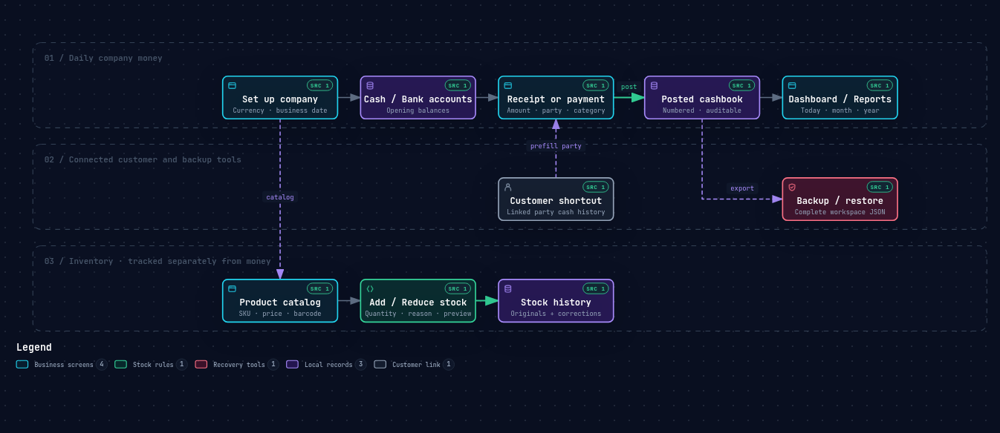

**[Explore the interactive workflow](docs/diagrams/business-workflow.html)** · [Source specification & validation](docs/diagrams/README.md)

1. **Set up your company.** Choose business details, base currency and business timezone; create Cash/Bank accounts with opening balances.
2. **Record the money.** A customer pays? Post a receipt. You pay for courier charges? Post a payment. Link the party when it matters.
3. **Move it without counting it twice.** Use Transfer money for a Cash→Bank deposit, rather than inventing an income/expense pair.
4. **Keep products accountable.** Add delivered stock, reduce damaged/missing stock with a reason, and inspect history. Record a related supplier payment separately if money moved.
5. **Review and preserve.** Check today's dashboard, filter a period/party in Reports, export a statement and keep a complete local backup.

<details>
<summary><strong>🧮 A practical example—with numbers that reconcile</strong></summary>

Start with **₹10,000 Cash** and **₹0 Bank**:

| Action | Cash | Bank | Company total |
| --- | ---: | ---: | ---: |
| Opening balances | ₹10,000 | ₹0 | ₹10,000 |
| Customer receipt +₹2,500 | ₹12,500 | ₹0 | ₹12,500 |
| Courier payment −₹800 | ₹11,700 | ₹0 | ₹11,700 |
| Transfer ₹3,000 Cash → Bank | ₹8,700 | ₹3,000 | **₹11,700** |

Business receipts are **₹2,500**, payments **₹800** and net business cash movement **₹1,700**. The transfer does not create revenue. This is a cash explanation, not a profit calculation.

Separately, 50 items + 20 delivered − 2 damaged = **68 items**. That inventory adjustment does not post a cashbook payment. A receipt linked to a customer appears in their cash history; invoice receivables are a future workflow.

[Customer/Cashbook guide](docs/customer-cashbook-guide.md) · [Transfer guide](docs/account-transfers-guide.md) · [Stock guide](docs/product-stock-guide.md)

</details>

### ☕ When the internet clocks out early

<picture>
  <source media="(prefers-reduced-motion: reduce)" srcset="docs/assets/current/offline-chai-static.png" />
  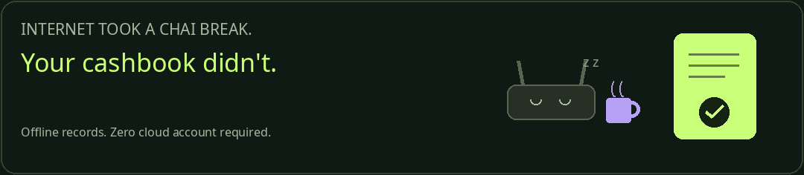
</picture>

<sub>An original BillZen animation. A little humour; the local-first architecture does the real work.</sub>

<a name="architecture"></a>
## 🏗 Local by design. Connected where it counts.

<picture>
  <source media="(prefers-color-scheme: light)" srcset="docs/assets/current/architecture-light.png" />
  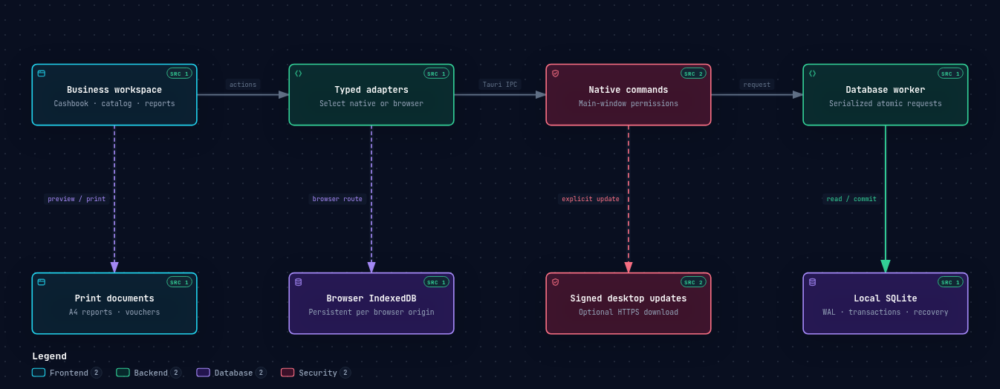
</picture>

**[Interactive Archify architecture](docs/diagrams/billzen-runtime.html)** · [Diagram sources/receipts](docs/diagrams/README.md) · [Technical design](docs/technical-design.md) · [Database model](docs/data-model.md)

The shared React interface dispatches through typed adapters. Installed apps use Tauri commands and a Rust database worker; browser workflows use durable IndexedDB. Native writes are serialized and transactional. Money uses integer minor units, quantities use scaled integers, and posted documents keep snapshots rather than silently changing history.

Printing reads document data; the optional release network downloads software, not business records. There is no cloud account or hosted database dependency in normal local record operations.

| Layer | In use |
| --- | --- |
| Shell & backend | Tauri 2 · Rust · scoped native capabilities |
| Interface | React 19 · TypeScript · Vite 8 |
| Design & motion | Tailwind CSS · Lucide · GSAP + `@gsap/react` |
| State | React state + TanStack Query; Zustand is installed, currently unused |
| Native storage | SQLite via bundled `rusqlite` · WAL · serialized worker |
| Browser storage | IndexedDB for supported workspace workflows; browser-origin/device local |
| Documents | React document components + print CSS |
| Desktop updates | Native Tauri updater 2.14 · pinned key · signed-version verification |

<details>
<summary><strong>🗂 Find your way around the source</strong></summary>

```text
src/
  components/         Dashboard, Cashbook, Reports, catalog, Settings, documents
  adapters/           Native/browser dispatch, IndexedDB, backup and update clients
  domain/             Financial, stock, transfer and backup rules
  hooks/              Motion, navigation, update and interaction hooks
  i18n/               English, Malayalam and Arabic resources
src-tauri/src/
  commands/           Scoped Tauri entry points
  db/                 Worker, migrations, cashbook, stock, transfers and recovery
  domain/             Rust contracts, validation and arithmetic
scripts/              Browser/native/PDF checks and release tooling
docs/                 Requirements, guides, evidence, brand and Archify diagrams
brain/                Persistent project memory and knowledge graph integration
.github/workflows/    CI, signed packaging and verified release-draft assembly
```

</details>

<a name="development"></a>
## 🛠 From clone to a running workspace

**Requirements:** Node.js 22 within its supported 22.x range (Vite requires 22.12+), npm, stable Rust and your OS's Tauri prerequisites. Use the committed lockfiles for resolved dependency versions.

```sh
git clone https://github.com/MohammedJabir18/BillZen.git
cd BillZen
npm ci
npm run tauri dev
```

<details>
<summary><strong>🐧 Debian / Ubuntu native prerequisites</strong></summary>

```sh
sudo apt-get update
sudo apt-get install --no-install-recommends \
  libwebkit2gtk-4.1-dev build-essential curl wget file \
  libxdo-dev libssl-dev libayatana-appindicator3-dev librsvg2-dev
```

Browser/PDF verification additionally uses Playwright browsers and `poppler-utils`; see the [development](docs/development.md) and [testing](docs/testing.md) guides.

</details>

| Command | Purpose |
| --- | --- |
| `npm run tauri dev` | Installed-app development with local SQLite |
| `npm run dev` | Browser development; supported records persist in IndexedDB |
| `npm run build` | TypeScript check and static frontend production assets |
| `npm run preview` | Serve the built browser assets locally |
| `npm run tauri -- build --no-bundle` | Host-native production executable; does not create installers |
| `npm run tauri build` | Host installer bundles; signed updater artifacts require the configured signing identity |

Browser data is scoped to its origin/profile; clearing site storage removes it. The static build must be served over HTTP(S). It is not advertised as an installable PWA or cross-device sync service. Export backups before clearing profiles. Native builds need host-specific prerequisites; platform binaries are built by the release matrix.

<a name="verification"></a>
## 🧪 Evidence before “done”

**v0.1.6 acceptance · 23–24 October 2026.** These are recorded release checks, not promises about every device or future commit.

| Gate | Recorded result | What it establishes |
| --- | --- | --- |
| Frontend unit suite | **95 passed** | Tested domain/adapters/hooks |
| Native Rust suite | **118 passed** | Tested domain, worker, migrations, updater and persistence paths; one existing fixture-only interop test remains ignored in ordinary runs |
| TypeScript + Vite | **Passed** | Production assets build; existing chunk/import warnings remain |
| Release publisher tests | **7 test files passed** | Feed completeness, version/provenance/hash/signature checks and rejection paths |
| Exact hosted Linux AppImage | **68 native assertions passed** | Real IPC cashbook/customer/stock/transfers, updater guards, backup and cold restart; real-data fingerprints unchanged |
| Actual signed Linux upgrade | **Passed** | Private updater-enabled baseline → hosted 0.1.6; verified bytes, recovery snapshot, restart and synthetic product/preferences preserved |
| Desktop packaging | **All 3 platforms + feed passed** | Mac actual-DMG ARM64/ad-hoc checks, Windows icon checks, signed updater packages and provenance |
| Browser update UX | **Passed** | Offline/themes/viewports, dirty-work protection, cancellation, Android return flow and installation focus lock |

The original public desktop 0.1.5 had no updater: the upgrade test used a private updater-enabled baseline. Windows/macOS physical installation/restart and physical printing remain unverified. Local Linux success does not certify those devices. [Full evidence and hashes](docs/distribution-v0.1.6.md).

**CI is live, not decorative.** The badge links to the latest actual state. The packaged application revision [`ad9845a`](https://github.com/MohammedJabir18/BillZen/commit/ad9845a0da90cbaf10f52136fbfb23e595c1edff) passed [source CI](https://github.com/MohammedJabir18/BillZen/actions/runs/40002288754) and [platform packaging](https://github.com/MohammedJabir18/BillZen/actions/runs/40002290661). The latest inspected follow-up, [`e73abb1`](https://github.com/MohammedJabir18/BillZen/actions/runs/40007751868), also passed after correcting an expired fixed-date test fixture. Release evidence is not a claim that every future run is green.

<details>
<summary><strong>🔬 Run targeted checks</strong></summary>

```sh
npm test
npm run build
cargo test --manifest-path src-tauri/Cargo.toml
node --test scripts/release/tests/*.node.mjs
npx playwright install --with-deps chromium chrome
npm run test:workspace
npm run test:customer-cashbook
npm run test:transfers
npm run test:stock
npm run test:reports-refresh
npm run test:desktop-update-ui
npm run test:native-cashbook
```

Native UI checks require a graphical/WebKit environment and a production binary. Fixtures use isolated synthetic workspaces. Media/diagram rendering is checked separately from application runtime tests. See [testing guide](docs/testing.md).

</details>

## 🗺 Shipped, next, and deliberately later

| State | Work |
| --- | --- |
| ✅ **Available** | Company Cashbook, customer history, account transfers, stock adjustments, period reports, complete backup/restore, regional interface and desktop/Android delivery |
| 🛠 **Next commercial slice** | Save/reopen/edit invoice drafts, with no stock/cash/debt effects while still draft |
| 📋 **Planned** | Atomic invoice finalization, numbering and snapshots, sale-linked stock decrement, receivables/settlements and supplier bills |
| 🔭 **Deferred / unshipped** | Device sync/team collaboration, encrypted data storage, scheduled backups, attachments, XLSX workbooks, budgets, thermal printing and Intel Mac/iOS installers |

INR plus GCC currency/exponent support and Arabic formatting are regional foundations. They do **not** imply GST/VAT filing, India e-invoicing or GCC statutory e-invoicing certification. [Regional scope](docs/regional-scope.md) · [Roadmap](docs/roadmap.md) · [B1 invoice-draft plan](docs/superpowers/plans/2026-10-23-invoice-drafts.md).

## 📚 The project library

| For business users | For builders and reviewers |
| --- | --- |
| [Customer ↔ Cashbook guide](docs/customer-cashbook-guide.md) | [Product requirements](docs/product-requirements.md) |
| [Account transfer guide](docs/account-transfers-guide.md) | [Technical design](docs/technical-design.md) |
| [Product stock guide](docs/product-stock-guide.md) | [Architecture & data model](docs/architecture.md) · [Schema](docs/data-model.md) |
| [Desktop updates](docs/desktop-updates.md) | [Development](docs/development.md) · [Testing](docs/testing.md) |
| [Release files, hashes & limits](docs/distribution-v0.1.6.md) | [Archify viewers/specifications](docs/diagrams/README.md) |
| [Regional scope](docs/regional-scope.md) | [Verification status](docs/verification-status.md) · [Media research/provenance](docs/readme-design.md) |

## 🤝 Built carefully. Open to contribution.

Read [CONTRIBUTING](CONTRIBUTING.md), keep fixtures synthetic and submit reviewable changes with actual verification. The owner-requested delivery loop is **one logical section → checks → commit → push → inspect CI**. [Agent instructions](AGENTS.md) and [session history](brain/sessions.md) preserve context across coding agents.

Local SQLite files and portable workspace JSON are **unencrypted** today. Backup 1.1 and recovery snapshots provide durability, not encryption. Keep copies outside the app's data directory, protect access to the device, and never upload real business records to Git. [Security policy](SECURITY.md).

## 👋 Made by Mohammed Jabir

Building a practical workspace for the people who run the shop, serve the customer and close the books at the end of the day.

**[🌐 Website](https://mohammedjabir.me)** · **[💻 GitHub](https://github.com/MohammedJabir18)** · **[🔗 LinkedIn](https://www.linkedin.com/in/mohammed--jabir)** · **[✉️ Email](mailto:jabirahmedz111@gmail.com)**

[𝕏 / Twitter](https://twitter.com/mohammedjabir__) · [Instagram](https://www.instagram.com/mohammedjabir__/) · [Reddit](https://www.reddit.com/u/Mohammadjabir/s/usrcbZqXzK)

[](https://buymeacoffee.com/mohammedjabir)

<sub>The website is the author's personal site, not a deployed BillZen web application.</sub>

---

<div align="center">


**Your business. In your hands.**

MIT licensed · © 2026 Mohammed Jabir<br />
[License](LICENSE) · [Security](SECURITY.md) · [Third-party notices](THIRD_PARTY_NOTICES.md)

</div>
