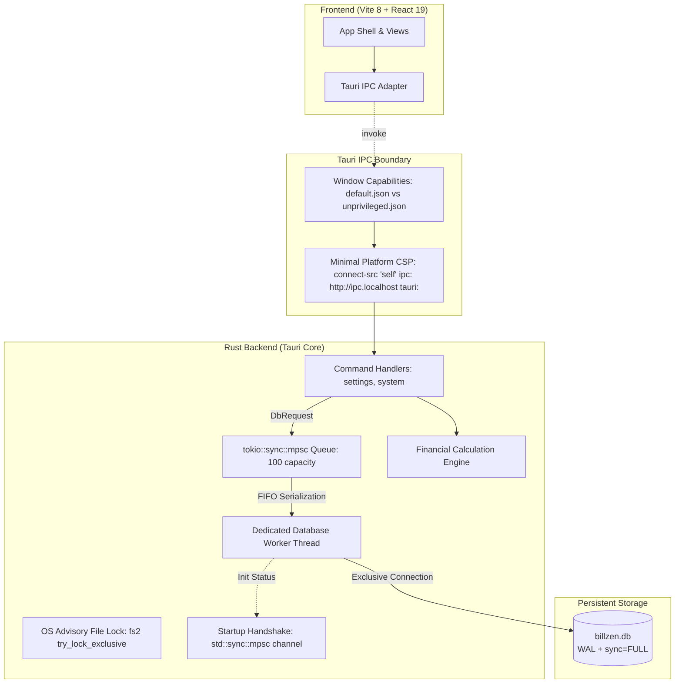

# BillZen Architecture & System Design

## 1. Overview
BillZen is an offline-first desktop billing and financial management system designed for retail, wholesale, and service businesses. It prioritizes financial precision, zero external network dependency during point-of-sale operations, commercial invoice immutability, and single-instance data durability.

## 2. Tech Stack & Environment
- **Desktop Shell**: Tauri 2.12.4 (`@tauri-apps/api 2.12.4`, `tauri 2.12.4`, `tauri-build 2.7.3`)
- **Backend Language**: Rust 1.99.0 (2021 edition)
- **Local Database**: SQLite 3 (via static bundled `rusqlite 0.40.2`)
- **Frontend Framework**: React 19.3.1 (`@tanstack/react-query 5.66.0`, `lucide-react 0.475.0`)
- **Bundler & Toolchain**: Vite 8.3.4, Node.js v22.23.3 LTS (Active)
- **Styling**: Tailwind CSS 3.4.17 (tabular numbers, print CSS media queries)
- **Testing**: Vitest 5.0.5 (frontend calculation parity), Cargo test (13 unit and integration tests across domain, migrations, rollback, worker handshake, single-instance lock, and capability isolation)
- **Packaging**: Debian installer (`.deb`, 7.27 MiB) and standalone release binary

## 3. High-Level Architecture


## 4. Database Concurrency & Durability Model
1. **Dedicated Worker Thread**: All SQLite operations within BillZen are serialized onto a single background OS thread communicating via a bounded `tokio::sync::mpsc` queue. This guarantees that internal threads never contend for database writes and UI execution remains unblocked.
2. **Handling `SQLITE_BUSY` & External Contention**:
   > [!IMPORTANT]
   > The single internal worker thread eliminates internal lock conflicts, but **does NOT eliminate external `SQLITE_BUSY` conditions**. If an external process (e.g., SQLite CLI, file backup utility, cloud sync, or antivirus) opens the database file, SQLite will still return `SQLITE_BUSY`.
   - Durability PRAGMAs:
     - `journal_mode = WAL`
     - `synchronous = FULL`
     - `busy_timeout = 5000` (blocks for up to 5 seconds before failing if an external process holds a lock)
     - `foreign_keys = ON`
3. **Database Worker Startup Handshake**:
   - `DbWorkerHandle::new` establishes a synchronous `std::sync::mpsc` handshake channel with the worker thread.
   - If database creation, directory creation, migrations, or seeding fail, the error is immediately returned to `run()` before UI launch, aborting with an actionable fatal error.

## 5. Process Lifecycle & Single-Instance Protection
- **OS-Backed Advisory Locking**: `acquire_instance_lock` opens `billzen.lock` and acquires an exclusive non-blocking OS file lock via `fs2::FileExt::try_lock_exclusive()` (`flock` on Unix / `LockFileEx` on Windows).
- **Contention Rejection**: If a secondary instance attempts to launch while the primary instance is alive, the OS immediately rejects the lock with `EAGAIN` (`Resource temporarily unavailable`), and the secondary process terminates with an actionable diagnostic message.
- **Automatic Recovery**: When the primary process exits or terminates for any reason, the OS kernel automatically releases the advisory file lock, enabling immediate clean relaunch.

## 6. Security & Capability Permissions
1. **App Command Manifest Registration**: Custom commands (`get_business_settings`, `update_business_settings`, `check_print_support`, `ping`) are explicitly registered in `src-tauri/build.rs` via `tauri_build::AppManifest`.
2. **Capability Scopes**:
   - `default.json`: Grants `allow-get-business-settings`, `allow-update-business-settings`, `allow-check-print-support`, and `allow-ping` exclusively to window `main`.
   - `unprivileged.json`: Confines secondary/untrusted windows (`unprivileged-window`) to `core:default`, with zero access to business data or settings.
3. **Minimal Platform CSP**:
   - `default-src 'self'; script-src 'self'; style-src 'self' 'unsafe-inline'; img-src 'self' data: asset:; font-src 'self' data:; connect-src 'self' ipc: http://ipc.localhost tauri:;`
   - External network connections from the frontend webview are strictly rejected.

## 7. Commercial Immutability & Financial Invariants
1. **Draft vs Finalized Lifecycle**: Invoices exist as `draft` until finalization. Upon finalization:
   - Status changes to `finalized`.
   - Immutable snapshot columns (`snapshot_business_name`, `snapshot_tax_identifier`, `snapshot_currency_code`, `snapshot_currency_exponent`, etc.) are frozen.
   - Separate triggers (`trg_invoices_prevent_update_when_finalized`, `trg_invoices_prevent_delete_when_finalized`, `trg_invoice_items_prevent_insert_when_finalized`, `trg_invoice_items_prevent_update_when_finalized`, `trg_invoice_items_prevent_delete_when_finalized`, and `v3_protect_currency_exponent.sql`) block any modification, reassignment, or deletion of finalized commercial records.
2. **Receivables & Settlement Derivation**:
   - Receivables are dynamically derived:
     $$\text{Receivables} = \sum_{\text{finalized}} (\text{grand\_total\_minor} - \text{allocated\_minor})$$
   - Settlement statuses: `unpaid`, `partially_paid`, `fully_paid`.
   - Invoices with `grand_total_minor == 0` (e.g. 100% promotional discounts) have deterministic settlement status `fully_paid`.
3. **Exact Half-Up Arithmetic**:
   - Currency: 64-bit integer minor units (e.g., paisa / cents).
   - Quantities: $1000\times$ scaled integer (allows 3 decimal places, e.g. 1.375 kg = 1375).
   - Tax: Basis points integer (18% = 1800 bp).
   - Rounding: Standard half-up integer division: `(value + 500) / 1000`.
   - Implementation: Exact `BigInt` intermediate arithmetic in TypeScript (`src/domain/financial.ts`) and checked 64-bit/128-bit integer arithmetic in Rust (`src-tauri/src/domain/financial.rs`) eliminates floating-point drift.

## 8. Print Verification & Dedicated Output Architecture

The former user-facing Print Feasibility Probe was removed on 2026-10-22. Invocation/dialog/output remain engineering verification concepts, not navigation or operator tasks in the product. Explicit `?scenario=...` synthetic fixtures still feed the isolated invoice print target for automated PDF checks, without a diagnostic screen. Real Reports/voucher printing continues through its own controls.
- **Three-Stage Verification**:
  1. *Invocation*: Dispatched via `window.print()` (WebKitGTK print trigger).
  2. *Dialog Observation*: Interactive operator confirmation determining whether the host desktop environment actually rendered the native print modal window.
  3. *Output / Spool Verification*: Confirmation whether a physical page or PDF file was produced. Verified via automated headless Chrome `--print-to-pdf` and Poppler inspection across 4 matrix scenarios (short oracle, multi-page, 3-decimal KWD, long text wrapping).
- **Strict Print Media Isolation**:
  - Global CSS enforces `body * { visibility: hidden !important; }` and `#printable-invoice-root, #printable-invoice-root * { visibility: visible !important; }`.
  - UI probe controls, navigation bars, diagnostics, and preview borders are explicitly suppressed with `.no-print`.
  - `@page { size: A4 portrait; margin: 12mm 15mm; }` guarantees standardized 594.96 $\times$ 841.92 pt geometry with no trailing blank pages.

## 9. Regional Currency & Multi-Exponent Mathematical Model
- **India & GCC Member Support**: Supports 2-decimal currencies (INR ₹, AED, SAR, QAR) and 3-decimal currencies (KWD, BHD, OMR).
- **Rust Domain Currency Validation**: `src-tauri/src/domain/currency.rs` enforces valid ISO 4217 code and exponent combinations and rejects illegal currencies before DB persistence.
- **Minor-Unit Invariant**:
  - Quantities are scaled by $1000$ ($1.500\text{ kg} = 1500$).
  - Unit prices are stored in native minor units (e.g. 2250 fils for 2.250 KWD).
  - Division by $1000$ (`roundHalfUp(quantity_scaled * unit_price_minor, 1000)`) yields exact minor units regardless of currency exponent.
- **Currency Immutability**:
  - `trg_business_settings_prevent_currency_change_when_invoices_exist` and worker domain checks block altering `currency_code` or `currency_exponent` once products, invoices, payments, or expenses exist in the database.

## 10. Decoupled Statutory Compliance Architecture
- **Offline POS Autonomy**: Counter checkout and receipt printing operate with zero internet dependency.
- **Asynchronous Outbox**: Statutory e-invoicing pipelines (India GSTN/IRP JSON schemas and Saudi Arabia ZATCA Phase 1/2 TLV/UBL schemas) read finalized records and submit asynchronously without blocking billing workflows. Detailed in `docs/tax-and-e-invoicing-matrix.md`.
- **Cross-Platform Engineering**: SQLite durability, single-instance file locking, and native print dispatchers mapped across Linux, Windows, macOS, Android, and iOS in `docs/platform-support-matrix.md`.

## 11. Milestone 3: Catalog Domain, Inventory Ledger & Regional Localization
1. **Catalog Domain Model & Numeric Limits**:
   - `products`: SKU (uppercase normalized), Barcode (string preserving leading zeros), Name, Category FK, Unit, Unit selling price minor (bounded by `MAX_MONEY_MINOR`), Cost price minor (bounded by `MAX_MONEY_MINOR`), Tax rate basis points, Stock tracking flag, Current stock scaled ($1000\times$, bounded by `MAX_QUANTITY_SCALED`), Minimum stock alert threshold scaled ($1000\times$, bounded by `MAX_QUANTITY_SCALED`).
   - `categories`: Normalized categories with case-insensitive uniqueness (`v5_category_nocase.sql` enforcing `idx_categories_name_nocase ON categories(name COLLATE NOCASE)`).
   - `customers`: Name, Phone (international prefix preserved), Email, Tax Identifier (GSTIN/TRN/VATIN), Address Lines 1 & 2, City, State, Postal Code, Country, Current balance minor.
2. **Atomic Inventory Ledger & Stock Reconciliation**:
   - Product creation with positive opening stock atomically writes both the product record and an opening stock movement (`reference_type = 'opening'`) in `stock_movements` within a single SQLite transaction. Untracked products (`is_stock_tracked: false`) strictly reject opening stock (`opening_stock_scaled > 0`).
   - Product updates (`UPDATE products`) strictly omit `current_stock_scaled`; inventory mutations are ledger-driven and cannot be altered directly via product editing.
   - Transitioning an untracked product to tracked (`!was_tracked && is_stock_tracked`) enforces ledger reconciliation: `current_stock_scaled` must strictly match `SUM(stock_movements.quantity_delta_scaled)`, preventing phantom stock balances without history.
3. **Identifier Normalization & Uniqueness**:
   - SKUs are trimmed and converted to uppercase (`PROD-001`).
   - Barcodes are preserved as strings without numerical conversion, preserving critical leading zeros (e.g., `"0012345678905"`).
   - Duplicate SKUs or barcodes trigger descriptive error feedback from the database worker.
4. **Barcode Scanner & Keyboard-Wedge Protocol**:
   - Hardware USB/Bluetooth scanners operate in keyboard-wedge mode emitting standard keystrokes terminated by an `Enter` key.
   - Product search inputs handle the `Enter` key event, immediately querying the catalog and providing visual scan confirmation.
5. **Bundled Offline Fonts & Trilingual Localization**:
   - Local `@font-face` assets bundled in `public/fonts/` (`NotoSans-Regular.ttf`, `NotoSansMalayalam-Regular.ttf`, `NotoSansArabic-Regular.ttf`).
   - First-class UI localization supporting English (`en`), Malayalam (`ml`), and Arabic (`ar`) with RTL document flow (`dir="rtl"`).
6. **Cross-Platform Multi-Process Persistence Probe**:
   - Portable Node runner `scripts/run_native_probe.js` isolates SQLite lifecycle to clean temporary directories across POSIX, macOS, and Windows.


## 12. Milestone 3.1: Legacy Category Migration Reconciliation & Audit Safety
- **Collision Reconciliation**: When upgrading legacy V4 databases containing case-variant category duplicates (e.g. `Groceries` and `groceries`), `v5_category_nocase.sql` executes deterministic window partitioning (`FIRST_VALUE(id) OVER (PARTITION BY name COLLATE NOCASE ORDER BY created_at ASC, id ASC)`) to select the earliest canonical category.
- **Audit Tracking (`category_merges`)**: A persistent audit table records `(merged_category_id, canonical_category_id, merged_name, merged_description, merged_at)`.
- **Foreign Key Preservation**: Referencing products (`products.category_id`) are repointed to the canonical category prior to duplicate removal, preserving zero `PRAGMA foreign_key_check` errors.
- **Metadata Preservation**: Canonical categories with null/empty descriptions inherit non-empty descriptions from merged duplicates.
- **Dual-Checksum Backward Compatibility**: The migration runner (`src-tauri/src/db/mod.rs`) recognizes both the initial and reconciled V5 SHA256 checksums, enabling seamless forward upgrades for both un-migrated V4 databases and early-migrated V5 databases without checksum errors.

## 13. Appearance Settings, First-Use Setup & Android Beta Packaging
1. **Appearance Preference Engine & Settings Ownership**:
   - Strictly three options: `System — default`, `Light`, `Dark`.
   - Theme controls are strictly isolated to `SettingsView` (zero theme switches in headers, bottom nav, or onboarding modals).
   - Independent Settings Ownership: `update_business_settings` and `update_business_profile` strictly update profile columns only, omitting `is_setup_completed`, `appearance_preference`, `guide_status`, and `guide_version` to prevent profile saves from reverting user theme or guide states.
   - Theme context provides optimistic UI updates with automatic state and `localStorage` rollback upon native persistence failure.
   - Dynamic OS color scheme listener for System mode (`prefers-color-scheme`); explicit Light/Dark selections override OS events.
   - Synchronizes `<meta name="theme-color">` for mobile browser and webview chrome (`#09090b` dark, `#ffffff` light).
   - Print paper purity: `@media print` strictly enforces `#printable-invoice-root` with pure white background (`rgb(255, 255, 255)`) and dark text (`rgb(0, 0, 0)`), suppressing dark-mode tokens during printing or PDF exports.
2. **First-Use Business Setup Wizard (`OnboardingSetupWizard`)**:
   - First-run databases (`is_setup_completed = 0` with uncustomized defaults) gate access with a 3-step modal wizard. Existing databases with customized profiles are conservatively treated as completed setups.
   - Step 1: Regional & Localization Defaults (India and GCC member states: IN, AE, SA, QA, KW, BH, OM), automatically suggesting currency code, precision exponent (e.g., KWD = 3 decimals), and timezone.
   - Step 2: Business Profile Information (Business Name, Legal Trading Name, Tax ID / GSTIN / TRN, Phone, Email, Address, City, State, Country). Postal code is explicitly optional for UAE, Qatar, and Oman (`['AE', 'QA', 'OM']`).
   - Resumable Draft: Form inputs and step progression persist to `localStorage` (`billzen_setup_draft`), allowing interruption recovery without data loss.
   - Step 3: Review & Confirm with explicit currency lock notice (`trg_business_settings_prevent_currency_change_when_invoices_exist`).
   - Atomic persistence: `complete_business_setup` saves business profile and sets `is_setup_completed = true` in a single transaction.
3. **Getting-Started Guide (`GettingStartedGuide`)**:
   - 3-slide accessible dialog covering actual implemented features: Product catalog & stock ledger, Customer directory & profiles (address book, contacts, GSTIN/TRN), Local durability & appearance.
   - Auto-opens upon first launch if setup is completed and guide is unseen.
   - Skip, Back, Next controls with versioned persistence (`last_seen_guide_version`).
   - Replayable anytime from Settings -> Help & Getting Started.
4. **Database Migration `v6_setup_and_onboarding.sql` & Repair Scoping**:
   - Extends `business_settings` with `is_setup_completed BOOLEAN NOT NULL DEFAULT 0`, `appearance_preference TEXT NOT NULL DEFAULT 'system'`, and `last_seen_guide_version INTEGER NOT NULL DEFAULT 0`.
   - Migration repair scoping: The one-time legacy business repair UPDATE is strictly executed only when `stored_checksum == INITIAL_V6_CHECKSUM && is_setup_completed = 0`. Upon execution, `schema_migrations.checksum` advances to `current_checksum6`.
   - For databases with `stored_checksum == current_checksum6`, no repair UPDATE is run, guaranteeing that `unseen`, `skipped`, and `completed` guide states persist indefinitely across repeated application restarts.
5. **Android Standalone Packaging & Toolchain**:
   - Rootless OpenJDK 17 (`~/.android-toolchain/jdk`) + Android SDK (`android-36`, `build-tools/36.0.0`) & NDK 26.1 (`~/.android-toolchain/android-sdk/ndk/26.1.10909125`).
   - Authoritative Versioning: `build.gradle.kts` resolves `versionCode` through authoritative precedence: `System.getenv("BILLZEN_VERSION_CODE")?.toIntOrNull() ?: (project.findProperty("versionCode") as? String)?.toIntOrNull() ?: tauriProperties.getProperty("tauri.android.versionCode")?.toIntOrNull() ?: 1001`. `tauri.conf.json` specifies `"android": { "versionCode": 1001 }`.
   - Hardened APK Selection & Assembly: `scripts/build_android_apk.sh` supports both default ARM64 release variant (`dist-android/billzen-beta-v0.1.0-arm64-v8a.apk`) and emulator test variant (`dist-android/billzen-test-v0.1.0-x86_64.apk`), strictly selecting release builds and aborting on missing release artifacts.
   - 16 KB page-size ELF alignment for Android 15+ native libraries (`RUSTFLAGS="-C link-arg=-z -C link-arg=max-page-size=16384"`, verified `0x4000` segment alignment via `llvm-readelf -l`).
   - 16 KB packaging alignment: Enforced via `zipalign -v -f -P 16 4` and verified via `zipalign -c -v -P 16 4` on final signed APKs.
   - Self-contained packaging: SQLite, bundled Noto Sans offline fonts, and Vite assets bundled directly into APK (`versionCode = 1001`).
   - Signed with BillZen Beta Keystore (`v2` + `v3` APK signature schemes, verified certificate identity `CN=BillZen Beta` and SHA-256 fingerprint matching keystore via `apksigner`).
   - Badging assertion: `aapt dump badging` automatically verifies package name (`com.billzen.desktop`), version code (`1001`), version name (`0.1.0`), min SDK (`24`), target SDK (`34`), and ABI.
6. **Automated Android Runtime Verification Architecture**:
   - Automated via `scripts/verify_android_runtime.js` (`npm run test:android-runtime`) executing against headless Android 14.0 (API 34) emulator with KVM hardware acceleration.
   - Dual-channel test architecture:
     1. Remote Chrome DevTools Protocol (CDP) client over ADB forwarded abstract unix socket (`adb forward tcp:9222 localabstract:webview_devtools_remote_<PID>`) for evaluating DOM state, inspecting React 19 synthetic input events via native prototype property setters, and validating theme classes.
     2. ADB shell commands for OS lifecycle simulation (`am start`, `am force-stop`, `svc wifi/data disable/enable`, `input keyevent 4`, and `logcat -d`).
   - Verifies cold launch, setup wizard, product catalog with leading-zero barcode preservation (`0012345678905`), customer directory, light/dark appearance persistence across process termination, in-place upgrade from v1000 to v1001 without data loss, 100% offline database operations, and logcat crash cleanliness.

## 14. Native Mobile UI, Edge-to-Edge Safe Insets & Android Back Navigation
1. **Edge-to-Edge Safe Area Insets (`--sat`, `--sab`)**:
   - `index.html` declares `<meta name="viewport" content="width=device-width, initial-scale=1.0, viewport-fit=cover">`.
   - `MainActivity.kt` tracks `WindowInsetsCompat.Type.systemBars()` via `ViewCompat.setOnApplyWindowInsetsListener(window.decorView)` and updates WebView CSS root variables `--sat` (top inset) and `--sab` (bottom inset) on creation, window insets change, and `onResume()`.
   - `src/styles/globals.css` declares `--sat: env(safe-area-inset-top, 0px)` and `--sab: env(safe-area-inset-bottom, 0px)`.
   - `App.tsx` pads `<header>` with `isAndroid ? max(24px, env(safe-area-inset-top, 0px), var(--sat, 0px)) : ...` and bottom `<nav>` with `isAndroid ? max(1.5rem, env(safe-area-inset-bottom, 0px), var(--sab, 0px)) : ...`, completely eliminating status bar and gesture navigation bar overlaps.
2. **Native Android Back Navigation & Modal Dismissal**:
   - `MainActivity.kt` registers `onBackPressedDispatcher.addCallback` which inspects the WebView DOM for open dialogs (`role="dialog"` or `[aria-modal="true"]`) and dispatches a synthetic `billzen-back-button` `CustomEvent`. If handled, system back navigation is cancelled without exiting the application.
   - Frontend components use the reusable hook `src/hooks/useBackHandler.ts` which binds both keyboard `Escape` and native `billzen-back-button` CustomEvents. Integrated in `CustomerCatalogView.tsx`, `ProductCatalogView.tsx`, and `GettingStartedGuide.tsx`.
3. **High-Contrast Dark Theme Foundation & Status Bar Contrast Synchronization**:
   - `index.html` specifies `<body class="bg-slate-50 dark:bg-zinc-950 text-slate-900 dark:text-zinc-100 ...">` matching `@layer base` rules, ensuring `#09090b` paints behind all views in dark mode with >16:1 contrast against white headers and text.
   - Dynamic Status Bar Icon Contrast: `MainActivity.kt` implements `applySystemBarsTheme(isDark: Boolean)` updating `WindowCompat.getInsetsController(window, window.decorView).isAppearanceLightStatusBars = !isDark` and `isAppearanceLightNavigationBars = !isDark`. When dark theme is active, icons are white on `#09090b`. When light theme is active, icons are dark on `#ffffff`.
   - NativeBridge integration: `MainActivity.kt` exposes `@JavascriptInterface setDarkMode(isDark: Boolean)` and `ThemeContext.tsx` synchronously invokes `window.BillZenNative?.setDarkMode(isDark)` on theme mutations.
   - Added `ACCESS_NETWORK_STATE` in `AndroidManifest.xml` and defensive try-catch in network monitoring.
4. **Compact Mobile Navigation Localization**:
   - Historical compact Print Probe label was superseded on 2026-10-22: diagnostic destination and its translations were removed from desktop/mobile navigation.
## 15. Milestone 4A Architecture: Draft Invoices & Zero-Stock Decrement Invariant
- **Specification**: Complete specification documented in `docs/m4a-invoice-drafts-spec.md`.
- **Draft Lifecycle**: Invoices are created in `status = 'draft'` with draft line items stored directly in SQLite tables `invoices` and `invoice_items`.
- **Zero-Stock Decrement Invariant**: Drafting or editing an invoice **never decrements stock**. Tracked physical stock movements (`stock_movements`) and inventory deductions occur strictly upon finalization in Milestone 4B.
- **Optimistic Concurrency**: Draft updates require matching `draft_version` to prevent concurrent POS overwrites.
- **Exact Financial Arithmetic**: Reuses `src/domain/financial.ts` and `src-tauri/src/domain/financial.rs` with `round_half_up_128` and checked integer arithmetic across 2-decimal and 3-decimal currencies.

## 16. WebView Debugging Restriction & Build Variant Architecture (versionCode 1004)
1. **Security Isolation & WebView Debugging Boundary**:
   - `src-tauri/gen/android/app/src/main/java/com/billzen/desktop/MainActivity.kt` guards `WebView.setWebContentsDebuggingEnabled(true)` strictly with `if (BuildConfig.ENABLE_WEBVIEW_DEBUGGING)`.
   - In distribution release builds (`BILLZEN_ENABLE_WEBVIEW_DEBUGGING=false`), R8 dead-code elimination completely purges `setWebContentsDebuggingEnabled` calls from `classes.dex`, verified via `dexdump`.
   - In test builds (`BILLZEN_ENABLE_WEBVIEW_DEBUGGING=true`), debugging is enabled for CDP automation on port 9222.
2. **Authoritative Versioning (versionCode 1004)**:
   - Synchronized across `tauri.conf.json`, `build.gradle.kts`, `tauri.properties`, and `scripts/build_android_apk.sh`.
   - Signed distribution release APK: `dist-android/billzen-beta-v0.1.0-arm64-v8a.apk` (15M, SHA-256: `fb9f2d170afe535132a24329b5c5b5e6d6ce1b60b9adc0de39cbcf2a4d282279`).
   - Signed test APK: `dist-android/billzen-test-v0.1.0-x86_64.apk` (14M, SHA-256: `adeda77f1ea88e64c6d9689f13fd0f1904b6da023dfa91732024e9dea51f5024`).

## 17. Offline Company Cashbook Architecture (Milestones C0 — C4)
- **Specification & Plan**: Complete architectural specification in `docs/cashbook-architecture-spec.md` and sequenced implementation plan in `docs/superpowers/plans/2026-10-19-cashbook-implementation-plan.md`.
- **Core Priority**: Shifted from deferred commercial invoicing (M4A) to an offline-first company cashbook for recording money received (Receipts) and money paid (Payments), issuing numbered vouchers, tracking running balances, and providing portable backups.
- **Single-Operator Local Independence**: Operates on an independent local device (desktop or mobile) without cloud servers, user logins, staff roles, live multi-device synchronization, or automatic dataset merging.
- **Cash Flow vs. Profit Invariant**: Net cash flow and accumulated balances represent cash liquidity, **never "Profit"**. Capital injections, loan disbursements, supplier advances, and transfers are strictly decoupled from operating income/expense totals.
- **Canonical Ledger & Reversal Semantics**:
  - Vouchers: `draft`, `posted`, `reversed`. Posted vouchers are immutable.
  - Zero double-cancellation: Reversing an errant voucher posts an equal and opposite movement to the ledger. Both original and reversal movements remain in the ledger table summing to zero. Balance queries sum all movements without excluding reversed rows.
  - Duplicate Prevention: UUID `idempotency_key` with SHA-256 payload hashing. Identical payload returns existing record; altered payload returns `409 Conflict`.
- **Party & Historical Snapshots**:
  - Parties can be linked to existing `customers` or ad-hoc entities (suppliers, employees, owners, lenders).
  - Vouchers freeze immutable snapshots of business profile, party contact details, currency, and amount words to guarantee stable reprints.
- **Exact Amount Contract & Numerical Bounds**:
  - Entry amounts bound: `MAX_MONEY_MINOR = 10^11` ($100,000,000,000$).
  - Cumulative balance bound: `MAX_TOTAL_MINOR = 10^14` ($100,000,000,000,000 < \text{Number.MAX\_SAFE\_INTEGER}$).
  - Supported: 2-decimal (INR, AED, SAR, QAR, USD, EUR, GBP) and 3-decimal (KWD, BHD, OMR) currencies with `round_half_up_128`.
  - Base currency change is blocked if invoices, posted vouchers, or non-zero accounts exist.
- **Portable Backup & Safe Restore**:
  - Versioned JSON format `1.0` with SHA-256 checksum and balance equation pre-validation.
  - Atomic staging and timestamped recovery copy (`billzen.db.recovery-{timestamp}`) prevent corruption from raw WAL copies.
- **Phased Delivery**:
  - C1A: Schema migration `v7_cashbook_foundation.sql`, Rust domain entities, sequence generator, native commands, integrity tests.
  - C1B: React cashbook UI, entry modal, running balance ledger, printable voucher PDF.
  - C1C: Persistent Web IndexedDB adapter, portable backup/restore engine, cross-platform acceptance suite.
  - C2: Account transfers (`TRF-`), XLSX workbooks, attachments.
  - C3: Cash counter, budgets, local reminders, app lock.
  - C4: Invoicing integration (resuming deferred M4A/M4B).

## 18. Cashbook Financial Integrity Hardening & V8 Architecture (Milestone C1A+)
1. **Migration V8 & Invariant Trigger Suite (`v8_cashbook_integrity_hardening.sql`)**:
   - `trg_prevent_posted_voucher_update`: Replaced v7 trigger to strictly block status downgrades (e.g. `posted` -> `draft`), prevent mutations on already-reversed vouchers, and mandate that `reversed_by_voucher_id` links to an existing reversal voucher (`is_reversal = 1`).
   - `trg_prevent_cashbook_audit_event_update` & `trg_prevent_cashbook_audit_event_delete`: Immutable audit history; records cannot be updated or deleted under any circumstance.
   - `trg_validate_cashbook_movement_insert`: Enforces exactly 1 movement per C1 voucher, validates account match, business date match, amount magnitude match (`ABS(amount_minor) == voucher.amount_minor`), and sign direction (`> 0` for inflow, `< 0` for outflow).
   - `trg_cashbook_prevent_opening_balance_update_when_movements_exist` & `trg_business_settings_prevent_currency_change_when_cashbook_records_exist`: Prevents modifying account opening balance or currency when movements exist, and protects base currency settings.
2. **Authoritative Transaction Execution Model**:
   - All balance verifications, account status checks (`is_archived = 0`), base currency compatibility checks, category compatibility checks, and idempotency checks are conducted **atomically** inside `rusqlite::TransactionBehavior::Immediate`.
   - Sequence generation and ledger movement inserts occur only after authoritative balance and policy checks pass.
   - Unconfirmed negative balances abort cleanly without sequence allocation or table writes.
   - Transactional audit events: `voucher_posted`, `voucher_reversed`, and `negative_balance_confirmed` are committed synchronously with the respective financial movements.
3. **Account Lifecycle & Base Currency Synchronization**:
   - Accounts must strictly match company base currency code and exponent.
   - Postings and reversals to archived accounts are rejected (`AccountArchived`).
   - Reversals on archived accounts require the operator to explicitly unarchive the account first.
   - When base currency is legitimately changed in settings (zero products, invoices, posted vouchers, non-zero accounts, or movements), empty accounts (`opening_balance_minor = 0 AND NOT EXISTS (movements)`) are atomically updated to match the new company currency code and exponent.
4. **Summary & Date-Windowed Ledger Formulations**:
   - `total_cash_minor`: Sum of all accounts (opening balance + movements).
   - `active_cash_minor`: Sum of active accounts only (`is_archived = 0` applied to both opening balances and movements).
   - `opening_balance_minor`: Initial opening balance + sum of movements strictly prior to start date (`m.business_date < start_date`).
   - `closing_balance_minor`: `opening_balance_minor + period_inflows - period_outflows`.
   - `net_operating_cash_flow_minor`: Excludes capital injections, loans, advances, and transfers from operating cash flow.

## 19. Milestone C1B Cashbook UI, Voucher Lifecycle & Dedicated Printable Documents
1. **Interactive Dashboard & Ledger UI (`src/components/CashbookView.tsx`)**:
   - 4-Card Summary Bar: Total Cash (all accounts), Active Cash (excluding archived), Period Inflows, Period Outflows, Closing Balance.
   - Non-Accounting Terminology Protection: Cash movements are strictly labeled as Inflow / Outflow / Net Operating Cash Flow, and are **never** labeled as "Profit".
   - Responsive Layout: Full financial ledger table on desktop (`md` and above); dense voucher cards on mobile (< `md`) with touch-friendly 48px tap targets.
   - Independent Financial Balances vs Display Filters: Text search and classification filters narrow visible ledger rows and compute separate `matching_inflows_minor`, `matching_outflows_minor`, and `matching_count` in a prominent filter banner, while core financial statement balances (Opening, Total Cash, Closing Balance) remain strictly decoupled and accurate.
2. **Voucher Entry & Two-Step Negative Balance Confirmation**:
   - Receipt (`RCP-`) and Payment (`PAY-`) voucher creation with account selector, classification, category, party, payment method, reference, and notes.
   - Negative Balance Guard: If an account has `allow_negative_balance = false` and a payment would cause the projected balance to fall below zero, the native/browser engine rejects direct posting and returns `status: 'requires_confirmation'`.
   - The UI presents a dedicated two-step warning modal requiring explicit operator confirmation before re-posting with the identical idempotency key and `confirmed_negative_balance = true`.
3. **Dedicated Printable Voucher Engine (`src/components/PrintableVoucherDocument.tsx`)**:
   - Dual Layouts:
     - **A4 Portrait Voucher**: Professional company header, frozen business snapshots, counterparty particulars, tabular amount breakdown, deterministic amount in words, dual signature lines (Prepared By, Receiver/Authorized Signatory), and void watermarks for reversed vouchers.
     - **80mm Thermal Receipt**: Compact thermal format with centered company header, dashed section dividers, monospace typography, amount in words, and receipt signature blocks.
   - Zero DOM Duplication Print Isolation: Modal preview renders with inline styles while print media output renders under `#printable-voucher-root` with strict print isolation (`body * { visibility: hidden !important; }`, `#printable-voucher-root { visibility: visible !important; position: absolute; top: 0; left: 0; }`).
4. **Deterministic Number-to-Words Converter (`src/domain/number_to_words.ts`)**:
   - Converts integer minor units into deterministic English currency words.
   - Supports 2-decimal currencies (INR: Rupees & Paise, AED: Dirhams & Fils, SAR: Riyals & Halalas, USD: Dollars & Cents, EUR: Euros & Cents, GBP: Pounds & Pence) and 3-decimal currencies (KWD: Dinars & Fils, BHD: Dinars & Fils, OMR: Rials & Baisa).

## Application brand assets (2026-10-18)
`public/brand/billzen-icon.svg` is the canonical README-derived mark. `npm run icons:generate` regenerates desktop/mobile icon assets, browser icons and the README hero mark. The app header uses the source SVG; native bundle icons are explicit in tauri.conf.json. Mobile assets do not imply mobile runtime verification.

## 20. Print Tree Isolation & Desktop Data Directory Isolation (C1B Refinements)
1. **Dynamic Active Print Container (`src/App.tsx`, `src/utils/print.ts`)**:
   - Replaced permanently mounted invoice documents with `#active-printable-container` which mounts exclusively the selected document (`ActivePrintDocument: 'invoice' | 'voucher' | null`). Inactive documents are completely unmounted from the DOM, eliminating multi-page print contamination.
   - Dynamic `@page` CSS rule injection in `src/utils/print.ts`:
     - 80mm Thermal: Dynamically calculates element scroll height in millimeters and sets `@page { size: 80mm ${heightMm}mm !important; margin: 0; }` to prevent Chromium from forcing standard Letter/A4 pages.
     - A4 Portrait: Sets `@page { size: A4 portrait !important; margin: 10mm 12mm; }`.
   - Strict `@media print` isolation: `main, header, nav, footer, button, [role="dialog"], .no-print *` set to `display: none !important;`, preventing screen elements from claiming layout height or generating blank extra pages.
2. **Reversal Negative-Balance Confirmation**:
   - Reversing a receipt voucher deducts funds from an account. If the resulting balance would become negative and the account does not permit negative balances, the operation prompts the operator with a dedicated two-step warning modal (`reversalNegativeBalancePrompt`) showing original voucher number, current balance, reversal deduction, and projected balance.
   - Confirming sends `confirmed_negative_balance = true`, committing the reversal and recording the transaction in `cashbook_audit_events`.
3. **Desktop Data Directory Isolation (`BILLZEN_DATA_DIR`)**:
   - `get_app_data_dir()` in `src-tauri/src/lib.rs` checks `BILLZEN_DATA_DIR`. When set, it redirects SQLite database path and instance lock path to an isolated custom directory, enabling parallel headless desktop testing and pristine test fixtures.

## 21. Native Desktop Verification Harness (`scripts/verify_native_cashbook.js`)
1. **WebKitGTK Inspector Remote Control**:
   - Executes the standalone release binary (`src-tauri/target/release/billzen`) directly with `BILLZEN_DATA_DIR` pointing to an isolated temp directory and `WEBKIT_INSPECTOR_HTTP_SERVER=127.0.0.1:9235`.
   - Connects to `/socket/1/1/WebPage` via WebSocket and drives the application using the WebKit Remote Inspector protocol (`Runtime.evaluate` wrapped in `Target.sendMessageToTarget`).
2. **Controlled Form Input Synchronization**:
   - To reliably update React 19 controlled states across WebKitGTK without WebDriver overhead, input updates invoke the prototype property setters (`window.HTMLInputElement.prototype.value` and `window.HTMLTextAreaElement.prototype.value`) followed by `input` and `change` event dispatch.
3. **Data Safety Assurance**:
   - Real user business records in `~/.local/share/billzen` are protected by checking their modification timestamp before and after test execution to guarantee zero data alteration.

## 22. Safe Whole-Workspace Backup & Restore Architecture (Milestone C1C)
1. **Versioned Portable Logical Backup Format (`version = "1.0"`, `scope = "workspace"`)**:
   - Single-file JSON representation containing all 19 workspace tables: `schema_migrations`, `business_settings`, `categories`, `category_merges`, `products`, `customers`, `invoices`, `invoice_items`, `payments`, `expenses`, `expense_categories`, `stock_movements`, `audit_logs`, `cashbook_accounts`, `cashbook_categories`, `cashbook_parties`, `cashbook_vouchers`, `cashbook_movements`, `cashbook_audit_events`.
   - Canonical Envelope Structure:
     ```json
     {
       "format_version": "1.0",
       "scope": "workspace",
       "created_at": "2026-10-19T21:00:00Z",
       "app_version": "0.1.0",
       "database_version": 8,
       "payload_sha256": "abcdef...",
       "tables": { ... }
     }
     ```
2. **RFC 8785 JSON Canonicalization Scheme (JCS) Checksum Integrity**:
   - `payload_sha256` is calculated over the exact UTF-8 bytes of the canonicalized `tables` object according to RFC 8785 (keys sorted lexicographically by UTF-16 code units, IEEE 754 float representation, no whitespace).
   - Identical byte-for-byte canonical hashing implemented in Rust (`src-tauri/src/db/backup.rs`) and TypeScript (`src/domain/backup_crypto.ts`).
3. **Four-Tier Pre-Restore Validation & Atomic Staging**:
   - *Tier 1 (Envelope Verification)*: Validates `format_version == "1.0"`, `scope == "workspace"`, and recomputes the SHA-256 hash over canonical `tables` JSON bytes. If checksum mismatches or payload is corrupted, restore is rejected immediately before touching disk.
   - *Tier 2 (Schema Compatibility)*: Validates table presence and required system table structure (`schema_migrations`, `business_settings`).
   - *Tier 3 (Atomic Staging Database)*: Populates a fresh temporary database (`billzen.staging.db`) with foreign keys enabled, executes `PRAGMA foreign_key_check`, runs standard migrations to ensure schema alignment, and executes a WAL truncate checkpoint (`PRAGMA wal_checkpoint(TRUNCATE)`).
   - *Tier 4 (Atomic File Replacement & Recovery Fallback)*: Prior to database replacement, the live `billzen.db` is copied to `billzen.db.recovery-{timestamp}`. The staging database is then renamed over the live database file, ensuring zero data loss if an OS write failure occurs.
4. **Accessible Settings UI (`src/components/SettingsView.tsx`)**:
   - Card 6 "Backup & Restore" provides single-click "Export Backup" saving formatted timestamped files (`billzen-backup-YYYY-MM-DD-HHmm.json`).
   - "Restore Backup" validates selected files with real-time UI status banners, presents a destructive replacement warning modal displaying backup timestamp, table count, and record count, and requires explicit confirmation.

## 23. Durable IndexedDB Web Storage (`BillZen_Web_DB`)
1. **Schema & Object Stores**:
   - Database: `BillZen_Web_DB` (version 1) providing durable offline browser storage.
   - 7 Object Stores: `cashbook_accounts`, `cashbook_categories`, `cashbook_parties`, `cashbook_vouchers`, `cashbook_movements`, `cashbook_sequences`, `cashbook_audit_events`.
   - Secondary indices on foreign keys, dates, and unique constraints (`idempotency_key`, `name_nocase`).
2. **Concurrency & Resilience Protections**:
   - Multi-tab safety: `versionchange` event listener closes database connection immediately to prevent blocking schema upgrades in other tabs.
   - Quota error handling: Traps DOMException `QuotaExceededError` and surfaces user-friendly storage exhaustion error without state corruption.
   - Node.js fallback: Automatically falls back to thread-safe in-memory maps in headless test environments (Vitest/Node.js) where native `indexedDB` is undefined.
3. **Financial Invariant Parity with Native SQLite Worker**:
   - Atomic Transactions: Voucher creation, movement generation, sequence incrementing, and audit logging execute within a single atomic IndexedDB `readwrite` transaction.
   - Client Intent Hash: Browser adapter computes deterministic SHA-256 client intent hash (`computeClientIntentHash`) byte-for-byte identical to Rust `compute_client_intent_hash`.
   - Running Balance Window Calculation: Window partitioned per account starting from `opening_balance_minor`, matching the SQLite window function formulation.
   - Negative Balance Guard: Enforces `allow_negative_balance` check; requires `confirmed_negative_balance = true` to post overdrafts.
   - Reversal Lifecycle: Reversals allocate unique `rev_{id}` idempotency keys and update original voucher status atomically.

## 24. Cross-Platform Automated Acceptance Suite
1. **Native Desktop Verification Harness (`scripts/verify_native_cashbook.js`)**:
   - 34 native assertions across 12 end-to-end steps driving standalone release binary (`src-tauri/target/release/billzen`).
   - Eliminates startup race conditions via bounded URL & `__TAURI_INTERNALS__` polling.
   - Verifies binary provenance (SHA-256 checksum & source Git commit revision).
   - Cold Restart Verification: Kills release process, relaunches against identical isolated database, and verifies exact persistent balances (-₹84,000.00), voucher IDs, and duplicate payload rejection.
   - Strict business data protection: Asserts real user database in `~/.local/share/billzen` is 100% untouched.
2. **Playwright E2E Acceptance Suite (`scripts/verify_cashbook_playwright.js`)**:
   - 12 automated steps covering complete browser lifecycle.
   - Step 11 verifies persistent storage across hard page reload (`page.reload()`).
   - Step 12 verifies backup export, corrupted checksum rejection in UI, and restore roundtrip via Settings modal.
3. **Printable Voucher PDF Isolation Suite (`scripts/verify_cashbook_pdf.js`)**:
   - 3/3 scenarios verified: A4 portrait single-page fit, 80mm thermal receipt geometry, and long-text multi-page flow. Zero invoice DOM contamination.


## Appearance contrast and native form controls (2026-10-19)
- Screen surfaces and muted text have explicit light/dark pairs, including the print diagnostics UI, cashbook summaries, warning dialogs, catalog placeholders and onboarding badges.
- `html.dark` declares `color-scheme: dark`; the default is light. Native date/select controls follow the chosen theme, while print media explicitly uses light paper styling.
- `scripts/verify_theme_contrast.js` audits computed solid-color text contrast, placeholders, resolved theme and horizontal page overflow across desktop/mobile dark/light states. It uses isolated synthetic browser contexts, excludes disabled controls and background content behind dialogs, and does not constitute a full accessibility certification.
- `npm run test:theme` builds the frontend before running the regression matrix. Native WebKitGTK theme checks also run in `test:native-cashbook`.


## Android update delivery (Verified Delivery Architecture)
- Version metadata is centralized in `release/version.json` (0.1.1/code1005) and strictly validated against package.json, Cargo.toml, and tauri.conf.json.
- `src-tauri/src/updates` verifies exact-byte Ed25519 manifests with a compile-time public key pin (`BILLZEN_ANDROID_UPDATE_PUBLIC_KEY = "pNYmOtwIbds59TbdaplsW2JVTXoYl/piCQSu/crdg60="`), channel/package/ABI/replay rules and bounded HTTPS GitHub downloads (`https://github.com/MohammedJabir18/BillZen/releases/download/vVERSION/`). No business records are uploaded.
- Android uses the internal app cache (`activity.cacheDir/updates/update.apk`) and a dedicated `UpdateFileProvider` subclass mapped to `${applicationId}.updates`. `UpdateInstaller.kt` uses `Intent.ACTION_VIEW` with granted `ClipData` URI permissions to `com.google.android.packageinstaller` / `com.android.packageinstaller`.
- The installer checks cached digest/size, real package/version, production certificate SHA-256 (`becf5a076bb17161c01f992a0d4561ede07394fd413407084e83e7f0325d25e4`), and non-debuggable APK before OS consent.
- Database worker preparation snapshots SQLite database via backup API to `/recovery/before-app-update-*.db` (DELETE journal for standalone recovery), pauses requests during installation, and resumes on return or app cold restart.
- Full automated 27-assertion verification passed on headless Android 14 (API 34) emulator (`npm run test:android-update`), proving clean baseline install, seeding, 5 tampering rejections, permission flow, back-key cancellation, real in-place upgrade (v1005 → v1006), and zero data loss.
- Signed ARM64 bootstrap APK generated at `dist-android/billzen-beta-v0.1.1-arm64-v8a.apk` (20,544,136 bytes, SHA-256 `495f086218303099edece69c2435106e36bf9072b2821085ea6f9f7897ab5d99`, 16 KB page alignment, 16 KB packaging alignment).
- Production update manifest signed with Ed25519 private key at `dist-android/android-update.json`.

## Dashboard, Reporting & Analytics Engine (v0.1.2 / versionCode 1007)
- **Calculation Parity Contract**: Shared calculation logic implemented in both Rust SQLite worker (`src-tauri/src/db/worker.rs`) and TypeScript IndexedDB adapter (`src/adapters/web_cashbook_db.ts`):
  - $\text{Opening Balance} = \sum \text{Opening Balances} + \sum_{\text{prior}} \text{Inflows} - \sum_{\text{prior}} \text{Outflows}$
  - $\text{Closing Balance} = \text{Opening Balance} + \text{Period Inflows} - \text{Period Outflows}$
  - $\text{Net Cash Change} = \text{Period Inflows} - \text{Period Outflows}$ (labeled as liquidity/change, never as "profit")
  - $\text{Operating Cash Flow} = \sum_{\text{period}} \text{Operating Inflows} - \sum_{\text{period}} \text{Operating Outflows}$ (excludes loan/capital movements)
  - Detail and search filters filter visible ledger rows without mutating full period opening, inflow, outflow, or closing balances.
- **Dashboard Architecture (`DashboardView.tsx`)**:
  - Default view is set to "Today" in configured business timezone.
  - 4 primary cards: Money Received, Money Paid, Net Cash Change, and Closing Balance (featured card in `#ceeaa0`).
  - Cash breakdown row displaying active account opening balances.
  - Simple View: 5 most recent transactions with link to full view, plus visual cash movement equation and explicit non-profit disclaimer.
  - Detailed Analytics View: Pure SVG/CSS period bar chart (grouped by day or month) and category spending breakdown with percentage share and loan/capital helper notice.
- **Reporting & Export Subsystem (`ReportsView.tsx`)**:
  - Period controls: Today, Month, Year, and Custom Date Range.
  - Multi-factor filtering: search query, flow direction, category, classification, and payment method.
  - Balance summary bar showing period totals alongside filter matching notification banner.
  - Dedicated A4 printable document (`PrintableReportDocument.tsx`) with repeated table headers, business particulars, and strict CSS print isolation (`#printable-report-root`).
  - RFC 4180 CSV export (`csv_export.ts`) with CWE-1236 spreadsheet formula injection defense (prepends `'` to cells starting with `=`, `+`, `-`, `@`, `\t`, `\r`).
- **Data Flow**: Documented via Archify specification (`docs/diagrams/reporting-data-flow.spec.json`) and rendered diagram (`docs/diagrams/reporting-data-flow.html`).


## Responsive application shell — 2026-10-20

`src/components/AppNavigation.tsx` owns the shared destination list. At widths below 1024px, Dashboard, Cashbook and Reports remain primary bottom actions; More opens a bounded secondary sheet for Products, Customers, Settings and Print. At desktop widths all seven actions appear in a separate row below the brand/language controls. Destination IDs and app routes are unchanged.

The More sheet uses the existing `useBackHandler` LIFO stack for Escape/Android back, traps keyboard focus, restores trigger focus, locks background scrolling and closes at the desktop breakpoint. Bottom navigation and main content spacing respect native safe-area variables.

Dashboard custom dates stack on narrow phones. Dashboard/Reports amount summaries use one column below 400px and allow large values to wrap without losing digits. Guide, restore and cashbook confirmation panels are bounded by dynamic viewport height; their content scrolls. Fixed-size printable paper remains unchanged, with horizontal scrolling confined to its on-screen preview. No financial schema, calculation, persistence or updater protocol changes are part of this correction.

`npm run test:layout` builds and audits rendered layouts across ten widths, three languages and both themes. It checks navigation geometry/touch targets, hidden-container clipping, large amounts/long account labels, dialogs, setup, paper scrolling, Escape/Android-back dismissal and breakpoint cleanup. Browser and Android regression helpers navigate through More instead of clicking hidden desktop controls.

## Precision Ledger Design System & Shell Architecture (UI-1) — 2026-10-20

BillZen's visual direction follows the owner-approved **Direction 1 — Precision Ledger**:
- **Design Tokens & Palette**:
  - Semantic Surfaces: Light canvas `--bg-canvas: #f8f9f6`, light surface `--bg-surface: #ffffff`; Dark canvas `--bg-canvas: #0c0f0d`, dark surface `--bg-surface: #141915`.
  - Brand & Accents: Primary Forest Green `--brand-primary: #1f3d23` (dark: `#2e5733`), Accent Lime `--brand-lime: #ceeaa0`, Muted Lime `--brand-lime-muted: #eef8f0` (dark: `#1e261f`).
  - Text Hierarchy: Primary `#141915` / `#f0f3ee`, Secondary `#576356` / `#9eaba0`, Tertiary/Muted `#788677` / `#6f7c71`.
  - Borders: `--border-subtle: #e5e9df` / `#242c26`, `--border-strong: #c8d1bf` / `#364239`.
- **Typography & Numerical Integrity**:
  - Strict `tabular-nums font-mono` enforcement across all financial amounts, currency symbols, percentages, codes, dates, and counters.
  - Zero-emoji policy across all production interfaces; clean SVG icons (Lucide React) with accessible labels and semantic colors.
- **Application Shell & Navigation (`AppNavigation.tsx`, `App.tsx`)**:
  - Reusable Precision Ledger foundation: Header with authentic BillZen SVG mark, high-contrast title, `#ceeaa0` beta badge, system status indicator, and unobtrusive language selector.
  - Responsive layout: Dedicated 7-item desktop pill row (`lg:flex`); 4-column thumb-friendly bottom nav (`lg:hidden`) for primary views (Dashboard, Cashbook, Reports) plus More drawer trigger.
  - Accessible More Drawer: Accessible modal sheet (`role="dialog" aria-modal="true"`) with backdrop blur, focus trap, trigger focus restoration upon dismissal, body scroll lock (`overflow: hidden`), Escape key listener, Android back button handler (`useBackHandler`), and `>= 1024px` desktop resize dismiss.
  - Multi-language & RTL: Comprehensive support for English, Malayalam, and Arabic (RTL) across all navigation items and drawer controls.
- **Automated Verification**:
  - `npm run test:layout`: 906/906 layout states passed across 10 viewports, 3 languages, and light/dark modes.
  - `npm run test:theme`: 104/104 computed WCAG AA contrast checks passed.
  - `npm run test:responsive`: 6/6 viewports passed with 0px horizontal scroll.
  - `npm test`: 53/53 Vitest unit tests passed.
  - `npm run test:matrix`: 4/4 printable A4 matrix scenarios passed.

## Precision Ledger Dashboard Architecture (UI-2) — 2026-10-20

`src/components/DashboardView.tsx` implements the owner-approved Precision Ledger dashboard layout:
- **Design Token & Surface Realization**:
  - Semantic canvas (`var(--bg-canvas)`) and surface cards (`var(--bg-surface)`).
  - Prominent action bar: `＋ Add Receipt` and `− Add Payment` buttons with tactile compression (`active:scale-[0.975]`).
  - Period filter pill with active lime indicator, chevron step controls, custom date inputs, account dropdown, and Simple/Analytics toggle.
  - 4 Summary Cards: Money Received (emerald badge), Money Paid (coral badge), Net Cash Change (liquidity indicator), and Featured Closing Balance (`bg-[#ceeaa0] border-[#b8d98b] text-[#142811]` light / `bg-[#1e3518] border-[#2e5733] text-[#ceeaa0]` dark).
- **Dynamic Account Balance & Date Scope Parity**:
  - Employs TanStack React Query `useQueries` to query period closing balances per account for the exact active cutoff date.
  - When "All Accounts" is selected, the strip displays all active accounts and $\sum \text{account closing balances} \equiv \text{summary.closing\_balance\_minor}$.
  - When a specific account is selected, the strip strictly displays only that account with an explicit `(filtered)` badge, ensuring the strip never contradicts the single-account closing total.
  - If an archived account is explicitly selected, it is rendered in the strip with `[Archived]` indicator and `(filtered)` badge.
  - Honest Loading & Error Handling: Queries track loading states with animated skeletons (`···` / `Loading…`) and surface retry controls (`Failed to load. Retry`) on query failure. Unverified historical/opening balances and fake zero balances are strictly avoided.
- **Simple View**:
  - 5 recent ledger entries with direction badge, party, and formatted amount.
  - Visual cash movement equation: $\text{Opening} + \text{Inflows} - \text{Outflows} = \text{Closing}$.
  - Statutory/accounting footnote: "Receipts − Payments = Net cash change. This is not business profit."
- **Detailed Analytics View & Accessible HTML/CSS Bar Visualization**:
  - Responsive semantic HTML/CSS bar chart with accessible markup: `role="graphics-symbol"`, `tabIndex={0}`, focus rings, descriptive `aria-label`, tap/keyboard selection popover, legend, category progress bars, and loan/capital classification helper notice.
  - Zero-inflow or zero-outflow bars render with strictly `height: 0%` instead of misleading minimum heights.
- **Verification Matrix**:
  - 70/70 Vitest unit/behavioral tests (including 13/13 `DashboardView.test.tsx` verifying multi-account consistency, single-account filtering, 3-decimal currencies like KWD, loading/error states, and bar geometry).
  - 9/9 scenarios (25/25 assertions) passed in Playwright Dashboard E2E (`npm run test:dashboard`).
  - 6/6 viewports passed with 0px horizontal scroll (`npm run test:responsive`).
  - 906/906 layout states checked with zero failures (`npm run test:layout`).
  - 104/104 computed WCAG AA contrast checks passed (`npm run test:theme`).
  - 39/39 native assertions passed across 13 steps on temporary SQLite database (`npm run test:native-cashbook`).
  - 8 production screenshots captured into `test_artifacts/ui2_dashboard/`.

## Cashbook Precision Ledger UI boundary (UI-3) — 2026-10-20

`CashbookView` now consumes the existing semantic surface/text/border/financial tokens and a typed Cashbook copy dictionary (`src/i18n/cashbook.ts`) for English/Malayalam/Arabic. Monetary values retain integer-minor-unit domain formatting and tabular figures; narrow summaries stack below 400px, mobile ledger rows reflow and mixed RTL amounts use isolated LTR content. Loading/read failures show unavailable values rather than invented zero balances.

`CashbookDialog` is a presentation-only shell: named dialog, initial focus, top-layer Tab containment, reversible background inert/ARIA leases, nested scroll locking and deferred trigger return. The existing `useBackHandler` continues to own Escape/Android Back. Local error notices remain inside the accessible dialog. Dashboard receipt/payment shortcuts now call the same entry initializer as Cashbook actions once accounts load; this corrects a pre-existing payment shortcut whose displayed option hid stale submitted income classification.

No financial schema, adapter, transaction, numbering, idempotency, backup, signing or updater protocol changed. The browser Cashbook adapter already persists in IndexedDB; its storage notice now accurately distinguishes browser-site data from native SQLite. Printable voucher/invoice documents retain their existing contract and independent scrolling preview. Dark semantic coral is `#f87171` after a measured normal-text contrast failure at the earlier color.

See `docs/design/cashbook-ui3.md` and the verification record. Android distribution is unchanged; native evidence applies only to the rebuilt Linux executable and isolated test database.

## UI-4 — Reports and Settings language (2026-10-20)

The shared App header no longer renders a language selector or platform/framework badge, and the diagnostic footer/backend ping polling are removed. Settings owns the language control through the same App callback/localStorage preference; document language/direction update with the preference. Initial setup still offers language selection. Financial locale, currency and timezone remain separate.

Reports use the approved semantic tokens, accessible named/touch-sized filters, wrapping monetary summaries and a labelled narrow-screen table scroll region. Invalid/read-pending/read-failed ranges show unavailable values; CSV/print wait for the ledger and category/account lookups. Category filters now use IDs, and optional category-name maps feed CSV and printable report presentation without changing monetary values or formula protection. Full-period statement totals remain independent of matching transaction totals. Arabic period labels explicitly use Gregorian dates matching the ledger.


### UI-4 distribution candidate (2026-10-21)

Version 0.1.3 / Android code1008 aligns package, Cargo, Tauri, release metadata and Gradle fallback. Shared UI language is a Settings-only persisted device preference; onboarding retains language selection. Reports migration does not change storage/domain contracts. Original APK signer and Android manifest public pin are retained. The local ARM64 distribution APK disables debug WebView; the separate x86_64 test APK enables it for automation. Release publication remains a separate delivery action. Candidate paths/hashes and actual verification scope are in `docs/android-v0.1.3-candidate.md`.


### Android release feed live (2026-10-21)

Owner-authorized v0.1.3 publishes the ARM64 APK, signed Android manifest and checksums on the original public repository. `releases/latest/download/android-update.json` now serves the verified code1008 manifest. Public download bytes/signature were verified; future releases require higher codes and unchanged APK/manifest signing identities. This release contains no desktop updater metadata. Publication evidence: `docs/verification-status.md`.


### Desktop installer delivery (2026-10-22)

Linux per-user installation copies the verified native executable into `~/.local/opt/billzen` with an application-menu launcher; existing `~/.local/share/billzen` data stays in place. Manual `.github/workflows/windows-installer.yml` builds on hosted Windows x64 via Tauri NSIS, records source/hash/size and retains installer artifacts14days. Successful packaging does not establish physical runtime acceptance. This unsigned candidate does not configure desktop automatic updates or publish a Windows release. Delivery identity is documented in `docs/desktop-installation.md`.


### Desktop icon identity (2026-10-22)

Installed Linux launcher uses an absolute canonical PNG path; the user hicolor theme index/cache also resolves the named icon. Windows NSIS installer and uninstaller explicitly use `icons/icon.ico`, matching the app bundle. `scripts/verify_windows_icons.py` compares real PE group/image resources against every canonical ICO frame; Windows artifact upload requires app/setup matches and includes `icon-verification.json`. This is artifact branding verification, not physical shell/runtime certification. Corrected candidate identity: `docs/desktop-installation.md`.

### Decorative motion ownership (2026-10-22)

Desktop/Mobile navigation share `useNavigationCapsule`: a clipped layer follows independent leading/trailing physical edges, measured in layout coordinates to exclude press transforms. Active colors/labels update immediately; resizing, keyboard input and live reduced-motion changes settle without travel. Each hook owns a single cancellable timeline plus cleaned-up ResizeObserver/font/preference/input listeners. Secondary destinations map to More; physical offsets support RTL without signed scale.

`useEntryMotion` scopes summary-card and analytics-bar GSAP effects, reverts before dependency updates/unmount, and responds live to reduced motion. Explicit final opacity/translation/scale prevents interrupted tweens retaining faded financial values. Analytics dependencies include ledger arrival. No schema/domain/IPC/print/update contract changes. `npm run test:motion` is part of browser CI; desktop installers/APK need separate verified builds to receive these source changes.

`usePanelMotion` owns entry-only effects for the More drawer and shared Cashbook dialogs (220/240ms). Existing focus/inert/scroll-lock/Escape/Back/submission ownership is untouched; closing unmounts immediately. `useInputModality` shares a reference-counted key/pointer listener pair between navigation and panels; keyboard/reduced-motion entries settle immediately and live preference changes do not replay visible panels. Reduced-motion CSS transitions are truly zero-duration. Browser motion coverage includes19 scenarios; settled layout/contrast checks use `scripts/lib/motion.js`.

### v0.1.4 local distribution candidates (2026-10-22)

Central metadata is0.1.4/Android1009 with the original package, APK certificate and updater public pin retained. Source39d6b99 includes the approved motion section. Windows NSIS and Linux deb/AppImage/executable candidates are recorded with provenance/checksums in `docs/distribution-v0.1.4.md`; the existing Linux per-user launcher executable is refreshed without relocating business records. Standalone and actual AppImage each passed39 isolated native assertions. Android ARM64 distribution is separate from the debugging x86_64 acceptance build. Local packaging does not publish a GitHub release, change the signed Android feed or activate desktop automatic updates; public v0.1.3 assets remain unchanged.

### Entry-motion continuity correction (2026-10-22)

GSAP owns summary/screen translation/opacity and chart scale; animated bars/cards use color-only CSS transitions. Bar origin is set to 50% 100% before scale writes, with simultaneous 420ms baseline growth. `useEntryMotion` gates on initial data readiness and remembers entered DOM nodes with a WeakSet so ordinary refetch/filter changes do not replay entrances. Chart group-label identity detects newly mounted groups. Live reduced motion settles without replay; input modality is shared with navigation/panels.

Reports, Products, Customers and Settings animate explicitly marked content sections (260ms,35ms stagger,10px/0.85 opacity). Fixed dialog/printing ancestors are excluded. Product/customer modals reuse `usePanelMotion`; dismissal remains immediate. Settled layout/contrast audits also await these targets. No domain/schema/updater/version contract changes.

### Chart period replay (2026-10-22)

Chart entries intentionally replay the complete series on a selected period/date/account or group-identity change, including keyed DOM bars retained between Today and Month. Chart dependencies include mode, period, resolved date bounds, account and group labels, plus data readiness. `useEntryMotion`'s per-node entrance memory applies to ordinary cards/sections; bars animate as one dataset. Scoped cleanup cancels replaced growth and live preference changes settle without replay. Same-dataset background refetches do not restart the entrance.
