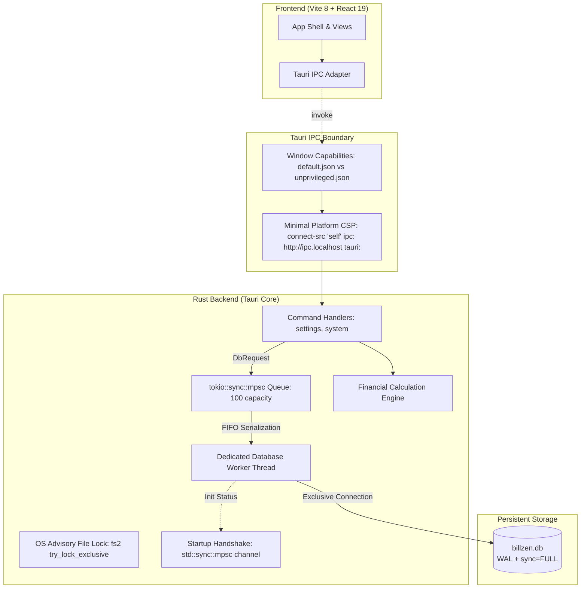

# BillZen Architecture & System Design

## 1. Overview
BillZen is an offline-first desktop billing and financial management system designed for retail, wholesale, and service businesses. It prioritizes financial precision, zero external network dependency during point-of-sale operations, commercial invoice immutability, and single-instance data durability.

## 2. Tech Stack & Environment
- **Desktop Shell**: Tauri 2.12.4 (`@tauri-apps/api 2.12.4`, `tauri 2.12.4`, `tauri-build 2.7.3`)
- **Backend Language**: Rust 1.99.0 (2021 edition)
- **Local Database**: SQLite 3 (via static bundled `rusqlite 0.40.2`)
- **Frontend Framework**: React 19.3.1 (`@tanstack/react-query 5.66.0`, `lucide-react 0.475.0`)
- **Bundler & Toolchain**: Vite 8.3.4, Node.js v22.23.3 LTS (Active)
- **Styling**: Tailwind CSS 3.4.17 (tabular numbers, print CSS media queries)
- **Testing**: Vitest 5.0.5 (frontend calculation parity), Cargo test (13 unit and integration tests across domain, migrations, rollback, worker handshake, single-instance lock, and capability isolation)
- **Packaging**: Debian installer (`.deb`, 7.27 MiB) and standalone release binary

## 3. High-Level Architecture

## 4. Database Concurrency & Durability Model
1. **Dedicated Worker Thread**: All SQLite operations within BillZen are serialized onto a single background OS thread communicating via a bounded `tokio::sync::mpsc` queue. This guarantees that internal threads never contend for database writes and UI execution remains unblocked.
2. **Handling `SQLITE_BUSY` & External Contention**:
   > [!IMPORTANT]
   > The single internal worker thread eliminates internal lock conflicts, but **does NOT eliminate external `SQLITE_BUSY` conditions**. If an external process (e.g., SQLite CLI, file backup utility, cloud sync, or antivirus) opens the database file, SQLite will still return `SQLITE_BUSY`.
   - Durability PRAGMAs:
     - `journal_mode = WAL`
     - `synchronous = FULL`
     - `busy_timeout = 5000` (blocks for up to 5 seconds before failing if an external process holds a lock)
     - `foreign_keys = ON`
3. **Database Worker Startup Handshake**:
   - `DbWorkerHandle::new` establishes a synchronous `std::sync::mpsc` handshake channel with the worker thread.
   - If database creation, directory creation, migrations, or seeding fail, the error is immediately returned to `run()` before UI launch, aborting with an actionable fatal error.

## 5. Process Lifecycle & Single-Instance Protection
- **OS-Backed Advisory Locking**: `acquire_instance_lock` opens `billzen.lock` and acquires an exclusive non-blocking OS file lock via `fs2::FileExt::try_lock_exclusive()` (`flock` on Unix / `LockFileEx` on Windows).
- **Contention Rejection**: If a secondary instance attempts to launch while the primary instance is alive, the OS immediately rejects the lock with `EAGAIN` (`Resource temporarily unavailable`), and the secondary process terminates with an actionable diagnostic message.
- **Automatic Recovery**: When the primary process exits or terminates for any reason, the OS kernel automatically releases the advisory file lock, enabling immediate clean relaunch.

## 6. Security & Capability Permissions
1. **App Command Manifest Registration**: Custom commands (`get_business_settings`, `update_business_settings`, `check_print_support`, `ping`) are explicitly registered in `src-tauri/build.rs` via `tauri_build::AppManifest`.
2. **Capability Scopes**:
   - `default.json`: Grants `allow-get-business-settings`, `allow-update-business-settings`, `allow-check-print-support`, and `allow-ping` exclusively to window `main`.
   - `unprivileged.json`: Confines secondary/untrusted windows (`unprivileged-window`) to `core:default`, with zero access to business data or settings.
3. **Minimal Platform CSP**:
   - `default-src 'self'; script-src 'self'; style-src 'self' 'unsafe-inline'; img-src 'self' data: asset:; font-src 'self' data:; connect-src 'self' ipc: http://ipc.localhost tauri:;`
   - External network connections from the frontend webview are strictly rejected.

## 7. Commercial Immutability & Financial Invariants
1. **Draft vs Finalized Lifecycle**: Invoices exist as `draft` until finalization. Upon finalization:
   - Status changes to `finalized`.
   - Immutable snapshot columns (`snapshot_business_name`, `snapshot_tax_identifier`, `snapshot_currency_code`, `snapshot_currency_exponent`, etc.) are frozen.
   - Separate triggers (`trg_invoices_prevent_update_when_finalized`, `trg_invoices_prevent_delete_when_finalized`, `trg_invoice_items_prevent_insert_when_finalized`, `trg_invoice_items_prevent_update_when_finalized`, `trg_invoice_items_prevent_delete_when_finalized`, and `v3_protect_currency_exponent.sql`) block any modification, reassignment, or deletion of finalized commercial records.
2. **Receivables & Settlement Derivation**:
   - Receivables are dynamically derived:
     $$\text{Receivables} = \sum_{\text{finalized}} (\text{grand\_total\_minor} - \text{allocated\_minor})$$
   - Settlement statuses: `unpaid`, `partially_paid`, `fully_paid`.
   - Invoices with `grand_total_minor == 0` (e.g. 100% promotional discounts) have deterministic settlement status `fully_paid`.
3. **Exact Half-Up Arithmetic**:
   - Currency: 64-bit integer minor units (e.g., paisa / cents).
   - Quantities: $1000\times$ scaled integer (allows 3 decimal places, e.g. 1.375 kg = 1375).
   - Tax: Basis points integer (18% = 1800 bp).
   - Rounding: Standard half-up integer division: `(value + 500) / 1000`.
   - Implementation: Exact `BigInt` intermediate arithmetic in TypeScript (`src/domain/financial.ts`) and checked 64-bit/128-bit integer arithmetic in Rust (`src-tauri/src/domain/financial.rs`) eliminates floating-point drift.

## 8. Print Feasibility & Dedicated Output Architecture
- **Three-Stage Verification**:
  1. *Invocation*: Dispatched via `window.print()` (WebKitGTK print trigger).
  2. *Dialog Observation*: Interactive operator confirmation determining whether the host desktop environment actually rendered the native print modal window.
  3. *Output / Spool Verification*: Confirmation whether a physical page or PDF file was produced. Verified via automated headless Chrome `--print-to-pdf` and Poppler inspection across 4 matrix scenarios (short oracle, multi-page, 3-decimal KWD, long text wrapping).
- **Strict Print Media Isolation**:
  - Global CSS enforces `body * { visibility: hidden !important; }` and `#printable-invoice-root, #printable-invoice-root * { visibility: visible !important; }`.
  - UI probe controls, navigation bars, diagnostics, and preview borders are explicitly suppressed with `.no-print`.
  - `@page { size: A4 portrait; margin: 12mm 15mm; }` guarantees standardized 594.96 $\times$ 841.92 pt geometry with no trailing blank pages.

## 9. Regional Currency & Multi-Exponent Mathematical Model
- **India & GCC Member Support**: Supports 2-decimal currencies (INR ₹, AED, SAR, QAR) and 3-decimal currencies (KWD, BHD, OMR).
- **Rust Domain Currency Validation**: `src-tauri/src/domain/currency.rs` enforces valid ISO 4217 code and exponent combinations and rejects illegal currencies before DB persistence.
- **Minor-Unit Invariant**:
  - Quantities are scaled by $1000$ ($1.500\text{ kg} = 1500$).
  - Unit prices are stored in native minor units (e.g. 2250 fils for 2.250 KWD).
  - Division by $1000$ (`roundHalfUp(quantity_scaled * unit_price_minor, 1000)`) yields exact minor units regardless of currency exponent.
- **Currency Immutability**:
  - `trg_business_settings_prevent_currency_change_when_invoices_exist` and worker domain checks block altering `currency_code` or `currency_exponent` once products, invoices, payments, or expenses exist in the database.

## 10. Decoupled Statutory Compliance Architecture
- **Offline POS Autonomy**: Counter checkout and receipt printing operate with zero internet dependency.
- **Asynchronous Outbox**: Statutory e-invoicing pipelines (India GSTN/IRP JSON schemas and Saudi Arabia ZATCA Phase 1/2 TLV/UBL schemas) read finalized records and submit asynchronously without blocking billing workflows. Detailed in `docs/tax-and-e-invoicing-matrix.md`.
- **Cross-Platform Engineering**: SQLite durability, single-instance file locking, and native print dispatchers mapped across Linux, Windows, macOS, Android, and iOS in `docs/platform-support-matrix.md`.

