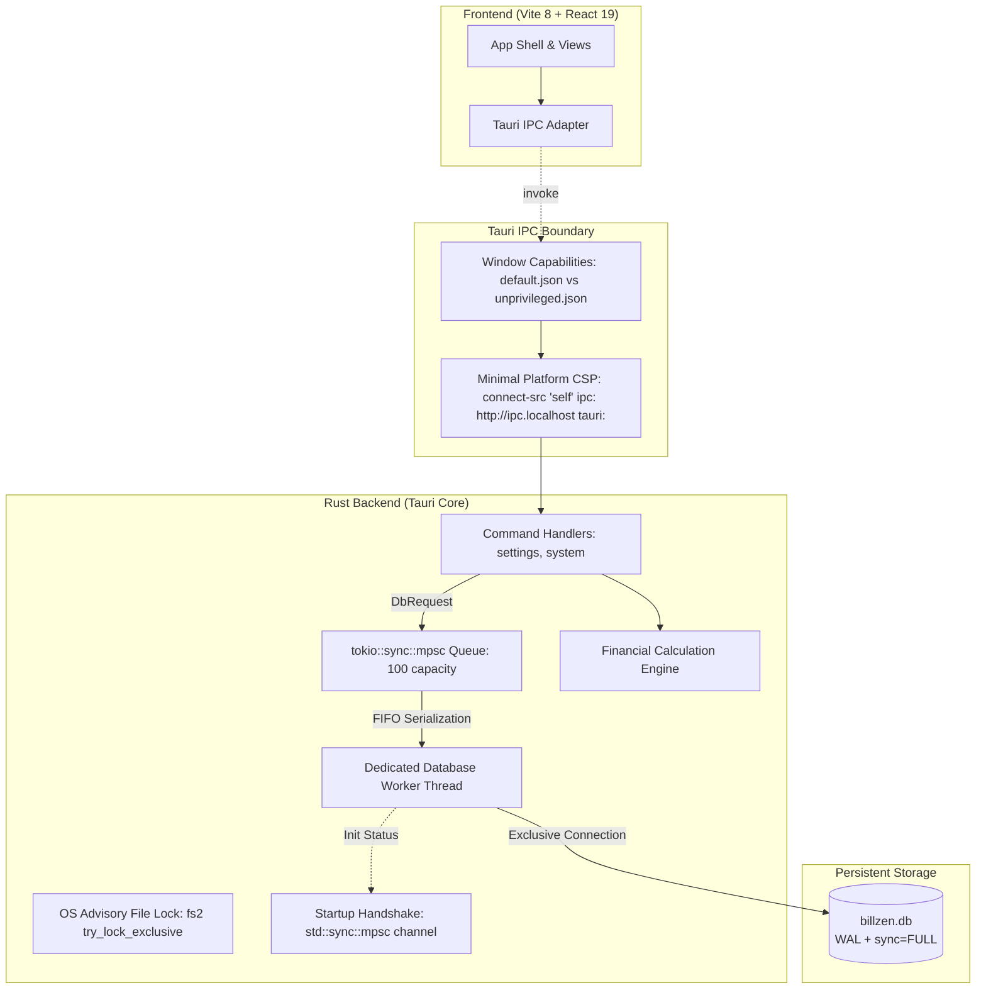

# BillZen Architecture & System Design

## 1. Overview
BillZen is an offline-first desktop billing and financial management system designed for retail, wholesale, and service businesses. It prioritizes financial precision, zero external network dependency during point-of-sale operations, commercial invoice immutability, and single-instance data durability.

## 2. Tech Stack & Environment
- **Desktop Shell**: Tauri 2.12.4 (`@tauri-apps/api 2.12.4`, `tauri 2.12.4`, `tauri-build 2.7.3`)
- **Backend Language**: Rust 1.99.0 (2021 edition)
- **Local Database**: SQLite 3 (via static bundled `rusqlite 0.40.2`)
- **Frontend Framework**: React 19.3.1 (`@tanstack/react-query 5.66.0`, `lucide-react 0.475.0`)
- **Bundler & Toolchain**: Vite 8.3.4, Node.js v22.23.3 LTS (Active)
- **Styling**: Tailwind CSS 3.4.17 (tabular numbers, print CSS media queries)
- **Testing**: Vitest 5.0.5 (frontend calculation parity), Cargo test (13 unit and integration tests across domain, migrations, rollback, worker handshake, single-instance lock, and capability isolation)
- **Packaging**: Debian installer (`.deb`, 7.27 MiB) and standalone release binary

## 3. High-Level Architecture

## 4. Database Concurrency & Durability Model
1. **Dedicated Worker Thread**: All SQLite operations within BillZen are serialized onto a single background OS thread communicating via a bounded `tokio::sync::mpsc` queue. This guarantees that internal threads never contend for database writes and UI execution remains unblocked.
2. **Handling `SQLITE_BUSY` & External Contention**:
   > [!IMPORTANT]
   > The single internal worker thread eliminates internal lock conflicts, but **does NOT eliminate external `SQLITE_BUSY` conditions**. If an external process (e.g., SQLite CLI, file backup utility, cloud sync, or antivirus) opens the database file, SQLite will still return `SQLITE_BUSY`.
   - Durability PRAGMAs:
     - `journal_mode = WAL`
     - `synchronous = FULL`
     - `busy_timeout = 5000` (blocks for up to 5 seconds before failing if an external process holds a lock)
     - `foreign_keys = ON`
3. **Database Worker Startup Handshake**:
   - `DbWorkerHandle::new` establishes a synchronous `std::sync::mpsc` handshake channel with the worker thread.
   - If database creation, directory creation, migrations, or seeding fail, the error is immediately returned to `run()` before UI launch, aborting with an actionable fatal error.

## 5. Process Lifecycle & Single-Instance Protection
- **OS-Backed Advisory Locking**: `acquire_instance_lock` opens `billzen.lock` and acquires an exclusive non-blocking OS file lock via `fs2::FileExt::try_lock_exclusive()` (`flock` on Unix / `LockFileEx` on Windows).
- **Contention Rejection**: If a secondary instance attempts to launch while the primary instance is alive, the OS immediately rejects the lock with `EAGAIN` (`Resource temporarily unavailable`), and the secondary process terminates with an actionable diagnostic message.
- **Automatic Recovery**: When the primary process exits or terminates for any reason, the OS kernel automatically releases the advisory file lock, enabling immediate clean relaunch.

## 6. Security & Capability Permissions
1. **App Command Manifest Registration**: Custom commands (`get_business_settings`, `update_business_settings`, `check_print_support`, `ping`) are explicitly registered in `src-tauri/build.rs` via `tauri_build::AppManifest`.
2. **Capability Scopes**:
   - `default.json`: Grants `allow-get-business-settings`, `allow-update-business-settings`, `allow-check-print-support`, and `allow-ping` exclusively to window `main`.
   - `unprivileged.json`: Confines secondary/untrusted windows (`unprivileged-window`) to `core:default`, with zero access to business data or settings.
3. **Minimal Platform CSP**:
   - `default-src 'self'; script-src 'self'; style-src 'self' 'unsafe-inline'; img-src 'self' data: asset:; font-src 'self' data:; connect-src 'self' ipc: http://ipc.localhost tauri:;`
   - External network connections from the frontend webview are strictly rejected.

## 7. Commercial Immutability & Financial Invariants
1. **Draft vs Finalized Lifecycle**: Invoices exist as `draft` until finalization. Upon finalization:
   - Status changes to `finalized`.
   - Immutable snapshot columns (`snapshot_business_name`, `snapshot_tax_identifier`, `snapshot_currency_code`, `snapshot_currency_exponent`, etc.) are frozen.
   - Separate triggers (`trg_invoices_prevent_update_when_finalized`, `trg_invoices_prevent_delete_when_finalized`, `trg_invoice_items_prevent_insert_when_finalized`, `trg_invoice_items_prevent_update_when_finalized`, `trg_invoice_items_prevent_delete_when_finalized`, and `v3_protect_currency_exponent.sql`) block any modification, reassignment, or deletion of finalized commercial records.
2. **Receivables & Settlement Derivation**:
   - Receivables are dynamically derived:
     $$\text{Receivables} = \sum_{\text{finalized}} (\text{grand\_total\_minor} - \text{allocated\_minor})$$
   - Settlement statuses: `unpaid`, `partially_paid`, `fully_paid`.
   - Invoices with `grand_total_minor == 0` (e.g. 100% promotional discounts) have deterministic settlement status `fully_paid`.
3. **Exact Half-Up Arithmetic**:
   - Currency: 64-bit integer minor units (e.g., paisa / cents).
   - Quantities: $1000\times$ scaled integer (allows 3 decimal places, e.g. 1.375 kg = 1375).
   - Tax: Basis points integer (18% = 1800 bp).
   - Rounding: Standard half-up integer division: `(value + 500) / 1000`.
   - Implementation: Exact `BigInt` intermediate arithmetic in TypeScript (`src/domain/financial.ts`) and checked 64-bit/128-bit integer arithmetic in Rust (`src-tauri/src/domain/financial.rs`) eliminates floating-point drift.

## 8. Print Feasibility & Dedicated Output Architecture
- **Three-Stage Verification**:
  1. *Invocation*: Dispatched via `window.print()` (WebKitGTK print trigger).
  2. *Dialog Observation*: Interactive operator confirmation determining whether the host desktop environment actually rendered the native print modal window.
  3. *Output / Spool Verification*: Confirmation whether a physical page or PDF file was produced. Verified via automated headless Chrome `--print-to-pdf` and Poppler inspection across 4 matrix scenarios (short oracle, multi-page, 3-decimal KWD, long text wrapping).
- **Strict Print Media Isolation**:
  - Global CSS enforces `body * { visibility: hidden !important; }` and `#printable-invoice-root, #printable-invoice-root * { visibility: visible !important; }`.
  - UI probe controls, navigation bars, diagnostics, and preview borders are explicitly suppressed with `.no-print`.
  - `@page { size: A4 portrait; margin: 12mm 15mm; }` guarantees standardized 594.96 $\times$ 841.92 pt geometry with no trailing blank pages.

## 9. Regional Currency & Multi-Exponent Mathematical Model
- **India & GCC Member Support**: Supports 2-decimal currencies (INR ₹, AED, SAR, QAR) and 3-decimal currencies (KWD, BHD, OMR).
- **Rust Domain Currency Validation**: `src-tauri/src/domain/currency.rs` enforces valid ISO 4217 code and exponent combinations and rejects illegal currencies before DB persistence.
- **Minor-Unit Invariant**:
  - Quantities are scaled by $1000$ ($1.500\text{ kg} = 1500$).
  - Unit prices are stored in native minor units (e.g. 2250 fils for 2.250 KWD).
  - Division by $1000$ (`roundHalfUp(quantity_scaled * unit_price_minor, 1000)`) yields exact minor units regardless of currency exponent.
- **Currency Immutability**:
  - `trg_business_settings_prevent_currency_change_when_invoices_exist` and worker domain checks block altering `currency_code` or `currency_exponent` once products, invoices, payments, or expenses exist in the database.

## 10. Decoupled Statutory Compliance Architecture
- **Offline POS Autonomy**: Counter checkout and receipt printing operate with zero internet dependency.
- **Asynchronous Outbox**: Statutory e-invoicing pipelines (India GSTN/IRP JSON schemas and Saudi Arabia ZATCA Phase 1/2 TLV/UBL schemas) read finalized records and submit asynchronously without blocking billing workflows. Detailed in `docs/tax-and-e-invoicing-matrix.md`.
- **Cross-Platform Engineering**: SQLite durability, single-instance file locking, and native print dispatchers mapped across Linux, Windows, macOS, Android, and iOS in `docs/platform-support-matrix.md`.

## 11. Milestone 3: Catalog Domain, Inventory Ledger & Regional Localization
1. **Catalog Domain Model & Numeric Limits**:
   - `products`: SKU (uppercase normalized), Barcode (string preserving leading zeros), Name, Category FK, Unit, Unit selling price minor (bounded by `MAX_MONEY_MINOR`), Cost price minor (bounded by `MAX_MONEY_MINOR`), Tax rate basis points, Stock tracking flag, Current stock scaled ($1000\times$, bounded by `MAX_QUANTITY_SCALED`), Minimum stock alert threshold scaled ($1000\times$, bounded by `MAX_QUANTITY_SCALED`).
   - `categories`: Normalized categories with case-insensitive uniqueness (`v5_category_nocase.sql` enforcing `idx_categories_name_nocase ON categories(name COLLATE NOCASE)`).
   - `customers`: Name, Phone (international prefix preserved), Email, Tax Identifier (GSTIN/TRN/VATIN), Address Lines 1 & 2, City, State, Postal Code, Country, Current balance minor.
2. **Atomic Inventory Ledger & Stock Reconciliation**:
   - Product creation with positive opening stock atomically writes both the product record and an opening stock movement (`reference_type = 'opening'`) in `stock_movements` within a single SQLite transaction. Untracked products (`is_stock_tracked: false`) strictly reject opening stock (`opening_stock_scaled > 0`).
   - Product updates (`UPDATE products`) strictly omit `current_stock_scaled`; inventory mutations are ledger-driven and cannot be altered directly via product editing.
   - Transitioning an untracked product to tracked (`!was_tracked && is_stock_tracked`) enforces ledger reconciliation: `current_stock_scaled` must strictly match `SUM(stock_movements.quantity_delta_scaled)`, preventing phantom stock balances without history.
3. **Identifier Normalization & Uniqueness**:
   - SKUs are trimmed and converted to uppercase (`PROD-001`).
   - Barcodes are preserved as strings without numerical conversion, preserving critical leading zeros (e.g., `"0012345678905"`).
   - Duplicate SKUs or barcodes trigger descriptive error feedback from the database worker.
4. **Barcode Scanner & Keyboard-Wedge Protocol**:
   - Hardware USB/Bluetooth scanners operate in keyboard-wedge mode emitting standard keystrokes terminated by an `Enter` key.
   - Product search inputs handle the `Enter` key event, immediately querying the catalog and providing visual scan confirmation.
5. **Bundled Offline Fonts & Trilingual Localization**:
   - Local `@font-face` assets bundled in `public/fonts/` (`NotoSans-Regular.ttf`, `NotoSansMalayalam-Regular.ttf`, `NotoSansArabic-Regular.ttf`).
   - First-class UI localization supporting English (`en`), Malayalam (`ml`), and Arabic (`ar`) with RTL document flow (`dir="rtl"`).
6. **Cross-Platform Multi-Process Persistence Probe**:
   - Portable Node runner `scripts/run_native_probe.js` isolates SQLite lifecycle to clean temporary directories across POSIX, macOS, and Windows.

## 12. Milestone 3.1: Legacy Category Migration Reconciliation & Audit Safety
- **Collision Reconciliation**: When upgrading legacy V4 databases containing case-variant category duplicates (e.g. `Groceries` and `groceries`), `v5_category_nocase.sql` executes deterministic window partitioning (`FIRST_VALUE(id) OVER (PARTITION BY name COLLATE NOCASE ORDER BY created_at ASC, id ASC)`) to select the earliest canonical category.
- **Audit Tracking (`category_merges`)**: A persistent audit table records `(merged_category_id, canonical_category_id, merged_name, merged_description, merged_at)`.
- **Foreign Key Preservation**: Referencing products (`products.category_id`) are repointed to the canonical category prior to duplicate removal, preserving zero `PRAGMA foreign_key_check` errors.
- **Metadata Preservation**: Canonical categories with null/empty descriptions inherit non-empty descriptions from merged duplicates.
- **Dual-Checksum Backward Compatibility**: The migration runner (`src-tauri/src/db/mod.rs`) recognizes both the initial and reconciled V5 SHA256 checksums, enabling seamless forward upgrades for both un-migrated V4 databases and early-migrated V5 databases without checksum errors.

## 13. Appearance Settings, First-Use Setup & Android Beta Packaging
1. **Appearance Preference Engine & Settings Ownership**:
   - Strictly three options: `System — default`, `Light`, `Dark`.
   - Theme controls are strictly isolated to `SettingsView` (zero theme switches in headers, bottom nav, or onboarding modals).
   - Independent Settings Ownership: `update_business_settings` and `update_business_profile` strictly update profile columns only, omitting `is_setup_completed`, `appearance_preference`, `guide_status`, and `guide_version` to prevent profile saves from reverting user theme or guide states.
   - Theme context provides optimistic UI updates with automatic state and `localStorage` rollback upon native persistence failure.
   - Dynamic OS color scheme listener for System mode (`prefers-color-scheme`); explicit Light/Dark selections override OS events.
   - Synchronizes `<meta name="theme-color">` for mobile browser and webview chrome (`#09090b` dark, `#ffffff` light).
   - Print paper purity: `@media print` strictly enforces `#printable-invoice-root` with pure white background (`rgb(255, 255, 255)`) and dark text (`rgb(0, 0, 0)`), suppressing dark-mode tokens during printing or PDF exports.
2. **First-Use Business Setup Wizard (`OnboardingSetupWizard`)**:
   - First-run databases (`is_setup_completed = 0` with uncustomized defaults) gate access with a 3-step modal wizard. Existing databases with customized profiles are conservatively treated as completed setups.
   - Step 1: Regional & Localization Defaults (India and GCC member states: IN, AE, SA, QA, KW, BH, OM), automatically suggesting currency code, precision exponent (e.g., KWD = 3 decimals), and timezone.
   - Step 2: Business Profile Information (Business Name, Legal Trading Name, Tax ID / GSTIN / TRN, Phone, Email, Address, City, State, Country). Postal code is explicitly optional for UAE, Qatar, and Oman (`['AE', 'QA', 'OM']`).
   - Resumable Draft: Form inputs and step progression persist to `localStorage` (`billzen_setup_draft`), allowing interruption recovery without data loss.
   - Step 3: Review & Confirm with explicit currency lock notice (`trg_business_settings_prevent_currency_change_when_invoices_exist`).
   - Atomic persistence: `complete_business_setup` saves business profile and sets `is_setup_completed = true` in a single transaction.
3. **Getting-Started Guide (`GettingStartedGuide`)**:
   - 3-slide accessible dialog covering actual implemented features: Product catalog & stock ledger, Customer directory & profiles (address book, contacts, GSTIN/TRN), Local durability & appearance.
   - Auto-opens upon first launch if setup is completed and guide is unseen.
   - Skip, Back, Next controls with versioned persistence (`last_seen_guide_version`).
   - Replayable anytime from Settings -> Help & Getting Started.
4. **Database Migration `v6_setup_and_onboarding.sql` & Repair Scoping**:
   - Extends `business_settings` with `is_setup_completed BOOLEAN NOT NULL DEFAULT 0`, `appearance_preference TEXT NOT NULL DEFAULT 'system'`, and `last_seen_guide_version INTEGER NOT NULL DEFAULT 0`.
   - Migration repair scoping: The one-time legacy business repair UPDATE is strictly executed only when `stored_checksum == INITIAL_V6_CHECKSUM && is_setup_completed = 0`. Upon execution, `schema_migrations.checksum` advances to `current_checksum6`.
   - For databases with `stored_checksum == current_checksum6`, no repair UPDATE is run, guaranteeing that `unseen`, `skipped`, and `completed` guide states persist indefinitely across repeated application restarts.
5. **Android Standalone Packaging & Toolchain**:
   - Rootless OpenJDK 17 (`~/.android-toolchain/jdk`) + Android SDK (`android-36`, `build-tools/36.0.0`) & NDK 26.1 (`~/.android-toolchain/android-sdk/ndk/26.1.10909125`).
   - Authoritative Versioning: `build.gradle.kts` resolves `versionCode` through authoritative precedence: `System.getenv("BILLZEN_VERSION_CODE")?.toIntOrNull() ?: (project.findProperty("versionCode") as? String)?.toIntOrNull() ?: tauriProperties.getProperty("tauri.android.versionCode")?.toIntOrNull() ?: 1001`. `tauri.conf.json` specifies `"android": { "versionCode": 1001 }`.
   - Hardened APK Selection & Assembly: `scripts/build_android_apk.sh` supports both default ARM64 release variant (`dist-android/billzen-beta-v0.1.0-arm64-v8a.apk`) and emulator test variant (`dist-android/billzen-test-v0.1.0-x86_64.apk`), strictly selecting release builds and aborting on missing release artifacts.
   - 16 KB page-size ELF alignment for Android 15+ native libraries (`RUSTFLAGS="-C link-arg=-z -C link-arg=max-page-size=16384"`, verified `0x4000` segment alignment via `llvm-readelf -l`).
   - 16 KB packaging alignment: Enforced via `zipalign -v -f -P 16 4` and verified via `zipalign -c -v -P 16 4` on final signed APKs.
   - Self-contained packaging: SQLite, bundled Noto Sans offline fonts, and Vite assets bundled directly into APK (`versionCode = 1001`).
   - Signed with BillZen Beta Keystore (`v2` + `v3` APK signature schemes, verified certificate identity `CN=BillZen Beta` and SHA-256 fingerprint matching keystore via `apksigner`).
   - Badging assertion: `aapt dump badging` automatically verifies package name (`com.billzen.desktop`), version code (`1001`), version name (`0.1.0`), min SDK (`24`), target SDK (`34`), and ABI.
6. **Automated Android Runtime Verification Architecture**:
   - Automated via `scripts/verify_android_runtime.js` (`npm run test:android-runtime`) executing against headless Android 14.0 (API 34) emulator with KVM hardware acceleration.
   - Dual-channel test architecture:
     1. Remote Chrome DevTools Protocol (CDP) client over ADB forwarded abstract unix socket (`adb forward tcp:9222 localabstract:webview_devtools_remote_<PID>`) for evaluating DOM state, inspecting React 19 synthetic input events via native prototype property setters, and validating theme classes.
     2. ADB shell commands for OS lifecycle simulation (`am start`, `am force-stop`, `svc wifi/data disable/enable`, `input keyevent 4`, and `logcat -d`).
   - Verifies cold launch, setup wizard, product catalog with leading-zero barcode preservation (`0012345678905`), customer directory, light/dark appearance persistence across process termination, in-place upgrade from v1000 to v1001 without data loss, 100% offline database operations, and logcat crash cleanliness.

## 14. Native Mobile UI, Edge-to-Edge Safe Insets & Android Back Navigation
1. **Edge-to-Edge Safe Area Insets (`--sat`, `--sab`)**:
   - `index.html` declares `<meta name="viewport" content="width=device-width, initial-scale=1.0, viewport-fit=cover">`.
   - `MainActivity.kt` tracks `WindowInsetsCompat.Type.systemBars()` via `ViewCompat.setOnApplyWindowInsetsListener(window.decorView)` and updates WebView CSS root variables `--sat` (top inset) and `--sab` (bottom inset) on creation, window insets change, and `onResume()`.
   - `src/styles/globals.css` declares `--sat: env(safe-area-inset-top, 0px)` and `--sab: env(safe-area-inset-bottom, 0px)`.
   - `App.tsx` pads `<header>` with `isAndroid ? max(24px, env(safe-area-inset-top, 0px), var(--sat, 0px)) : ...` and bottom `<nav>` with `isAndroid ? max(1.5rem, env(safe-area-inset-bottom, 0px), var(--sab, 0px)) : ...`, completely eliminating status bar and gesture navigation bar overlaps.
2. **Native Android Back Navigation & Modal Dismissal**:
   - `MainActivity.kt` registers `onBackPressedDispatcher.addCallback` which inspects the WebView DOM for open dialogs (`role="dialog"` or `[aria-modal="true"]`) and dispatches a synthetic `billzen-back-button` `CustomEvent`. If handled, system back navigation is cancelled without exiting the application.
   - Frontend components use the reusable hook `src/hooks/useBackHandler.ts` which binds both keyboard `Escape` and native `billzen-back-button` CustomEvents. Integrated in `CustomerCatalogView.tsx`, `ProductCatalogView.tsx`, and `GettingStartedGuide.tsx`.
3. **High-Contrast Dark Theme Foundation & Status Bar Contrast Synchronization**:
   - `index.html` specifies `<body class="bg-slate-50 dark:bg-zinc-950 text-slate-900 dark:text-zinc-100 ...">` matching `@layer base` rules, ensuring `#09090b` paints behind all views in dark mode with >16:1 contrast against white headers and text.
   - Dynamic Status Bar Icon Contrast: `MainActivity.kt` implements `applySystemBarsTheme(isDark: Boolean)` updating `WindowCompat.getInsetsController(window, window.decorView).isAppearanceLightStatusBars = !isDark` and `isAppearanceLightNavigationBars = !isDark`. When dark theme is active, icons are white on `#09090b`. When light theme is active, icons are dark on `#ffffff`.
   - NativeBridge integration: `MainActivity.kt` exposes `@JavascriptInterface setDarkMode(isDark: Boolean)` and `ThemeContext.tsx` synchronously invokes `window.BillZenNative?.setDarkMode(isDark)` on theme mutations.
   - Added `ACCESS_NETWORK_STATE` in `AndroidManifest.xml` and defensive try-catch in network monitoring.
4. **Compact Mobile Navigation Localization**:
   - Added `tab_print_probe_short` to `src/i18n/index.ts` (`'Print Probe'` in EN, `'പ്രിന്റ് ടെസ്റ്റ്'` in ML, `'فحص الطباعة'` in AR) with full `aria-label={t.tab_print_probe}`, preventing mobile bottom nav crowding on narrow screens.
## 15. Milestone 4A Architecture: Draft Invoices & Zero-Stock Decrement Invariant
- **Specification**: Complete specification documented in `docs/m4a-invoice-drafts-spec.md`.
- **Draft Lifecycle**: Invoices are created in `status = 'draft'` with draft line items stored directly in SQLite tables `invoices` and `invoice_items`.
- **Zero-Stock Decrement Invariant**: Drafting or editing an invoice **never decrements stock**. Tracked physical stock movements (`stock_movements`) and inventory deductions occur strictly upon finalization in Milestone 4B.
- **Optimistic Concurrency**: Draft updates require matching `draft_version` to prevent concurrent POS overwrites.
- **Exact Financial Arithmetic**: Reuses `src/domain/financial.ts` and `src-tauri/src/domain/financial.rs` with `round_half_up_128` and checked integer arithmetic across 2-decimal and 3-decimal currencies.

## 16. WebView Debugging Restriction & Build Variant Architecture (versionCode 1004)
1. **Security Isolation & WebView Debugging Boundary**:
   - `src-tauri/gen/android/app/src/main/java/com/billzen/desktop/MainActivity.kt` guards `WebView.setWebContentsDebuggingEnabled(true)` strictly with `if (BuildConfig.ENABLE_WEBVIEW_DEBUGGING)`.
   - In distribution release builds (`BILLZEN_ENABLE_WEBVIEW_DEBUGGING=false`), R8 dead-code elimination completely purges `setWebContentsDebuggingEnabled` calls from `classes.dex`, verified via `dexdump`.
   - In test builds (`BILLZEN_ENABLE_WEBVIEW_DEBUGGING=true`), debugging is enabled for CDP automation on port 9222.
2. **Authoritative Versioning (versionCode 1004)**:
   - Synchronized across `tauri.conf.json`, `build.gradle.kts`, `tauri.properties`, and `scripts/build_android_apk.sh`.
   - Signed distribution release APK: `dist-android/billzen-beta-v0.1.0-arm64-v8a.apk` (15M, SHA-256: `fb9f2d170afe535132a24329b5c5b5e6d6ce1b60b9adc0de39cbcf2a4d282279`).
   - Signed test APK: `dist-android/billzen-test-v0.1.0-x86_64.apk` (14M, SHA-256: `adeda77f1ea88e64c6d9689f13fd0f1904b6da023dfa91732024e9dea51f5024`).

## 17. Offline Company Cashbook Architecture (Milestones C0 — C4)
- **Specification & Plan**: Complete architectural specification in `docs/cashbook-architecture-spec.md` and sequenced implementation plan in `docs/superpowers/plans/2026-10-19-cashbook-implementation-plan.md`.
- **Core Priority**: Shifted from deferred commercial invoicing (M4A) to an offline-first company cashbook for recording money received (Receipts) and money paid (Payments), issuing numbered vouchers, tracking running balances, and providing portable backups.
- **Single-Operator Local Independence**: Operates on an independent local device (desktop or mobile) without cloud servers, user logins, staff roles, live multi-device synchronization, or automatic dataset merging.
- **Cash Flow vs. Profit Invariant**: Net cash flow and accumulated balances represent cash liquidity, **never "Profit"**. Capital injections, loan disbursements, supplier advances, and transfers are strictly decoupled from operating income/expense totals.
- **Canonical Ledger & Reversal Semantics**:
  - Vouchers: `draft`, `posted`, `reversed`. Posted vouchers are immutable.
  - Zero double-cancellation: Reversing an errant voucher posts an equal and opposite movement to the ledger. Both original and reversal movements remain in the ledger table summing to zero. Balance queries sum all movements without excluding reversed rows.
  - Duplicate Prevention: UUID `idempotency_key` with SHA-256 payload hashing. Identical payload returns existing record; altered payload returns `409 Conflict`.
- **Party & Historical Snapshots**:
  - Parties can be linked to existing `customers` or ad-hoc entities (suppliers, employees, owners, lenders).
  - Vouchers freeze immutable snapshots of business profile, party contact details, currency, and amount words to guarantee stable reprints.
- **Exact Amount Contract & Numerical Bounds**:
  - Entry amounts bound: `MAX_MONEY_MINOR = 10^11` ($100,000,000,000$).
  - Cumulative balance bound: `MAX_TOTAL_MINOR = 10^14` ($100,000,000,000,000 < \text{Number.MAX\_SAFE\_INTEGER}$).
  - Supported: 2-decimal (INR, AED, SAR, QAR, USD, EUR, GBP) and 3-decimal (KWD, BHD, OMR) currencies with `round_half_up_128`.
  - Base currency change is blocked if invoices, posted vouchers, or non-zero accounts exist.
- **Portable Backup & Safe Restore**:
  - Versioned JSON format `1.0` with SHA-256 checksum and balance equation pre-validation.
  - Atomic staging and timestamped recovery copy (`billzen.db.recovery-{timestamp}`) prevent corruption from raw WAL copies.
- **Phased Delivery**:
  - C1A: Schema migration `v7_cashbook_foundation.sql`, Rust domain entities, sequence generator, native commands, integrity tests.
  - C1B: React cashbook UI, entry modal, running balance ledger, printable voucher PDF.
  - C1C: Persistent Web IndexedDB adapter, portable backup/restore engine, cross-platform acceptance suite.
  - C2: Account transfers (`TRF-`), XLSX workbooks, attachments.
  - C3: Cash counter, budgets, local reminders, app lock.
  - C4: Invoicing integration (resuming deferred M4A/M4B).

## Application brand assets (2026-10-18)
`public/brand/billzen-icon.svg` is the canonical README-derived mark. `npm run icons:generate` regenerates desktop/mobile icon assets, browser icons and the README hero mark. The app header uses the source SVG; native bundle icons are explicit in tauri.conf.json. Mobile assets do not imply mobile runtime verification.

