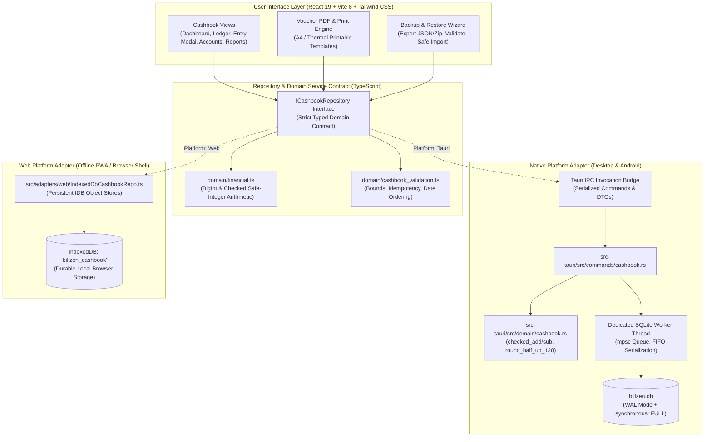
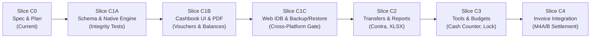

# BillZen — Offline Company Cashbook Architecture Specification

> **Status:** PROPOSED & APPROVED ARCHITECTURAL SPECIFICATION  
> **Date:** 2026-10-19  
> **Author:** Antigravity (Lead AI Pair Programmer) & Project Owner  
> **Supersedes/Defers:** Milestone 4A Invoice Drafts (`docs/m4a-invoice-drafts-spec.md` is deferred to Phase C4)

---

## 1. Executive Summary & Context

BillZen’s primary product priority is shifted to an **offline-first company cashbook** for recording money received (Receipts) and money paid (Payments), producing numbered vouchers, maintaining accurate running balances, generating financial reports, and ensuring durable backup and restore.

### Core Architectural Axioms
1. **Single-Operator Local Independence:** Operates on an independent local device (desktop or mobile) without cloud servers, user logins, staff roles, live multi-device synchronization, or automatic dataset merging.
2. **Never Label Cash as "Profit":** Net cash flow ($\text{Inflows} - \text{Outflows}$) and accumulated account balances represent cash liquidity, **never "Profit"**. Capital injections, loan disbursements, supplier advances, and transfers must never be conflated with operating profit.
3. **Single Financial Source of Truth:** Cashbook vouchers and movements constitute the primary ledger for funds in holding accounts. Invoicing (deferred M4A/M4B) will integrate in Phase C4 by linking commercial invoice settlements to cashbook vouchers, preventing any double-counting.
4. **Exact Integer Arithmetic:** All monetary amounts are stored as 64-bit integer minor units with strict bound validation and half-up rounding (`round_half_up_128`).
5. **Dual-Platform Durability:** Native platforms (Linux, Windows, macOS, Android) persist to SQLite via a serialized background Rust worker. The Web edition uses a genuine, persistent IndexedDB repository (not transient memory mocks).

---

## 2. Proposed High-Level Architecture & Boundaries



---

## 3. Reference App Evidence & Parity Matrix

The following matrix contrasts BillZen's specification against empirical evidence from the reference application *Cash Book : Expense Tracker* (`com.cashbook.expense.tracker`, Blackdot Solution).

> **Evidence Legend:**
> - `screenshot-observed`: Directly observed in published listing gallery screenshots.
> - `listing-advertised`: Claimed in store copy; implementation details unverified.
> - `not-verified`: Inspected evidence does not prove internal implementation or existence.
> - `planned`: Formally designed and scheduled in BillZen roadmap.
> - `platform-specific`: Limited to specific host OS capabilities.

| Feature Area | Reference App Capability | Evidence Classification | BillZen Specification & Status | Planned Delivery |
| :--- | :--- | :--- | :--- | :--- |
| **Cash In / Out Recording** | Dated income & expense entry | `screenshot-observed` | Formally separated receipt/payment directions with explicit business classifications | **C1A / C1B** |
| **Named Holding Accounts** | Multiple accounts (Cash, Bank) | `screenshot-observed` | Multi-account ledger with opening balances and currency safeguards | **C1A / C1B** |
| **Running Cash Balance** | Inflow - Outflow summary | `screenshot-observed` | Strictly labeled **"Cash Balance"** / **"Net Movement"**; never "Profit" | **C1A / C1B** |
| **Formal Numbered Vouchers** | Not verified from available evidence | `not-verified` (simple transaction list shown) | Sequential immutable vouchers (`RCP-`, `PAY-`) with snapshot freezing | **C1A / C1B** |
| **Audit-Safe Reversals** | Not verified from available evidence | `not-verified` | Zero in-place ledger deletion; linked reversal vouchers and movement offsetting | **C1A** |
| **Voucher PDF Generation** | Not verified from available evidence | `not-verified` | Dedicated printable/exportable receipt voucher PDF (A4 & 80mm) | **C1B** |
| **Search & Period Filters** | Day/Month/Year filters & search | `screenshot-observed` | Deterministic date filtering with opening & closing period balance derivation | **C1B** |
| **Offline Durability** | Advertised offline | `listing-advertised` | 100% offline; SQLite (native) & IndexedDB (web); zero cloud sync requirement | **C1A / C1C** |
| **Portable Backup / Restore** | Local file & Drive backup | `screenshot-observed` | Versioned portable JSON archive, atomic staging, and recovery copy | **C1C** |
| **Party / Contact Model** | Simple party name field | `screenshot-observed` | Linkable to existing `customers` table or ad-hoc suppliers/employees/owners | **C1A** |
| **Account Transfers (Contra)** | Multi-account movement | `listing-advertised` (not verified from screenshots) | Atomic 2-legged movements; net zero at company level; excluded from P&L | **C2** |
| **Period Statements (PDF/XLSX)**| Tabular export | `screenshot-observed` | Genuine multi-sheet XLSX workbooks & Poppler-verified PDF statements | **C2** |
| **Receipt Image Attachments** | Attachment icon visible | `screenshot-observed` | Local file/metadata attachments included in portable backups | **C2** |
| **Denomination Cash Counter** | Calculator & counter | `screenshot-observed` | Physical currency note counter (e.g. ₹500, ₹200, ₹100, ₹50) | **C3** |
| **Spending Charts** | Inflow/Outflow & categories | `screenshot-observed` | Category breakdown & cash trend visualizations | **C3** |
| **Category Expense Budgets** | Monthly budget setting | `listing-advertised` | Monthly category spending caps with budget utilization tracking | **C3** |
| **Notes & Local Reminders** | Free-text notes & reminders | `screenshot-observed` | Local SQLite notes and platform-native reminder scheduling | **C3** |
| **App Lock / Security** | PIN / Fingerprint lock | `listing-advertised` (biometrics unverified) | Native/Web session PIN lock; note: UI screen protection, not full-disk encryption | **C3** |
| **Invoice Integration** | Not verified from available evidence | `not-verified` | Settlement of deferred M4 invoices via linked cashbook receipt vouchers | **C4** |
| **After-Call Entry** | Android post-call popup | `screenshot-observed` | Optional Android-only shortcut; core app never demands call permissions | **C4** |

---

## 4. Money-Flow Classification vs. Cash Movement Direction

A fundamental financial flaw in basic expense trackers is treating all cash receipts as sales revenue and all cash payments as operating expenses. BillZen strictly decouples **Movement Direction** from **Business Nature**.

### 4.1 Movement Direction
- `INFLOW` (Receipt): Increases the target money account balance.
- `OUTFLOW` (Payment): Decreases the source money account balance.

### 4.2 Business Classification Taxonomy
Every voucher entry must be classified into one of the following business classes:

1. **`operating_income`** (Direction: `INFLOW`):
   - Revenue from goods, services, consulting, retail sales, or scrap sales.
   - *Included* in operating income summaries.
2. **`operating_expense`** (Direction: `OUTFLOW`):
   - Operational overheads: rent, electricity, salaries, office supplies, repairs.
   - *Included* in operating expense summaries.
3. **`capital`** (Direction: `INFLOW` or `OUTFLOW`):
   - `INFLOW`: Capital introduced by business owner/partner.
   - `OUTFLOW`: Drawings or capital withdrawal by owner.
   - *Excluded* from operating income/expense; affects equity/liquidity only.
4. **`loan`** (Direction: `INFLOW` or `OUTFLOW`):
   - `INFLOW`: Loan principal received from bank or third-party lender.
   - `OUTFLOW`: Loan principal repayment. (Interest component is classified under `operating_expense`).
   - *Excluded* from operating income/expense.
5. **`advance`** (Direction: `INFLOW` or `OUTFLOW`):
   - `INFLOW`: Advance payment received from a customer prior to billing.
   - `OUTFLOW`: Advance payment paid to a vendor/supplier prior to delivery.
   - *Excluded* from current operating income/expense until settled.
6. **`refund`** (Direction: `INFLOW` or `OUTFLOW`):
   - `INFLOW`: Refund received from a vendor for returned purchases or overpayments.
   - `OUTFLOW`: Refund paid to a customer for returned goods or cancelled orders.
   - Tracked as contra-entries against income/expenses.
7. **`transfer`** (Direction: `INFLOW` + `OUTFLOW` — Milestone C2):
   - Contra movement between two company accounts (e.g. Cash withdrawal to Bank).
   - Net company monetary impact: exactly $0. Strictly excluded from operating totals.
8. **`opening_balance`** (Direction: `INFLOW`):
   - Initial cash/bank balance established upon account creation.
   - Counted once in account balance. **Strictly excluded from operating income.**

### Summary Formulation
$$\text{Total Cash Balance} = \sum \text{All Inflows} - \sum \text{All Outflows} + \sum \text{Opening Balances}$$
$$\text{Operating Net Margin} = \sum \text{Operating Inflows} - \sum \text{Operating Outflows} \quad (\neq \text{Cash Balance})$$

---

## 5. Canonical Ledger, Immutability & Reversal Semantics

### 5.1 Voucher States & Immutability Lifecycle
- **`draft`**: Working entry. Editable. Has **zero** movements and zero effect on posted balances. Not printable as a formal receipt.
- **`posted`**: Transactionally committed. Generates immutable ledger movements. Generates a permanent sequential voucher number. Snapshot columns are frozen. **Direct UPDATE or DELETE of posted financial rows is prohibited by database triggers.**
- **`reversed`**: A posted voucher that has been neutralized by a linked reversal voucher. Its original record and sequence number remain permanently visible in the audit trail.

### 5.2 Zero Double-Cancellation Reversal Principle
To correct or void an errant posted voucher:
1. The operator issues a **Reversal**.
2. BillZen generates a linked **Reversal Voucher** (e.g. `RCP-REV-202610-00001` or `PAY-REV-202610-00001`).
3. The reversal voucher posts **equal and opposite** movements to the ledger:
   - If original was `INFLOW` of $+10,000$, reversal movement is $-10,000$.
4. **Single Source of Truth Invariant:**
   - The query for an account's balance is simply:
     $$\text{Balance} = \text{OpeningBalance} + \sum_{\text{all movements}} \text{movement\_minor}$$
   - The original movement ($+10,000$) and reversal movement ($-10,000$) both exist in the ledger table. Their algebraic sum is $0$.
   - **Critical Rule:** The original voucher is marked `is_reversed = 1` solely for UI badge display and preventing duplicate reversals. **The balance query does NOT filter out reversed vouchers**, preventing double deduction.

### 5.3 Idempotency & Conflict Prevention
1. **Double-Tap / Retry Guard:**
   - Every voucher creation request must supply a client-generated UUID `idempotency_key`.
   - The server/worker computes a SHA-256 hash of the normalized request payload (`account_id`, `amount_minor`, `direction`, `business_date`, `classification`, `party_id`).
   - If `idempotency_key` already exists in `cashbook_vouchers`:
     - If `payload_hash` matches: Return the existing voucher record (Idempotent replay success).
     - If `payload_hash` differs: Abort immediately with error `IdempotencyKeyConflict` (HTTP 409 equivalent). Never return an unrelated voucher or overwrite existing data.
2. **Duplicate Reversal Prevention:**
   - Column `reversed_by_voucher_id TEXT UNIQUE` on `cashbook_vouchers`.
   - Attempting to reverse a voucher that already has `reversed_by_voucher_id IS NOT NULL` is rejected with `VoucherAlreadyReversed`.

---

## 6. Party & Contact Model with Historical Snapshots

### 6.1 Party Structure
Not every payee or payer is a commercial customer. A party can be an employee, supplier, government agency, landlord, or owner.

- `cashbook_parties` table stores entity records with optional association to BillZen's existing `customers` table:
  - `party_type`: `'customer'`, `'supplier'`, `'employee'`, `'owner'`, `'lender'`, `'other'`.
  - `customer_id`: Nullable foreign key referencing `customers(id) ON DELETE RESTRICT`.
  - `name`, `phone`, `email`, `tax_id`, `address`.

### 6.2 Immutable Historical Snapshots for Stable Reprints
When printing a receipt voucher months or years later, the document must reflect the exact business details and party contact info at the moment the transaction was executed—even if the company changes its legal address or the customer updates their phone number.

Every posted voucher freezes the following snapshot columns:
- `business_name_snap`, `business_tax_id_snap`, `business_address_snap`, `business_phone_snap`
- `party_name_snap`, `party_tax_id_snap`, `party_phone_snap`, `party_address_snap`
- `account_name_snap`, `currency_code_snap`, `currency_exponent_snap`
- `amount_minor`, `amount_in_words_snap`
- `business_date`, `posted_at`

Reprints render exclusively from these frozen snapshot fields.

---

## 7. Exact Amount Contract & Numerical Bounds

### 7.1 Cross-Platform Precision (Rust vs. JavaScript)
- JavaScript `Number.MAX_SAFE_INTEGER` $= 2^{53} - 1 = 9,007,199,254,740,991$ ($\approx 9 \times 10^{15}$).
- Rust `i64::MAX` $= 9,223,372,036,854,775,807$ ($\approx 9 \times 10^{18}$).
- To ensure 100% loss-free representation across JSON IPC, SQLite, TypeScript, and IndexedDB without floating-point distortion:
  1. **Maximum Entry Amount:**
     $$\text{MAX\_MONEY\_MINOR} = 100,000,000,000 \quad (10^{11})$$
     (e.g. ₹1,000,000,000.00 in 2-decimal or 100,000,000.000 in 3-decimal currency).
  2. **Maximum Cumulative Balance & Report Totals:**
     $$\text{MAX\_TOTAL\_MINOR} = 100,000,000,000,000 \quad (10^{14})$$
     Notice that $10^{14} < 9 \times 10^{15}$ (`Number.MAX_SAFE_INTEGER`), guaranteeing that all accumulated balances and period totals fit safely within standard JavaScript safe numbers without precision truncation.
  3. **Intermediate Computations:** Rust uses `i128` with `checked_add`/`checked_sub`. TypeScript uses native `BigInt` for intermediate balance summations before asserting safe bounds.

### 7.2 Currency Parsing & Exponents
- Supported ISO 4217 Currencies:
  - 2 decimals: `INR` (₹), `AED` (AED), `SAR` (SAR), `QAR` (QAR), `USD` ($), `EUR` (€), `GBP` (£).
  - 3 decimals: `KWD` (KWD), `BHD` (BHD), `OMR` (OMR).
- Parsing strictness: Reject strings with invalid characters, multiple decimal points, or trailing fractional digits exceeding `currency_exponent`.

### 7.3 Currency Protection Extension
The existing trigger preventing business base currency alterations (`trg_business_settings_prevent_currency_change_when_invoices_exist`) must be upgraded to:
```sql
CREATE TRIGGER trg_business_settings_prevent_currency_change_when_financial_records_exist
BEFORE UPDATE OF currency_code, currency_exponent ON business_settings
FOR EACH ROW
WHEN (NEW.currency_code IS NOT OLD.currency_code OR NEW.currency_exponent IS NOT OLD.currency_exponent)
  AND (
    EXISTS (SELECT 1 FROM invoices WHERE status = 'finalized') OR
    EXISTS (SELECT 1 FROM cashbook_vouchers WHERE status = 'posted') OR
    EXISTS (SELECT 1 FROM money_accounts WHERE opening_balance_minor != 0)
  )
BEGIN
    SELECT RAISE(ABORT, 'Cannot change currency after finalized invoices, posted vouchers, or non-zero accounts exist');
END;
```

---

## 8. Account & Date Policies

### 8.1 Overdraft & Negative Balance Policy
- Cash accounts (physical cash drawers) normally cannot be negative. However, real-world data entry lag (e.g. paying an expense before recording morning receipts) can cause temporary negative balances.
- Column `allow_negative_balance INTEGER NOT NULL DEFAULT 0` on `money_accounts`:
  - `0` (Strict/Cash Drawer): UI warns operator if transaction causes negative balance, with optional manager override flag.
  - `1` (Bank Overdraft / Line of Credit): Account balance is permitted to be negative up to an optional credit limit.

### 8.2 Opening Balance Immutability
- An account's opening balance can only be established upon initial record creation.
- Once posted vouchers exist for that account, direct modification of `opening_balance_minor` is rejected by trigger. Any subsequent opening adjustment must be posted as an explicit `Opening Balance Adjustment` audit voucher.

### 8.3 Account Archiving
- Accounts can be archived (`is_archived = 1`).
- Archived accounts cannot accept new vouchers or transfers.
- Historical records, statements, and reports for archived accounts remain fully queryable.
- An account with non-zero balance can be archived, but cannot be deleted from the database (`ON DELETE RESTRICT`).

### 8.4 Business Date vs. UTC Timestamp
- `business_date`: Stored as ISO `YYYY-MM-DD` string in the company's operational timezone. Represents the effective accounting date chosen by the operator.
- `created_at` / `posted_at`: Unix epoch milliseconds (UTC) recording physical write time.
- Backdated entries are permitted.

### 8.5 Deterministic Running Balance Ordering
To ensure running balances are 100% deterministic regardless of insertion order or backdated entries, the canonical sort order for ledger statements is:
$$\text{ORDER BY } \text{business\_date ASC}, \text{sequence\_number ASC}, \text{id ASC}$$

### 8.6 Filtered Period Balance Formulas
For any statement filtered from `start_date` to `end_date`:
- **Period Opening Balance:** Sum of all movements with `business_date < start_date` $+$ account opening balance.
- **Period Inflows:** Sum of `amount_minor` for inflow movements with `start_date <= business_date <= end_date` (excluding transfers).
- **Period Outflows:** Sum of `amount_minor` for outflow movements with `start_date <= business_date <= end_date` (excluding transfers).
- **Period Closing Balance:** $\text{Period Opening Balance} + \text{Period Inflows} - \text{Period Outflows}$.

### 8.7 Voucher Numbering Specification
Standardized format:
$$\mathbf{\{PREFIX\}-\{YYYYMM\}-\{SEQUENCE:05d\}}$$
- Receipts: `RCP-202610-00001`
- Payments: `PAY-202610-00001`
- Reversals: `RCP-REV-202610-00001` / `PAY-REV-202610-00001`
- Transfers (Phase C2): `TRF-202610-00001`

Sequences are allocated atomically from `cashbook_sequences` within the posting transaction. Once issued, a sequence number is never reused or reassigned.

---

## 9. Portable Backup & Safe Restore

### 9.1 Format Specification (`billzen-cashbook-backup-v1.json`)
A portable backup is a single versioned JSON document (or zipped JSON + media archive):
```json
{
  "format_version": "1.0",
  "app_version": "0.1.0",
  "generated_at": 1729337400000,
  "checksum_sha256": "...",
  "business_settings": { ... },
  "money_accounts": [ ... ],
  "cashbook_categories": [ ... ],
  "cashbook_parties": [ ... ],
  "cashbook_vouchers": [ ... ],
  "cashbook_movements": [ ... ],
  "cashbook_sequences": [ ... ],
  "cashbook_audit_events": [ ... ]
}
```

### 9.2 Safe Restore Protocol (Preventing Data Loss)
1. **Never copy a live WAL database:** A running SQLite database with active WAL and shared memory (`-wal`, `-shm`) will corrupt if copied naively. Native backup uses SQLite Online Backup API (`sqlite3_backup_*`) or an exclusive transaction lock.
2. **Pre-Restore Validation:**
   - Verify `format_version == "1.0"`.
   - Recompute SHA-256 payload checksum.
   - Run financial integrity check: Verify that $\sum \text{movements} + \text{opening} == \text{balance}$ for all accounts in the payload.
3. **Atomic Replacement & Recovery Copy:**
   - Before applying the restore, the existing active database is copied to a timestamped backup: `billzen.db.recovery-{timestamp}`.
   - On Native: Data is restored into a staging database `billzen.staging.db`, `PRAGMA integrity_check` is executed, and then files are atomically swapped.
   - On Web: Executed inside an atomic multi-store IndexedDB readwrite transaction. If any record fails insertion, the transaction aborts and original data is untouched.
4. **No Silent Merging:** Deliberate restore replaces the current workspace with the backup contents. Datasets from two independent devices are never silently merged without user direction.

---

## 10. Phased Delivery Roadmap & Acceptance Gates



### Milestone C1 Breakdown (Internal Sections of One Usable Release)
- **Slice C1A (Backend & Domain Engine):**
  - SQLite migration `v7_cashbook_foundation.sql`.
  - Rust domain entities, checked arithmetic, sequence generator, and idempotency engine.
  - Rust Tauri commands for accounts, categories, parties, and voucher posting/reversal.
  - Integration tests for rollback, negative balances, and double-reversal rejection.
- **Slice C1B (UI, Voucher Generation & Printing):**
  - Cashbook navigation, Dashboard summary cards, Account selector.
  - Fast receipt & payment entry modal with auto-complete categories and parties.
  - Running balance ledger view with date and search filtering.
  - Dedicated printable Voucher component (`PrintableVoucherDocument.tsx`) supporting A4 and thermal formats.
- **Slice C1C (Web Adapter, Backup/Restore & Acceptance Gate):**
  - Durable IndexedDB implementation of `ICashbookRepository`.
  - JSON backup generator and validated safe restore engine.
  - Automated cross-platform acceptance test suite.

### Milestone C1 Acceptance Gate
Before Milestone C1 is declared complete, the following empirical checks must pass:
1. **Oracle Invariant:** Opening balance 0, Receipt ₹10,000.00, Payment ₹2,500.00 $\rightarrow$ Balance strictly ₹7,500.00.
2. **Reprint Stability:** Re-rendering and re-printing vouchers does not mutate balances or snapshot fields.
3. **Idempotent Retry:** Retrying voucher creation with the same `idempotency_key` returns the existing voucher with zero duplicates. Reusing key with altered payload returns `409 Conflict`.
4. **Offline Restart:** Complete cold restart of application preserves all accounts, vouchers, movements, and sequences.
5. **Reversal Reconciliation:** Reversing a ₹2,500.00 payment restores the account balance to ₹10,000.00 with zero double-cancellation.
6. **Backup Roundtrip:** Exporting backup $\rightarrow$ wiping state $\rightarrow$ restoring backup reproduces exact records and balances.
7. **Multi-Decimal Parity:** Identical calculations for 2-decimal (INR) and 3-decimal (KWD) across Rust and Web.

---

## 11. Unresolved Owner Decisions

The following architectural questions are explicitly surfaced for the business owner:

1. **Physical Cash Overdraft Action:** When an operator enters a cash payment that exceeds physical cash in hand, should the default behavior be:
   - **Option A (Warning with Continue):** Show a prominent warning dialog ("Cash in hand will become negative: -₹500.00. Proceed anyway?") allowing entry.
   - **Option B (Strict Block):** Hard block with error ("Cannot disburse payment: insufficient cash in drawer") requiring an opening balance adjustment or prior receipt.
   *(Recommendation: Option A, to avoid halting busy shop operations during data catch-up).*

2. **Voucher Number Prefix Customization:** Should the voucher numbering prefixes (`RCP`, `PAY`, `TRF`) be fixed constants or configurable in Settings per company?
   *(Recommendation: Fixed standard prefixes for C1, made customizable in Settings in C2).*

3. **Party Credit Tracking:** Should ad-hoc parties (non-customers) track accumulated payable/receivable balances in C1, or should party running balances be deferred to C2?
   *(Recommendation: Record party snapshots on vouchers in C1; full party ledger statements in C2).*
