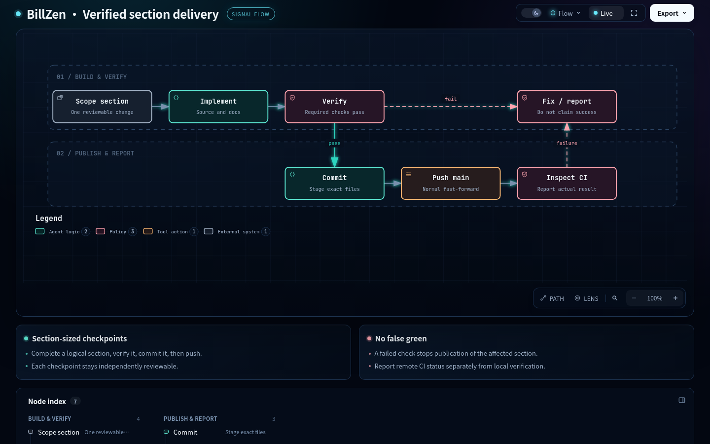

# Explore BillZen with Archify

## Current runtime · architecture

[Download the interactive HTML](billzen-system.html) · [Source specification](billzen-system.spec.json) · [Automated gate receipt](billzen-system.receipt.json)


Source identity: `a116ac0e984c59a80684d5964476f989d1edabce`. The diagram follows the React adapter, native commands, Rust worker and SQLite. It shows the browser mock separately and keeps A4 document rendering distinct from persistence.

## Section delivery · workflow

[Download the interactive HTML](verified-delivery.html) · [Source specification](verified-delivery.spec.json) · [Automated gate receipt](verified-delivery.receipt.json)



This diagram describes the owner-requested engineering procedure: one logical section, verification, commit, push and CI inspection. It is a process specification, not a claim that the product executes these steps itself.

## Open and reproduce

GitHub displays HTML source rather than executing these viewers in README. Open a file above, download its raw contents, and open the downloaded `.html` in your browser. The viewers are standalone and include the diagram code; no hosted diagram service is required.

Both diagrams were generated with the installed Archify skill. Showcase validation, strict artifact checks and real-browser gates passed. Light/dark captures were inspected separately. Motion is optional in the viewer and the static diagram remains complete.

Published HTML files are byte-identical copies of the validated artifacts. The portable specifications preserve the original relative authoring output under `.archify/`; receipts record their actual original generation paths. To regenerate, place the relevant specification at the `candidate.json` path corresponding to its `meta.output` and run:

```sh
node /path/to/archify/bin/archify.mjs finalize architecture .archify/architecture-billzen-20261018-220000/candidate.json .archify/architecture-billzen-20261018-220000/billzen-system.html --repo-root . --quality showcase --json
node /path/to/archify/bin/archify.mjs finalize workflow .archify/workflow-delivery-20261018-220000/candidate.json .archify/workflow-delivery-20261018-220000/verified-delivery.html --quality showcase --json
```

Recheck source evidence when the pinned runtime changes. Runtime sources are verified against committed bytes, not uncommitted feature edits. After a changed candidate, use a new evidence directory as required by Archify and refresh publication copies and previews.

## Viewer license

The standalone viewers include Archify runtime code. Keep the [Archify MIT notice](../licenses/archify-MIT.txt) with downloaded or redistributed HTML files; authored BillZen content retains the project's MIT license.
