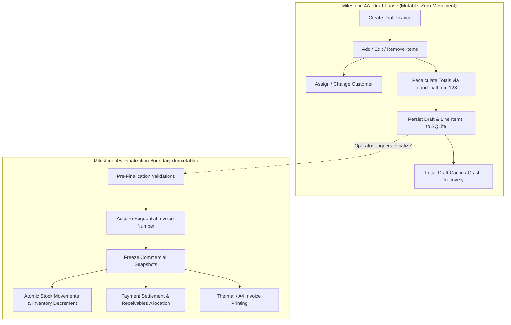

# BillZen — Milestone 4A: Invoice Drafts Specification

## 1. Executive Summary & Architectural Scope

Milestone 4 (Invoicing, Stock Integration & Settlements) is divided into two discrete, verifiable engineering phases:
- **Milestone 4A (This Specification)**: **Offline Invoice Drafts Engine & POS Cart Management**. Encompasses draft lifecycle, item additions/modifications, customer selection, real-time integer financial calculations, multi-draft persistence, and strict zero-stock-decrement invariants.
- **Milestone 4B (Future Phase)**: **Invoice Finalization, Commercial Snapshots, Inventory Decrements & Payment Settlement**. Encompasses immutable snapshot freezing, sequence number generation, stock movement transactions, payment allocations, and receipt/A4 printing.



---

## 2. Invariant Rules & Domain Boundaries

### 2.1 The Zero-Stock Decrement Invariant
> [!IMPORTANT]
> **A draft invoice MUST NOT alter inventory quantities or write to `stock_movements`.**
- Drafts represent tentative, uncommitted transactions (e.g., ongoing point-of-sale customer basket, held ticket, phone inquiry quotation).
- Physical stock remains on the shelf until explicit commercial commitment in Milestone 4B.
- Products referenced in draft line items may warn the cashier if `current_stock_scaled < quantity_scaled`, but this must **never** block draft creation or decrement the product's actual stock.

### 2.2 Mathematical Parity & Calculation Engine
All line items and invoice totals must strictly utilize the existing verified financial arithmetic in Rust (`src-tauri/src/domain/financial.rs`) and TypeScript (`src/domain/financial.ts`).
1. **Quantity**: $1000\times$ scaled integer (`1.500 kg` = `1500`). Range: `1 <= quantity_scaled <= 1,000,000,000`.
2. **Prices**: Integer minor units (paisa/cents). Range: `0 <= unit_price_minor <= 1,000,000,000,00`.
3. **Discount**: Integer minor units. Invariant: `0 <= discount_minor <= gross_minor`.
4. **Tax Rate**: Basis points (`18%` = `1800 bp`). Range: `0 <= tax_rate_bp <= 10000`.
5. **Gross Calculation**:
   $$\text{gross\_128} = \text{round\_half\_up\_128}(\text{quantity\_scaled} \times \text{unit\_price\_minor}, 1000)$$
6. **Taxable Amount**:
   $$\text{taxable\_minor} = \text{gross\_minor} - \text{discount\_minor}$$
7. **Tax Amount**:
   $$\text{tax\_128} = \text{round\_half\_up\_128}(\text{taxable\_minor} \times \text{tax\_rate\_bp}, 10000)$$
8. **Line Total**:
   $$\text{line\_total\_minor} = \text{taxable\_minor} + \text{tax\_minor}$$
9. **Invoice Totals**:
   $$\text{subtotal\_minor} = \sum \text{gross\_minor}$$
   $$\text{discount\_total\_minor} = \sum \text{discount\_minor}$$
   $$\text{taxable\_amount\_minor} = \sum \text{taxable\_minor}$$
   $$\text{tax\_total\_minor} = \sum \text{tax\_minor}$$
   $$\text{grand\_total\_minor} = \sum \text{line\_total\_minor}$$

### 2.3 Optimistic Concurrency & Draft Versioning
- Every draft row possesses a `draft_version INTEGER NOT NULL DEFAULT 1`.
- Any mutation to a draft (`update_invoice_draft`) must submit the expected current `draft_version`.
- If the database `draft_version != expected_version`, the mutation is rejected with `CONCURRENT_MODIFICATION_ERROR`, preventing stale overwrites across tabs or rapid UI dispatches.

---

## 3. Database Schema Mapping & Triggers

Milestone 4A utilizes the already established `invoices` and `invoice_items` tables from `v1_init.sql`.

### 3.1 `invoices` Table (Draft State)
When an invoice is in draft status:
- `status = 'draft'`
- `invoice_number = NULL` (Invoice numbers are reserved exclusively for finalized invoices)
- `sequence_number = NULL`
- `customer_id` is nullable (Supports anonymous / walk-in retail drafts)
- `business_date = CURRENT_DATE` (ISO YYYY-MM-DD)
- Snapshot fields (`business_name_snap`, `customer_name_snap`, etc.) remain `NULL`
- Financial columns (`subtotal_minor`, `discount_total_minor`, `taxable_amount_minor`, `tax_total_minor`, `grand_total_minor`) hold the calculated draft totals
- `paid_amount_minor = 0`, `balance_due_minor = grand_total_minor`
- `settlement_status = (grand_total_minor == 0 ? 'fully_paid' : 'unpaid')`

### 3.2 `invoice_items` Table
- `invoice_id` foreign key with `ON DELETE CASCADE`.
- Line items are ordered by `line_number` (`UNIQUE(invoice_id, line_number)`).
- `product_id` is nullable (allowing custom ad-hoc non-catalog line items if needed, while catalog items store `product_id`).
- Check constraint `CHECK (line_total_minor = taxable_minor + tax_minor)` is rigorously enforced.

### 3.3 Trigger Compatibility
Existing triggers `trg_prevent_finalized_invoice_update`, `trg_prevent_finalized_invoice_delete`, `trg_prevent_finalized_items_insert`, `trg_prevent_finalized_items_update`, and `trg_prevent_finalized_items_delete` only activate when `status = 'finalized'`.
Therefore, SQLite allows unrestricted insertion, updating, reordering, and deletion of drafts and line items.

---

## 4. Rust Backend Commands & IPC Contracts

### 4.1 Data Transfer Objects (DTOs)

```rust
// Draft Line Item Input
#[derive(Debug, Clone, Serialize, Deserialize)]
pub struct DraftItemInput {
    pub product_id: Option<String>,
    pub product_name: String,
    pub product_sku: Option<String>,
    pub unit: String,
    pub cost_price_minor: i64,
    pub quantity_scaled: i64,
    pub unit_price_minor: i64,
    pub discount_minor: i64,
    pub tax_rate_bp: i64,
}

// Create Draft Request
#[derive(Debug, Clone, Serialize, Deserialize)]
pub struct CreateDraftInvoiceRequest {
    pub customer_id: Option<String>,
    pub business_date: Option<String>, // Defaults to local current date
    pub notes: Option<String>,
    pub items: Vec<DraftItemInput>,
}

// Update Draft Request
#[derive(Debug, Clone, Serialize, Deserialize)]
pub struct UpdateDraftInvoiceRequest {
    pub id: String,
    pub expected_version: i64,
    pub customer_id: Option<String>,
    pub business_date: Option<String>,
    pub notes: Option<String>,
    pub items: Vec<DraftItemInput>,
}

// Draft Summary (for listing held tickets / drafts)
#[derive(Debug, Clone, Serialize, Deserialize)]
pub struct InvoiceDraftSummaryDto {
    pub id: String,
    pub draft_version: i64,
    pub customer_id: Option<String>,
    pub customer_name: Option<String>,
    pub business_date: String,
    pub item_count: usize,
    pub grand_total_minor: i64,
    pub updated_at: i64,
}

// Draft Detail (full view for POS editor)
#[derive(Debug, Clone, Serialize, Deserialize)]
pub struct InvoiceDraftDetailDto {
    pub id: String,
    pub draft_version: i64,
    pub customer_id: Option<String>,
    pub customer_name: Option<String>,
    pub business_date: String,
    pub notes: Option<String>,
    pub subtotal_minor: i64,
    pub discount_total_minor: i64,
    pub taxable_amount_minor: i64,
    pub tax_total_minor: i64,
    pub grand_total_minor: i64,
    pub items: Vec<InvoiceDraftItemDto>,
    pub created_at: i64,
    pub updated_at: i64,
}
```

### 4.2 Registered IPC Tauri Commands
1. `create_invoice_draft(request: CreateDraftInvoiceRequest) -> Result<InvoiceDraftDetailDto, String>`
   - Validates each item via `calculate_line_item`.
   - Computes overall totals via `calculate_invoice_totals`.
   - Inserts draft invoice and line items in a single atomic SQLite transaction.
2. `get_invoice_draft(id: String) -> Result<InvoiceDraftDetailDto, String>`
   - Fetches draft and its line items ordered by `line_number`.
3. `list_invoice_drafts() -> Result<Vec<InvoiceDraftSummaryDto>, String>`
   - Returns all active drafts with `status = 'draft'` ordered by `updated_at DESC`.
4. `update_invoice_draft(request: UpdateDraftInvoiceRequest) -> Result<InvoiceDraftDetailDto, String>`
   - Checks `draft_version == request.expected_version`.
   - Recalculates all items.
   - Replaces line items in atomic transaction (`DELETE FROM invoice_items WHERE invoice_id = ?; INSERT INTO ...`).
   - Increments `draft_version = draft_version + 1`.
5. `delete_invoice_draft(id: String) -> Result<(), String>`
   - Deletes draft (cascades to `invoice_items`). Strictly rejects if `status != 'draft'`.
6. `calculate_draft_totals(items: Vec<DraftItemInput>) -> Result<InvoiceTotalsCalculation, String>`
   - Pure domain query for real-time frontend recalculation without disk I/O.

---

## 5. Frontend POS & Drafts Architecture

### 5.1 Component Structure
- `src/components/InvoicingView.tsx`: Main POS interface with dual-pane layout (Item catalog & search on left/top; Active Cart/Draft on right/bottom).
- `src/components/DraftsModal.tsx`: Slide-over/dialog displaying held drafts, item count, totals, and "Resume Draft" / "Discard" actions.
- `src/components/ProductPicker.tsx`: Fast search by Name, SKU, or Barcode scanner input.
- `src/components/CustomerPicker.tsx`: Searchable customer dropdown or "Walk-in Customer".
- `src/components/LineItemRow.tsx`: Interactive row with quantity steppers, unit price display, discount modal, and item deletion.

### 5.2 Mobile & Responsive UX
- On mobile (`< 768px`), the cart utilizes a bottom summary bar showing Total Items & Grand Total with a button to toggle the full cart drawer.
- Safe Area Insets (`env(safe-area-inset-top)` and `env(safe-area-inset-bottom)`) integrated into header and sticky cart action bar.
- Native Android back button dismisses product picker, customer picker, or drafts drawer cleanly.

### 5.3 Local Persistence & Crash Protection
- Unpersisted edits to the active in-memory cart are backed by `localStorage.setItem('billzen_active_cart_draft', ...)` debounced at 300ms.
- If the app is killed abruptly before the operator taps "Save Draft" or "Hold Cart", the active draft is restored upon relaunch.

---

## 6. Acceptance Criteria & Test Plan

### 6.1 Unit & Arithmetic Tests
- [ ] Line item arithmetic rejects negative quantities, negative prices, and discounts exceeding gross amount.
- [ ] Line item arithmetic matches exact half-up intermediate rounding for 2-decimal and 3-decimal currencies.
- [ ] Large quantity and price calculations do not overflow 64-bit bounds due to 128-bit internal rounding.

### 6.2 Backend SQLite Worker Integration Tests
- [ ] `create_invoice_draft` persists header and line items atomically.
- [ ] `update_invoice_draft` increments `draft_version` and updates line items.
- [ ] Concurrent modification with stale `expected_version` fails with explicit error.
- [ ] Deleting a draft removes the invoice and cascades to `invoice_items`.
- [ ] **Zero-stock invariant verified**: Creating and modifying drafts leaves `products.current_stock_scaled` unchanged and writes zero rows to `stock_movements`.

### 6.3 Native Android & Browser E2E Tests
- [ ] Active draft with 3 products persists across cold restart.
- [ ] Switching between multiple held drafts updates cart state seamlessly.
- [ ] Barcode scanning input appends item to active draft and focuses quantity.
