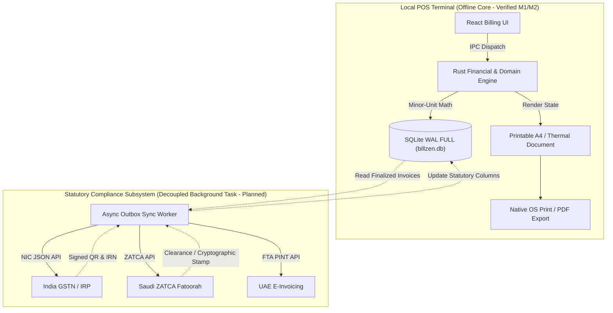

# BillZen Regional Tax & E-Invoicing Design Matrix
## India & GCC Regional Specifications

This document specifies the regional tax models, currency exponents, statutory identifiers, bilingual rendering requirements, and e-invoicing architecture for BillZen across India and the GCC member states.

**Status as of October 18, 2026**:
- **Offline Multi-Currency & Variable Exponents Engine**: **IMPLEMENTED & VERIFIED** (Tested for INR 2-decimal and KWD 3-decimal currencies).
- **Commercial Invoice Immutability & Snapshots**: **IMPLEMENTED & VERIFIED** (SQLite triggers in `v1_init.sql`, `v2_regional_foundation.sql`, `v3_protect_currency_exponent.sql`).
- **Data-Driven Tax UI & Printable Documents**: **IMPLEMENTED & VERIFIED** (Automatic GST vs VAT headers, tax rates, and bilingual labels).
- **Asynchronous Statutory Sync Outbox (NIC IRP / ZATCA Phase 2)**: **PLANNED ARCHITECTURE** (Decoupled background adapter queue; not in counter critical path).

---

## 1. Regional Currency & Tax Overview

| Country | Code | Symbol | Exponent | Minor Unit | Standard Tax Type | Standard Rate | Statutory Authority & Official Framework |
| :--- | :--- | :--- | :---: | :--- | :--- | :---: | :--- |
| **India** | `INR` | `₹` | 2 | Paise | GST (CGST+SGST / IGST) | 0%, 5%, 12%, 18%, 28% | **Central Board of Indirect Taxes and Customs (CBIC) / Goods & Services Tax Network (GSTN)** • *Statutory Act*: Central Goods and Services Tax Act, 2017 (Act No. 12 of 2017) • *Invoicing Rules*: CGST Rules, 2017 (Rule 46: Tax Invoice; Rule 48: Manner of issuing invoice / E-invoicing) • *Portal*: https://einvoice1.gst.gov.in (accessed October 2026) |
| **United Arab Emirates** | `AED` | `AED` / `د.إ` | 2 | Fils | VAT | 5% | **Federal Tax Authority (FTA)** • *Statutory Decree*: Federal Decree-Law No. (8) of 2017 on Value Added Tax • *Executive Regulations*: Cabinet Decision No. (52) of 2017 • *E-Billing Standard*: Ministerial Decision No. 17 of 2024 on E-Invoicing (Peppol PINT) • *Portal*: https://tax.gov.ae (accessed October 2026) |
| **Saudi Arabia (KSA)** | `SAR` | `SAR` / `﷼` | 2 | Halala | VAT | 15% | **Zakat, Tax and Customs Authority (ZATCA)** • *Statutory Law*: Value Added Tax Law (Royal Decree No. M/113) • *Invoicing Resolution*: Electronic Invoicing Resolution (Resolution No. 210917 / 28-05-1442H) • *Technical Specs*: ZATCA Fatoorah Phase 1 (Generation) & Phase 2 (Integration) • *Portal*: https://zatca.gov.sa (accessed October 2026) |
| **Qatar** | `QAR` | `QAR` / `ر.ق` | 2 | Dirham | Excise / Anticipated VAT | 5% (VAT anticipated) | **General Tax Authority (GTA)** • *Statutory Law*: Law No. 25 of 2018 on Selective Tax; VAT Draft Framework • *Portal*: https://www.gta.gov.qa (accessed October 2026) |
| **Kuwait** | `KWD` | `KWD` / `د.ك` | 3 | Fils | Corporate / Excise | 0% (VAT deferred) | **Ministry of Finance (MOF) / Central Bank of Kuwait (CBK)** • *Currency Law*: Law No. 32 of 1968 regarding Currency, Central Bank of Kuwait • *Portal*: https://www.mof.gov.kw (accessed October 2026) |
| **Bahrain** | `BHD` | `BHD` / `د.ب` | 3 | Fils | VAT | 10% | **National Bureau for Revenue (NBR)** • *Statutory Decree*: Decree-Law No. (48) of 2018 on Value Added Tax & Decree-Law No. (33) of 2021 • *Currency Law*: Central Bank of Bahrain Law (Decree Law No. 64 of 2006) • *Portal*: https://www.nbr.gov.bh (accessed October 2026) |
| **Oman** | `OMR` | `OMR` / `ر.ع.` | 3 | Baisa | VAT | 5% | **Oman Tax Authority (OTA)** • *Statutory Decree*: Royal Decree No. 121/2020 Promulgating the Value Added Tax Law • *Currency Law*: Banking Law promulgated by Royal Decree No. 114/2000 • *Portal*: https://taxoman.gov.om (accessed October 2026) |

---

## 2. Mathematical Precision & Minor-Unit Scaling

BillZen guarantees zero floating-point drift across all currencies and unit rates using integer math:
- **Quantity**: Scaled integer ($Q_{\text{scaled}} = \text{round}(Q \times 1000)$). Supports 3 decimal places (e.g. $1.375\text{ kg} = 1375$).
- **Unit Price**: Exact integer in native minor units ($P_{\text{minor}}$).
- **Gross Calculation**:
  $$\text{Gross}_{\text{minor}} = \left\lfloor \frac{Q_{\text{scaled}} \times P_{\text{minor}} + 500}{1000} \right\rfloor$$
  *Invariant*: Because quantity is normalized to $1000^{\text{ths}}$, dividing by 1000 with half-up rounding yields the precise line gross in the currency's native minor unit, regardless of whether exponent is 2 (Paise/Fils/Halala) or 3 (Kuwaiti Fils/Baisa).
- **Tax Calculation**: Tax rate is stored in Basis Points ($1\% = 100\text{ bp}$, $18\% = 1800\text{ bp}$):
  $$\text{Tax}_{\text{minor}} = \left\lfloor \frac{\text{Taxable}_{\text{minor}} \times \text{Rate}_{\text{bp}} + 5000}{10000} \right\rfloor$$

---

## 3. Country-Specific Tax & Invoicing Rules

### 3.1 India (GST Architecture)
1. **Tax Split Logic**:
   - **Intra-State**: Store State Code == Customer POS State Code $\rightarrow$ Split equally into **CGST** ($50\%$) and **SGST** ($50\%$) (or UTGST for Union Territories).
   - **Inter-State**: Store State Code != Customer POS State Code $\rightarrow$ Apply **IGST** ($100\%$).
2. **Identifiers**:
   - `GSTIN`: 15-character alphanumeric (`^[0-9]{2}[A-Z]{5}[0-9]{4}[A-Z]{1}[1-9A-Z]{1}Z[0-9A-Z]{1}$`).
   - `HSN/SAC`: 4, 6, or 8 digits commodity classification per First Schedule to the Customs Tariff Act, 1975.
3. **E-Invoicing & Compliance**:
   - **Offline First**: Commercial invoice is generated, finalized, and printed locally with local QR code and sequential invoice number.
   - **Decoupled E-Invoice Sync**: For B2B transactions subject to mandatory IRP registration under Rule 48(4), an asynchronous sync adapter formats the standard NIC e-Invoice JSON schema, obtains IRN (Invoice Reference Number) and signed IRP QR code, and records them into local compliance tables.

---

### 3.2 Saudi Arabia (ZATCA Fatoorah Architecture)
1. **VAT Rules**: Standard rate is $15\%$. B2C invoices are classified as "Simplified Tax Invoices"; B2B invoices are "Standard Tax Invoices".
2. **Phase 1 (Generation Phase — Verified Architecture)**:
   - Mandatory QR Code on B2C Simplified Invoices.
   - **TLV (Tag-Length-Value) Encoding**:
     - Tag 1: Seller's Name (UTF-8)
     - Tag 2: Seller's VAT Registration Number (15 digits, starting/ending with 3)
     - Tag 3: Time Stamp (ISO 8601 UTC `YYYY-MM-DDTHH:mm:ssZ`)
     - Tag 4: Invoice Total (with VAT)
     - Tag 5: Total VAT Amount
   - Result is encoded into Base64 and rendered as QR code on printable document.
3. **Phase 2 (Integration Phase — Planned Architecture)**:
   - XML UBL 2.1 schema generation.
   - Cryptographic invoice hash chaining (SHA-256 of current invoice + previous invoice hash).
   - ECDSA digital signatures using cryptographic stamp identifier (CSID).
   - Offline queue guarantees uninterrupted store billing even during Internet outages.

---

### 3.3 United Arab Emirates (FTA VAT)
1. **VAT Rules**: Standard rate is $5\%$.
2. **Bilingual Requirement**: Invoices must display commercial descriptions in Arabic alongside English (Cabinet Decision No. (52) of 2017).
   - BillZen incorporates `<bdi dir="rtl">` for Arabic product names and legal business names, ensuring clean bidirectional rendering without text corruption or layout overflow.
3. **E-Invoicing Roadmap**: UAE Federal Tax Authority (FTA) Peppol PINT electronic invoicing rollout (Ministerial Decision No. 17 of 2024). Invoices maintain canonical structured data fields to support export to standard XML formats.

---

### 3.4 Kuwait, Bahrain, and Oman (3-Decimal Currencies)
1. **Kuwait (KWD)**: 1 KWD = 1000 fils. 3-decimal formatting is mandatory (`KD 12.350`).
2. **Bahrain (BHD)**: 1 BHD = 1000 fils. Standard VAT is $10\%$ (1000 bp). 3-decimal formatting (`BD 5.250`).
3. **Oman (OMR)**: 1 OMR = 1000 baisa. Standard VAT is $5\%$ (500 bp). 3-decimal formatting (`OMR 8.750`).

---

## 4. Architectural Boundaries: Offline Billing vs. Statutory Sync

**Key Architectural Invariants**:
1. **Store billing never blocks on external network connectivity**. Counter point-of-sale checkout generates finalized receipts with zero internet latency.
2. **Immutability of Finalized Commercial Fields**: Once an invoice is finalized, currency code, currency exponent, quantities, unit prices, discounts, and taxes are locked by SQLite triggers (`v3_protect_currency_exponent.sql`). Statutory response tokens (IRN, clearance status, signed QR) are recorded in dedicated compliance columns without altering commercial figures.
3. **Preventing Mid-History Currency Drift**: A store cannot change its base operating currency once finalized invoices exist in the database (enforced by `trg_business_settings_prevent_currency_change_when_invoices_exist`).
